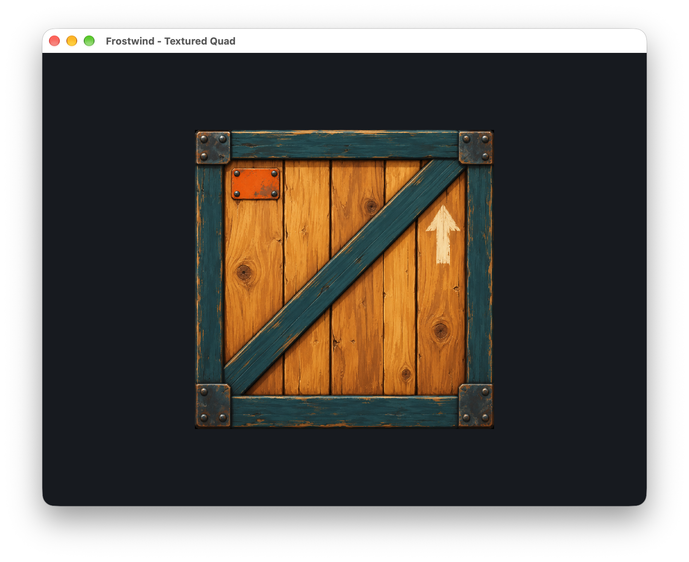

# Changelog

All notable changes to Frostwind and its examples are documented in this file.

## [Unreleased]

### Added

- Documentation: task-based rendering guide using textured-quad pseudocode, concise clear/draw explanations, and direct links to the working example, example-facing class reference, pipeline sharing, call/ownership/frame diagrams, current limits, and troubleshooting; public header comments clarify initialization, borrowing, and failure contracts.
- Documentation: README references to LearnOpenGL and Rastertek's OpenGL tutorials, with guidance for adapting examples to the engine and its OpenGL 3.3 baseline.
- Engine: scoped `RenderFrame` acquisition, clears, vertex draws, submission/abandonment, opaque device-backed `Buffer`/`Shader`/`Texture2D`/`GraphicsPipeline` owners, shader-layout validation, and per-frame resource retention.
- Engine: CPU-only `Image` PNG/JPEG loading with explicit dimension limits and local bottom-left row conversion, independent of graphics initialization.
- Engine: concrete `GraphicsDevice` facade, private abstract `GraphicsBackend`, and the first OpenGL implementation for graphics initialization and presentation, with a private abstract `WindowSurface` providing one controlled SDL-access boundary for concrete surfaces. Additional backends remain planned.
- Documentation: root `ROADMAP.md`, organized into themed phases using Dovyski's roadmap template, and RFC 9999 for extracting the existing OpenGL backend, migrating all three examples, and later exploring Metal, Vulkan, mesh shading, and ray tracing; the initial OpenGL boundary is implemented, while other APIs remain planned.
- Documentation: roadmap ideas for grass/vegetation, water/fluid simulation, and a physics sandbox, with initial scopes, prerequisites, and guidance for turning ideas into example experiments.
- Asteroids and Mini Artillery: separate runnable OpenGL window scaffolds, CMake executable targets, and runtime SDL packaging; all build presets now select all three examples. Gameplay and runtime art remain planned.
- Documentation: README links to Agent Sprite Forge for sprite creation and NormalMap-Online for height-to-normal conversion, with example asset provenance guidance.
- Mini Artillery: generated side-view concept matching the detailed Asteroids material direction; retained as design reference, with gameplay and runtime assets still planned.
- Asteroids: generated transparent ship and meteor art prototypes with prompt provenance; matching normal maps and runtime validation remain planned.
- Generated realistic and softer Asteroids concepts preserved alongside the original pack reference; draft RFC 0005 records the detailed sprite art direction, a common-source normal-map bake workflow, and an example-owned scrolling/parallax starfield.
- Owner-supplied Space Shooter pack scene preserved as an attributed visual reference for the planned Asteroids example.
- Draft RFC 0005 for the upcoming GLM-backed pixel-unit 2D camera, keyboard state, elapsed-time movement, and reusable sprite rendering in a separate Asteroids example, with a Kenney sprite sourcing plan and later gameplay stages; implementation remains planned.
- Engine: `u64` primitive alias for unsigned 64-bit values, used for application frame timing.
- Engine: configurable application FPS cap (60 by default, 0 disables software pacing) using monotonic nanosecond timing and precise waits for the remaining frame budget; independently configurable VSync.

### Changed

- Documentation: renamed the former RFC 0006 to `9999-multi-backend-rendering-research.md`, reserved the last-sorting number for deferred research, and updated references/status. Preserved the architecture, ownership, OpenGL/Metal/Vulkan pipeline comparison, shader-variant and attachment analysis; the implemented OpenGL setup remains documented separately and detailed scene/grass learning steps live in the roadmap.
- Textured Quad: folded the example-owned `QuadRenderer` into `QuadDemo`, keeping resource creation, Escape handling, and clear/scale/draw callbacks together; added an ownership diagram to the example README and aligned the rendering guide/structure notes.
- Documentation: recorded the OpenGL-first learning plan in RFC 9999 and aligned the roadmap/current guidance: retain the provisional rendering boundary, develop a small 3D scene and bounded grass experiment, and defer additional backends and shader-portability infrastructure.
- Textured Quad: migrated geometry, texture, pipeline, and scale parameters to engine resources and frame drawing; retained the crate image, orientation, nearest sampling, and square scaling. Asteroids and Mini Artillery now clear through the same frame interface.
- Engine: changed rendering callbacks to `render(RenderFrame&)`, added protected `graphics()` access for resource initialization, and made GLAD a private implementation dependency. Public rendering headers and examples no longer expose native graphics types/calls.
- Engine: separated SDL window/video ownership from OpenGL context and presentation ownership; `Application` now destroys example GPU resources before the device/context, then the window. Moved VSync from `WindowConfig::vsync` to `ApplicationConfig::graphics.vsync`, retaining independent application frame pacing.
- Documentation: accepted RFC 9999 for staged implementation and recorded its initial ownership refactor; completed the shared frame/resource migration through all three examples.
- Documentation: aligned the README technical approach and project structure guide with draft RFC 9999, explicitly separating the implemented layout from proposed window/device/backend ownership and source organization.
- Documentation: expanded draft RFC 9999 with concrete window/device composition, private backend inheritance and surface integration, resource/frame contracts, and staged example migration criteria.
- Examples: numbered source directories as `01-textured-quad`, `02-asteroids`, and `03-mini-artillery` for suggested learning order; updated build and documentation paths while retaining target names and executable output paths.
- Asteroids: placed the selected concept first in its README and specified mouse heading, heading-relative WASD movement, and Escape to quit; camera follows automatically at fixed rotation/zoom, while manual camera controls are deferred to another example.
- Asteroids: documented its purpose as a focused engine experiment, planned technical challenges and validation evidence, and completion criteria independent of a fully functional game.
- Examples: organized planned Asteroids and Mini Artillery around their own READMEs with embedded concepts, the Asteroids art progression and selected style, preserved older artwork, and example-owned `docs/assets/` provenance; historical milestone captures remain central. RFC 0005 also records NormalMap-Online as a candidate offline height-to-normal tool.
- Engine: replaced the fixed post-swap fallback delay with application-owned pacing that includes rendering and swap time and avoids catch-up frames after stalls. Application startup now takes `ApplicationConfig` containing window settings and the FPS cap.

### Removed

- Engine: public OpenGL `ShaderProgram` binding/uniform-location API, static texture-support initialization, direct texture binding, and transitional `GraphicsDevice::present()`; use device-backed shaders/pipelines/resources and scoped frames.

## 0.3.0 - 2026-10-14 (milestone)

Development milestone: reusable engine and example separation, shader/texture support, and file-loaded crate rendering. This records progress; no release or tag was created.

### Added

- Engine: shared primitive aliases in `core/Types.h`, applied to texture data/sizes and graphics math, with conversion guidance for engine and examples.
- Engine: `Texture2D::initializeFromFile` for PNG/JPEG assets using pinned stb_image 2.28, with RGBA8 conversion, bottom-left orientation, file diagnostics, and scoped decoded-pixel cleanup.
- Textured Quad: generated crate texture with recorded provenance, replacing the procedural checkerboard in the running example; historical captures are preserved.
- Conventional Commit guidelines with optional scopes, linked from the documentation index and required by agent instructions.
- Engine branding assets and generation provenance; the README now uses the Frostwind logo.
- RFC 0003 establishing Frostwind as an engine with independent examples in one repository.
- `ShaderProgram` for linked vertex/fragment shaders, with file/source loading, path and compilation/link diagnostics, cached uniform operations, and automatic cleanup.
- `Texture2D` for validated RGBA8 uploads, texture-unit binding, and automatic cleanup, preserving pixel-unpack state during uploads.
- Runtime demo shader assets, license records, and build-time copying beside the executable; support-class contracts documented in RFC 0002.

### Changed

- Renamed the engine to Frostwind: namespace/static library `frostwind`, `FROSTWIND_BUILD_EXAMPLES`, executable `frostwind-textured-quad`, CMake helpers, repository remote, and active documentation. The rename preserved historical logos/captures.
- Renamed dependency provenance records to `README.integration.md` and updated documentation links and CMake diagnostics.
- Engine: moved decoder setup behind `Texture2D::initializeSupport()` and cached the single context’s texture-size limit for file loads and raw uploads.
- Simplified numeric conversions in texture/shader loading and the textured-quad example, preserving size validation and required C API pointer casts.
- Engine: extracted the static `toybox` library, applied namespace `toybox`, and made application startup/events/rendering extensible through example-owned behavior.
- Textured Quad: moved the demo and its assets into `examples/textured-quad/`, with its own executable/output directory and shared runtime packaging.
- Rebranded active documentation and repository links for Toybox while preserving Mini Artillery release/screenshot history. Mini Artillery gameplay remains a planned example.
- Refactored the temporary quad demo to use the rendering support classes and external shader files, with executable-relative asset lookup that works across IDE and terminal working directories.

*Frostwind textured-quad example on macOS Apple M1 Pro, captured manually on 2026-10-14 after the engine rename.*

### Removed

- Unused automatic screenshot helpers; milestone screenshots are supplied manually by the project owner.

## [0.2.0] - 2026-10-13

### Added

- Planned audio technology noted in the README technical approach.
- C++ coding conventions covering ownership, initialization, callback flow, naming, and validation, linked from project guidance.
- VS Code setup instructions for CMake-based IntelliSense, the exported native compile database, and LLDB-MI debugging with build-before-launch tasks.
- RFC 0002 for native OpenGL integration, generated GLAD 2 files, and the planned WebGL 2 rendering path.
- Generated GLAD 2.0.8 OpenGL 3.3 Core loader, license and provenance record, and local native static CMake target. Native GLAD function loading uses SDL_GL_GetProcAddress.
- Native OpenGL Core context and procedural checkerboard quad, with shader diagnostics, drawable-pixel viewport sizing, VSync, and graphics cleanup before context destruction.

*Native OpenGL quad on macOS Apple M1 Pro, captured manually on 2026-10-13. Configure, build, launch, and checkerboard output verified with an OpenGL 4.1 context. Interactive resize/Retina and exit checks remain pending.*

### Changed

- Managed application callback ownership with `std::unique_ptr`, including automatic cleanup on initialization failure.
- Moved lifecycle and frame coordination into static `Application` callbacks, with `Window` owning SDL video/window lifetime, OpenGL initialization, and presentation. Kept native window access private, removed the project namespace, and documented the SDL-driven loop and resource lifetimes. The quad remains a temporary demo.

## [0.1.0] - 2026-10-13

### Added

- Native macOS SDL3 window with a plain background, resizing, event handling, and Escape or close-button exit.
- Local official SDL3 3.4.18 macOS universal framework, copied beside the executable during the CMake build.
- CMake configuration and Debug presets for macOS, Windows MSVC x64, and Linux x86_64. Windows and Linux SDKs are pending; those platforms remain unverified.
- Project documentation, RFC process, local dependency records, and platform SDK layout.
- Progress screenshots and an optional macOS window-capture helper.

*Native window on macOS Apple Silicon, captured on 2026-10-13. Native configuration, build, and launch verified; terrain rendering remains planned.*

[Unreleased]: https://github.com/vquanghuy/frostwind-engine/compare/97d8629...HEAD
[0.2.0]: https://github.com/vquanghuy/frostwind-engine/compare/v0.1.0...v0.2.0
[0.1.0]: https://github.com/vquanghuy/frostwind-engine/tree/v0.1.0

Format based on [Keep a Changelog](https://keepachangelog.com/en/1.1.0/).
