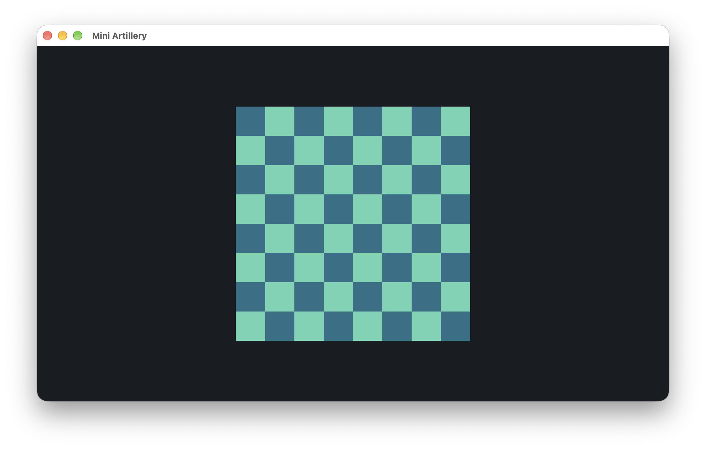
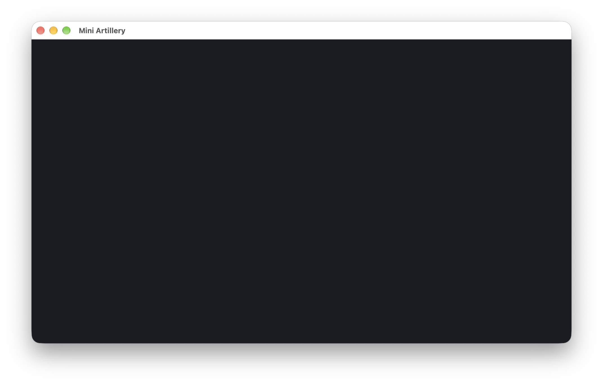

# Changelog

All notable changes to Toybox and its examples are documented in this file.

## [Unreleased]

### Added

- Toybox chest-and-toys logo in the README, with generation provenance recorded under documentation assets.
- RFC 0003 establishing Toybox as an engine with independent examples in one repository.
- `ShaderProgram` for linked vertex/fragment shaders, with file/source loading, path and compilation/link diagnostics, cached uniform operations, and automatic cleanup.
- `Texture2D` for validated RGBA8 uploads, texture-unit binding, and automatic cleanup, preserving pixel-unpack state during uploads.
- Runtime demo shader assets, license records, and build-time copying beside the executable; support-class contracts documented in RFC 0002.

### Changed

- Engine: extracted the static `toybox` library, applied namespace `toybox`, and made application startup/events/rendering extensible through example-owned behavior.
- Textured Quad: moved the demo and its assets into `examples/textured-quad/`, with its own executable/output directory and shared runtime packaging.
- Rebranded active documentation and repository links for Toybox while preserving Mini Artillery release/screenshot history. Mini Artillery gameplay remains a planned example.
- Refactored the temporary quad demo to use the rendering support classes and external shader files, with executable-relative asset lookup that works across IDE and terminal working directories.

### Removed

- Unused automatic screenshot helpers; milestone screenshots are supplied manually by the project owner.

## [0.2.0] - 2026-10-13

### Added

- Planned audio technology noted in the README technical approach.
- C++ coding conventions covering ownership, initialization, callback flow, naming, and validation, linked from project guidance.
- VS Code setup instructions for CMake-based IntelliSense, the exported native compile database, and LLDB-MI debugging with build-before-launch tasks.
- RFC 0002 for native OpenGL integration, generated GLAD 2 files, and the planned WebGL 2 rendering path.
- Generated GLAD 2.0.8 OpenGL 3.3 Core loader, license and provenance record, and local native static CMake target. Native GLAD function loading uses SDL_GL_GetProcAddress.
- Native OpenGL Core context and procedural checkerboard quad, with shader diagnostics, drawable-pixel viewport sizing, VSync, and graphics cleanup before context destruction.

*Native OpenGL quad on macOS Apple M1 Pro, captured manually on 2026-10-13. Configure, build, launch, and checkerboard output verified with an OpenGL 4.1 context. Interactive resize/Retina and exit checks remain pending.*

### Changed

- Managed application callback ownership with `std::unique_ptr`, including automatic cleanup on initialization failure.
- Moved lifecycle and frame coordination into static `Application` callbacks, with `Window` owning SDL video/window lifetime, OpenGL initialization, and presentation. Kept native window access private, removed the project namespace, and documented the SDL-driven loop and resource lifetimes. The quad remains a temporary demo.

## [0.1.0] - 2026-10-13

### Added

- Native macOS SDL3 window with a plain background, resizing, event handling, and Escape or close-button exit.
- Local official SDL3 3.4.18 macOS universal framework, copied beside the executable during the CMake build.
- CMake configuration and Debug presets for macOS, Windows MSVC x64, and Linux x86_64. Windows and Linux SDKs are pending; those platforms remain unverified.
- Project documentation, RFC process, local dependency records, and platform SDK layout.
- Progress screenshots and an optional macOS window-capture helper.

*Native window on macOS Apple Silicon, captured on 2026-10-13. Native configuration, build, and launch verified; terrain rendering remains planned.*

[Unreleased]: https://github.com/vquanghuy/toybox-engine/compare/v0.2.0...HEAD
[0.2.0]: https://github.com/vquanghuy/toybox-engine/compare/v0.1.0...v0.2.0
[0.1.0]: https://github.com/vquanghuy/toybox-engine/tree/v0.1.0

Format based on [Keep a Changelog](https://keepachangelog.com/en/1.1.0/).
