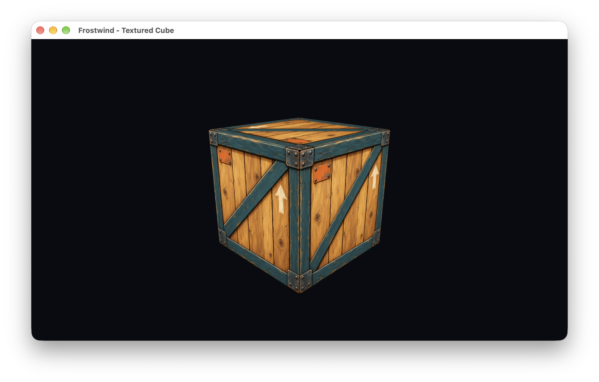

# Changelog

All notable changes to Frostwind and its examples are documented in this file.

## [Unreleased]

Unreleased work is grouped by date, newest first, based on the relevant Git commits in their recorded time zones.

### 2026-10-24

#### Changed

- Documentation: update the Deferred Rendering expected-output concept to use the same Nissan R34 visual target as glTF, retaining its many-light courtyard, skybox, and inspector. Preserve the rover version and edit prompt, and record reuse of the selected model in the future experiment.
- Planning: add a basic see-through material test to PBR and alpha-mode/window handling to the glTF milestone, including depth/sorting validation and inspection of the Nissan’s actual material extensions. Keep glass in material settings and advanced transmission/refraction as a future experiment; no additional selected example is introduced.
- Documentation: replace the glTF example’s rover preview with a generated Nissan R34 concept, link the owner-selected Sketchfab model in the README/roadmap, and record the intended loader target and screenshot-supplied metadata. Preserve the earlier concept and prompts; actual GLB import and runtime attribution/license verification remain pending.
- Planning: combine glTF rendering, synchronous resource sharing, and basic ECS in one staged example; grow per-entity animation state and explicit update ordering during skeletal animation. Keep advanced ECS capabilities in the roadmap’s Future experiments table rather than prerequisites, preserving separate asset/GPU ownership and existing simple examples.

#### Added

- Planning: record Deferred Rendering as a future many-light comparison after model/resource/ECS foundations, with G-buffer inspection and explicit forward/transparent/MSAA considerations. Add its standalone README expected-output concept and provenance without changing the selected learning sequence or claiming implementation/performance.
- Planning: select Post-processing after Dear ImGui, starting with an HDR scene target, exposure/tone mapping, FXAA, and UI-safe composition. Add a roadmap technique table covering bloom, color grading, vignette, depth of field, and motion blur as scoped follow-ups, with encoding/MSAA considerations and primary references.
- Planning: select Instanced Particles after Instanced Grass and before PBR, reusing shared instancing operations for a bounded spark emitter with dynamic billboard data, lifetimes, explicit blending, and ImGui controls. Alpha-blended smoke and richer effects remain separate work.
- Documentation: add standalone expected-output concepts and descriptions for both examples to the README, preserve prompts/provenance, and align project guidance and the selected sequence. Concepts do not establish implemented HDR, FXAA, particle behavior, or performance.

### 2026-10-23

#### Changed

- Documentation: update the PBR and Water Simulation expected-output previews to retain the mountain-and-sky background used by the earlier examples. Preserve prior concepts and edit prompts; skybox imagery does not add environment lighting or reflections.
- Planning: defer Asteroids and Mini Artillery scene/game development until relevant engine foundations have been demonstrated through smaller technical examples. Remove the automatic return to Asteroids after cube lighting; preserve both scaffolds and concepts. Select normal mapping + skybox, then shadow mapping, Dear ImGui, physics simulation, water simulation, instanced grass, PBR, static glTF model rendering, and skeletal animation. RFCs 0005/0009 remain drafts.

#### Added

- Documentation: separate the Phong lighting theory guide from RFC 0008’s implementation record, add vector and normal-matrix diagrams, refresh the component illustration, and update documentation links. Clarify documentation-only validation in project guidance.
- Planning: select Instanced Grass after Water Simulation and before PBR, targeting a horizon-reaching field with grass-textured ground under instanced blades, root-anchored wind, patch culling/distance-based detail, and ImGui controls. Replace the initial small-patch preview with a full-field concept; preserve both versions and prompts. Local interaction and persistent bending remain later increments.
- Planning: add a bounded shallow-water simulation example after Physics Simulation and before PBR, with fixed-step ripples, disturbances, boundary reflection, simple lighting, and ImGui controls. Add its expected-output concept, exact prompt, and provenance; numerical solver design and richer water rendering remain future work.

- Documentation: list each selected roadmap stage as an individual planned example in the README’s Engine and examples table, with concept previews where available and links to scoped roadmap entries. Preserve existing directory names and mark both game scaffolds as deferred.
- Documentation: add individual expected-output concept previews for all nine planned technical examples to the README table: Normal Mapping + Skybox, Shadow Mapping, Dear ImGui, Physics Simulation, Water Simulation, Instanced Grass, PBR, glTF Model Rendering, and Skeletal Animation. Record prompts/provenance and distinguish illustrative assets, controls, and values from implemented behavior. Preserve the earlier comparison diagram separately.

### 2026-10-22

#### Changed

- Textured Cube: increase ambient RGB from 0.16 to 0.192 (20%) to brighten faces away from the directional light.

#### Fixed

- Textured Cube: tune the light angle, specular color, and shininess so the initial camera sees a clear specular highlight. The original light elevation and narrow exponent made the specular term effectively invisible from that view. Verified the difference with numerical readback of actual cube geometry; restart the rebuilt demo to use the new values.

#### Added

- Documentation: preserve the owner’s Desktop lighting capture from 2026-10-22 at 21:15:03 and use it in the root/cube READMEs and changelog; retain older unlit captures and captions.
- Textured Cube: example-owned directional lighting with ambient fill, Lambert diffuse, Phong specular color/shininess, per-face normals, inverse-transpose normal transformation, and camera-dependent highlights. Uploads use existing ShaderProgram operations; no engine architecture changes. RFC 0008 is implemented; RFC 0009 remains draft.
- Validation: native builds, engine-only/three CTest checks, actual CubeDemo callbacks and shader-failure cleanup, and controlled floating-point shader readback passed. See the [development record](docs/development.md#cube-lighting-validation-2026-10-22). The owner-supplied lit capture is embedded below; historical unlit captures remain preserved.

*Frostwind Textured Cube with ambient, diffuse, and Phong specular lighting on
macOS Apple M1 Pro, captured manually by the owner on 2026-10-22 at 21:15:03.
Original PNG preserved byte-for-byte. Shadows and normal maps remain unimplemented.*

### 2026-10-21

#### Added

- Documentation: draft RFC 0009 records the proposed engine structure, Material/response components, CPU/GPU geometry, Mesh/Model ownership and placement, shader includes/built-ins/bindings, phased validation, and Filament/Khronos references. It remains separate from RFC 0008; implementation is on hold.
- Documentation: draft RFC 0008 explains lighting theory and proposes ambient/diffuse/Phong specular shading directly in Textured Cube, with example-owned normals, shader equations, and direct uniform uploads through existing engine APIs. Preserves the detailed crate/SVG theory figure and records broader material/mesh/model/shader architecture separately in draft RFC 0009, with Filament references. Implementation awaits the owner's explicit mark.
- Documentation: reserved RFC 9998 (formerly 0008) preserves WebGPU migration and pipeline/layout analysis as deferred research alongside multiple-backend RFC 9999, with WebGPU Unleashed as a learning reference. Restored C++17/OpenGL scene work as the active direction; no renderer migration or toolchain change is selected.

#### Changed

- Diagnostics: prefix engine/example logs and authored exception messages with their source class or example name, preserving nested error context at application callback boundaries.
- Engine: remove per-resource context pointers and identity checks from Texture2D, ShaderProgram, VertexBuffer, IndexBuffer, and VertexArray. Keep OpenGL availability and initialization checks; GPU cleanup relies on the single-context application lifetime.
- Engine: simplify Texture2D uploads by relying on default pixel-unpack state and no unpack buffer binding; remove unused unpack-state queries and restoration. Tightly packed RGBA8 rows satisfy the default four-byte alignment.
- Dependencies: owner-supplied GLAD 2.0.8 regeneration retains OpenGL 3.3 Core and adds 18 selected extension definitions/loading paths. RFC 0006 records each selection and its purpose; the dependency record preserves exact settings/checksums. Texture2D uses generated anisotropy constants and support flags instead of handwritten tokens; other extension features remain unimplemented.

### 2026-10-20

#### Added

- Engine: reusable CPU-only `OrbitCameraController` composed with PerspectiveCamera, with configurable target, angular/distance speeds, pitch/distance limits, and validated movement inputs. PerspectiveCamera exposes its validated pose; Textured Cube delegates orbit movement to the controller while retaining key bindings, camera setup, and cube animation.
- Engine: per-texture sampling options for trilinear filtering with generated mipmaps and capability-checked anisotropy. Textured Cube requests 16× anisotropy, clamped to the supported limit with a logged fallback; Textured Quad retains nearest filtering.
- Textured Cube: second learning example with indexed 3D cube geometry, explicit model/view/projection matrices, keyboard orbit/distance controls, elapsed-time rotation, pause/reset, depth testing/back-face culling, 4× MSAA, and a 120 FPS cap with VSync. Owner-supplied capture preserved below; lighting/shadows/skyboxes remain planned.
- Engine: CPU-only GLM-backed `PerspectiveCamera`, pinned local GLM 1.0.3 with provenance, Keyboard scancode state, and optional monotonic `update(deltaSeconds)` with focus handling, stall clamping, and callback result/exception propagation. Opt-in context-free camera/input/update CTest checks accompany the foundation.
- Engine: optional 24-bit depth and verified MSAA requests in WindowConfig, plus direct Renderer depth clear/test and back-face culling controls. Existing 2D defaults remain unchanged.
- Documentation: RFC 0007 records cube/camera/input/update contracts; RFC 0005 identifies the now-shared foundation. Cube transforms/camera and basic lighting precede the return to Asteroids; grass remains a later experiment.
- Engine: separate `VertexArray` owner with `VertexLayout` stride/attributes, optional initialized IndexBuffer association, stored vertex/index counts, and scoped initialization cleanup/state restoration.
- Engine: immutable u32 `IndexBuffer` storage with cached count/maximum metadata and indexed submission through `Renderer::drawTriangles`, including vertex-bound validation, context guards, and exception-safe VAO restoration.
- Documentation: task-based rendering guide using textured-quad pseudocode, concise clear/draw explanations, and direct links to the working example, example-facing class reference, program/geometry sharing, call/ownership/lifecycle diagrams, current limits, and troubleshooting; public header comments clarify initialization, borrowing, and failure contracts.
- Documentation: README references to LearnOpenGL and Rastertek's OpenGL tutorials, with guidance for adapting examples to the engine and its OpenGL 3.3 baseline.
- Engine: direct OpenGL `VertexBuffer` owning immutable vertex bytes and a concrete `Renderer` for color clears and complete triangle draws; `Application` owns viewport setup.
- Engine: CPU-only `Image` PNG/JPEG loading with explicit dimension limits and local bottom-left row conversion, independent of graphics initialization.
- Documentation: root `ROADMAP.md` using Dovyski's themed template; RFC 0006 records direct OpenGL rendering ownership, while RFC 9999 preserves the deferred multi-backend and advanced-feature research.

#### Changed

- Documentation: refresh the Textured Cube previews with the owner’s latest Desktop capture, preserving the earlier PNG and caption as history.
- Documentation: add a leftmost preview column to the README example table, using owner-supplied demo screenshots and clearly labeled concepts for planned games.
- Examples: inserted `02-textured-cube` and moved Asteroids/Mini Artillery sources and planning artwork to `03-asteroids` / `04-mini-artillery`; retained their target names, runtime output paths, behavior, and assets. All build presets include the cube.
- Build: simplified Textured Quad asset copying to a direct post-build step on its executable and removed the separate asset helper target. Asset-only changes use Rebuild; QuadDemo.h is listed with the example sources for IDE visibility.
- Engine: VertexBuffer now owns bytes only; VertexArray owns VAO/layout and borrows buffers. Renderer exposes one `drawTriangles(vertexArray)` method that uses stored counts and selects indexed/sequential drawing from the optional IndexBuffer; subrange overloads and the CPU index copy are removed. Textured Quad configures its array once and destroys it before its buffers.
- Documentation: refreshed the project structure, root README, and rendering usage guide with IndexBuffer ownership, the indexed quad flow/layout, byte-versus-element initialization units, automatic draw selection, and direct example links.
- Textured Quad: draws two indexed triangles from four shared position/UV vertices and six indices through engine calls.
- Engine: rendering/resource commands and CPU image loading now throw diagnostic exceptions instead of returning success flags; required uniform lookup throws for missing/inactive names. Application reports exceptions at SDL callback boundaries and skips failed-frame presentation. Destructors remain non-throwing; failed initialization cleans up for retry and promised upload/draw state is restored.
- Examples: simplified quad initialization/rendering and scaffold clears to direct engine calls, removing per-operation boolean checks and duplicate failure logs.
- Engine: Application owns and passes a persistent concrete Renderer to `render(Renderer&, width, height)`; Renderer handles clearing and triangle draw submission, while VertexBuffer owns bytes and VertexArray owns layout/buffer associations without drawing itself. All examples use the renderer reference.
- Engine: removed the separate RenderCommands module and named the shared private context/error helpers `GraphicsChecks`. Application sets the viewport directly; Renderer handles clearing and drawing.
- Engine: simplified OpenGL ownership: Window now owns context creation, GLAD, VSync, and presentation; Texture2D performs its own GL uploads/binding; linked ShaderProgram provides activation, uniform lookup, and integer/float/vec2/3/4/mat4 setters. GPU owners retain creating-context checks and automatic cleanup.
- Engine: supplied Renderer and drawable dimensions to rendering callbacks and restored `WindowConfig::vsync`; retained callback failures/exceptions, initialization retry, resource-before-context teardown, drawable viewport sizing, and software pacing.
- Documentation: aligned the README, structure/usage/development guides, project instructions, roadmap, and all examples with RFC 0006; the multi-backend checkpoint remains on `archive/multi-backend-experiment`.
- Documentation: renamed the former RFC 0006 to `9999-multi-backend-rendering-research.md`, reserved the last-sorting number for deferred research, and updated references/status. Preserved the architecture, ownership, OpenGL/Metal/Vulkan pipeline comparison, shader-variant and attachment analysis; the implemented OpenGL setup remains documented separately and detailed scene/grass learning steps live in the roadmap.
- Textured Quad: folded the example-owned `QuadRenderer` into `QuadDemo`, keeping resource creation, Escape handling, and clear/scale/draw callbacks together; added an ownership diagram to the example README and aligned the rendering guide/structure notes.
- Documentation: recorded the OpenGL-first learning plan in RFC 9999 and aligned the roadmap/current guidance: retain the provisional rendering boundary, develop a small 3D scene and bounded grass experiment, and defer additional backends and shader-portability infrastructure.
- Textured Quad: uses VertexBuffer, IndexBuffer, VertexArray, ShaderProgram, Texture2D, and the borrowed Renderer through engine methods, with a regular vec2 scale uniform; retained crate pixels, orientation, sampling, and square scaling. Asteroids and Mini Artillery use the engine color-clear function.
- Engine: kept GLAD as a private implementation dependency; public rendering headers and examples require no native graphics calls or GLAD headers.
- Documentation: accepted RFC 9999 for staged implementation and recorded its initial ownership refactor; completed the shared frame/resource migration through all three examples.

#### Removed

- Engine: experimental GraphicsDevice/GraphicsBackend, WindowSurface integration hierarchy, opaque resource registries, separate Shader stages, GraphicsPipeline descriptions, and scoped RenderFrame submission. The prior experiment is preserved in Git. Static texture-support initialization remains removed.

*Updated Frostwind Textured Cube capture on macOS Apple M1 Pro, supplied manually by the owner on 2026-10-20 at 15:49:58. Lighting and shadows remain planned.*

Earlier cube capture from 2026-10-20 at 15:11:17

*Frostwind Textured Cube on macOS Apple M1 Pro, captured manually by the owner on 2026-10-20. The running example displays the textured 3D cube; lighting and shadows remain planned.*

### 2026-10-19

#### Changed

- Documentation: aligned the README technical approach and project structure guide with draft RFC 9999, explicitly separating the implemented layout from proposed window/device/backend ownership and source organization.
- Documentation: expanded draft RFC 9999 with concrete window/device composition, private backend inheritance and surface integration, resource/frame contracts, and staged example migration criteria.

### 2026-10-18

#### Added

- Documentation: roadmap ideas for grass/vegetation, water/fluid simulation, and a physics sandbox, with initial scopes, prerequisites, and guidance for turning ideas into example experiments.
- Asteroids and Mini Artillery: separate runnable OpenGL window scaffolds, CMake executable targets, and runtime SDL packaging; all build presets now select all three examples. Gameplay and runtime art remain planned.
- Documentation: README links to Agent Sprite Forge for sprite creation and NormalMap-Online for height-to-normal conversion, with example asset provenance guidance.

#### Changed

- Examples: numbered source directories as `01-textured-quad`, `03-asteroids`, and `04-mini-artillery` for suggested learning order; updated build and documentation paths while retaining target names and executable output paths.

### 2026-10-15

#### Added

- Mini Artillery: generated side-view concept matching the detailed Asteroids material direction; retained as design reference, with gameplay and runtime assets still planned.
- Asteroids: generated transparent ship and meteor art prototypes with prompt provenance; matching normal maps and runtime validation remain planned.
- Generated realistic and softer Asteroids concepts preserved alongside the original pack reference; draft RFC 0005 records the detailed sprite art direction, a common-source normal-map bake workflow, and an example-owned scrolling/parallax starfield.
- Owner-supplied Space Shooter pack scene preserved as an attributed visual reference for the planned Asteroids example.
- Draft RFC 0005 for the upcoming GLM-backed pixel-unit 2D camera, keyboard state, elapsed-time movement, and reusable sprite rendering in a separate Asteroids example, with a Kenney sprite sourcing plan and later gameplay stages; implementation remains planned.

#### Changed

- Asteroids: placed the selected concept first in its README and specified mouse heading, heading-relative WASD movement, and Escape to quit; camera follows automatically at fixed rotation/zoom, while manual camera controls are deferred to another example.
- Asteroids: documented its purpose as a focused engine experiment, planned technical challenges and validation evidence, and completion criteria independent of a fully functional game.
- Examples: organized planned Asteroids and Mini Artillery around their own READMEs with embedded concepts, the Asteroids art progression and selected style, preserved older artwork, and example-owned `docs/assets/` provenance; historical milestone captures remain central. RFC 0005 also records NormalMap-Online as a candidate offline height-to-normal tool.

### 2026-10-14

#### Added

- Engine: `u64` primitive alias for unsigned 64-bit values, used for application frame timing.
- Engine: configurable application FPS cap (60 by default, 0 disables software pacing) using monotonic nanosecond timing and precise waits for the remaining frame budget; independently configurable VSync.

#### Changed

- Engine: replaced the fixed post-swap fallback delay with application-owned pacing that includes rendering and swap time and avoids catch-up frames after stalls. Application startup now takes `ApplicationConfig` containing window settings and the FPS cap.

## 0.3.0 - 2026-10-14 (milestone)

Development milestone: reusable engine and example separation, shader/texture support, and file-loaded crate rendering. This records progress; no release or tag was created.

### Added

- Engine: shared primitive aliases in `core/Types.h`, applied to texture data/sizes and graphics math, with conversion guidance for engine and examples.
- Engine: `Texture2D::initializeFromFile` for PNG/JPEG assets using pinned stb_image 2.28, with RGBA8 conversion, bottom-left orientation, file diagnostics, and scoped decoded-pixel cleanup.
- Textured Quad: generated crate texture with recorded provenance, replacing the procedural checkerboard in the running example; historical captures are preserved.
- Conventional Commit guidelines with optional scopes, linked from the documentation index and required by agent instructions.
- Engine branding assets and generation provenance; the README now uses the Frostwind logo.
- RFC 0003 establishing Frostwind as an engine with independent examples in one repository.
- `ShaderProgram` for linked vertex/fragment shaders, with file/source loading, path and compilation/link diagnostics, cached uniform operations, and automatic cleanup.
- `Texture2D` for validated RGBA8 uploads, texture-unit binding, and automatic cleanup, preserving pixel-unpack state during uploads.
- Runtime demo shader assets, license records, and build-time copying beside the executable; support-class contracts documented in RFC 0002.

### Changed

- Renamed the engine to Frostwind: namespace/static library `frostwind`, `FROSTWIND_BUILD_EXAMPLES`, executable `frostwind-textured-quad`, CMake helpers, repository remote, and active documentation. The rename preserved historical logos/captures.
- Renamed dependency provenance records to `README.integration.md` and updated documentation links and CMake diagnostics.
- Engine: moved decoder setup behind `Texture2D::initializeSupport()` and cached the single context’s texture-size limit for file loads and raw uploads.
- Simplified numeric conversions in texture/shader loading and the textured-quad example, preserving size validation and required C API pointer casts.
- Engine: extracted the static `toybox` library, applied namespace `toybox`, and made application startup/events/rendering extensible through example-owned behavior.
- Textured Quad: moved the demo and its assets into `examples/textured-quad/`, with its own executable/output directory and shared runtime packaging.
- Rebranded active documentation and repository links for Toybox while preserving Mini Artillery release/screenshot history. Mini Artillery gameplay remains a planned example.
- Refactored the temporary quad demo to use the rendering support classes and external shader files, with executable-relative asset lookup that works across IDE and terminal working directories.

*Frostwind textured-quad example on macOS Apple M1 Pro, captured manually on 2026-10-14 after the engine rename.*

### Removed

- Unused automatic screenshot helpers; milestone screenshots are supplied manually by the project owner.

## [0.2.0] - 2026-10-13

### Added

- Planned audio technology noted in the README technical approach.
- C++ coding conventions covering ownership, initialization, callback flow, naming, and validation, linked from project guidance.
- VS Code setup instructions for CMake-based IntelliSense, the exported native compile database, and LLDB-MI debugging with build-before-launch tasks.
- RFC 0002 for native OpenGL integration, generated GLAD 2 files, and the planned WebGL 2 rendering path.
- Generated GLAD 2.0.8 OpenGL 3.3 Core loader, license and provenance record, and local native static CMake target. Native GLAD function loading uses SDL_GL_GetProcAddress.
- Native OpenGL Core context and procedural checkerboard quad, with shader diagnostics, drawable-pixel viewport sizing, VSync, and graphics cleanup before context destruction.

*Native OpenGL quad on macOS Apple M1 Pro, captured manually on 2026-10-13. Configure, build, launch, and checkerboard output verified with an OpenGL 4.1 context. Interactive resize/Retina and exit checks remain pending.*

### Changed

- Managed application callback ownership with `std::unique_ptr`, including automatic cleanup on initialization failure.
- Moved lifecycle and frame coordination into static `Application` callbacks, with `Window` owning SDL video/window lifetime, OpenGL initialization, and presentation. Kept native window access private, removed the project namespace, and documented the SDL-driven loop and resource lifetimes. The quad remains a temporary demo.

## [0.1.0] - 2026-10-13

### Added

- Native macOS SDL3 window with a plain background, resizing, event handling, and Escape or close-button exit.
- Local official SDL3 3.4.18 macOS universal framework, copied beside the executable during the CMake build.
- CMake configuration and Debug presets for macOS, Windows MSVC x64, and Linux x86_64. Windows and Linux SDKs are pending; those platforms remain unverified.
- Project documentation, RFC process, local dependency records, and platform SDK layout.
- Progress screenshots and an optional macOS window-capture helper.

*Native window on macOS Apple Silicon, captured on 2026-10-13. Native configuration, build, and launch verified; terrain rendering remains planned.*

[Unreleased]: https://github.com/vquanghuy/frostwind-engine/compare/97d8629...HEAD
[0.2.0]: https://github.com/vquanghuy/frostwind-engine/compare/v0.1.0...v0.2.0
[0.1.0]: https://github.com/vquanghuy/frostwind-engine/tree/v0.1.0

Format based on [Keep a Changelog](https://keepachangelog.com/en/1.1.0/).
