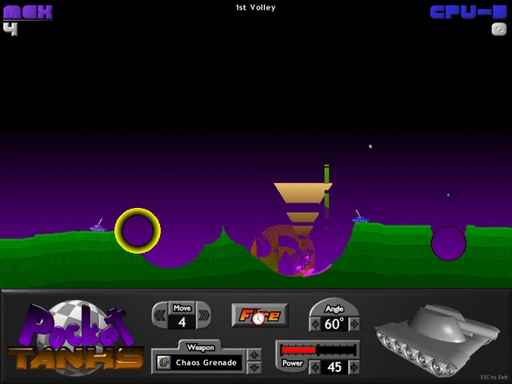
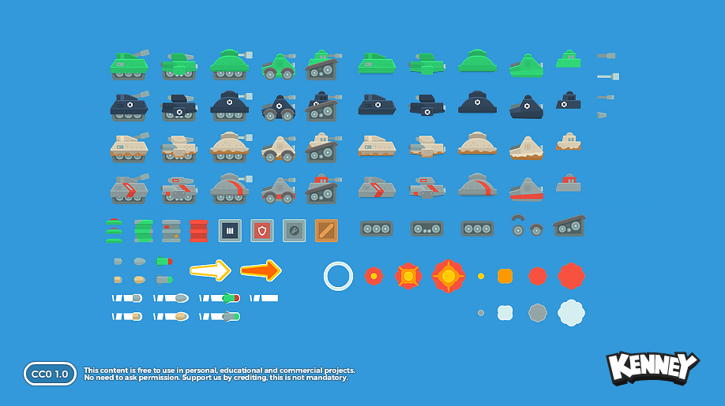

# Mini Artillery

A C++ experiment exploring **2D destructible terrain**, inspired by **Gunbound** and **Pocket Tanks**. The focus is terrain rendering, carving, and collision updates as explosions reshape the terrain.

An artillery-style sandbox provides a setting for testing terrain destruction, projectile impacts, and objects settling on the modified ground. Development starts on native macOS, with WebAssembly as a later portability experiment.

> **Status (0.2.0):** Native OpenGL scaffold implemented. SDL3 3.4.18 and GLAD 2.0.8 create an OpenGL Core context and render a procedural checkerboard quad on macOS. Terrain rendering and destruction remain planned experiments.

See the [changelog](CHANGELOG.md) for development progress and screenshots.

## Visual references


*Kenney Tanks asset-pack mockup, used as a visual reference. This is not a Mini Artillery screenshot.*

The planned art uses separate tank chassis and turret sprites, with the chassis following terrain slopes and the turret rotating independently for aiming.

<details>
<summary>Gameplay inspiration and asset preview</summary>

### Gunbound


Reference for turn-based aiming, wind, and terrain destruction.

### Pocket Tanks



Reference for artillery combat, shot controls, and crater formation.

### Kenney Tanks



Planned sprite source: [Kenney Tanks](https://kenney.nl/assets/tanks), released under CC0.

</details>

## Experimental scope

- GPU texture masking for visible terrain destruction.
- Polygon clipping and chunked collision-shape rebuilding after explosions.
- Keeping rendered terrain and physical collision boundaries aligned.
- Repeated craters, holes, thin terrain, and chunk-boundary behavior.
- Simple projectiles and tanks or debris interacting with modified terrain.
- Native versus browser behavior and performance, once the core experiment works.

## Technical approach

| Area | Choice |
| --- | --- |
| Language and build | C++ and CMake |
| Native development | macOS on Apple Silicon; Windows x64 and Linux x86_64 build scaffolds prepared but unverified |
| Graphics | Desktop OpenGL 3.3 Core with GLAD 2.0.8; SDL3 handles windows, contexts, and input |
| SDL version | 3.4.18, official macOS universal dynamic framework |
| Browser target | Emscripten, WebAssembly, separate SDL3 WASM library required, WebGL 2 through Emscripten’s OpenGL ES 3.0 interface |
| Physics | Box2D |
| Terrain geometry | Clipper2 |
| Math | GLM |
| UI and debugging | Dear ImGui with SDL3 and OpenGL3 backends |
| Sprites | Kenney Tanks, texture atlases, dynamic sprite batching |
| Image loading and packing | stb_image and stb_rect_pack |
| Audio | SDL3 built-in audio; SDL3_mixer if richer playback is needed |
| Optional networking experiment | WebSockets with a room-based relay server |

### Destructible terrain

Terrain has two coordinated representations:

- **Visual terrain:** A color texture and a solidity mask. Explosions erase circles from the mask by rendering into a framebuffer object; a shader hides the erased regions.
- **Collision terrain:** Chunked polygons. Clipper2 subtracts the explosion shape from affected chunks, then their Box2D collision shapes are rebuilt.

Both representations receive the same explosion coordinates and radius.

### Optional multiplayer exploration

One possible extension is exchanging shot and explosion events over WebSockets to explore terrain synchronization without streaming textures. Multiplayer and hosting are optional follow-up experiments rather than completion requirements.

Physics runs at a fixed timestep. Cross-platform consistency, authoritative impact resolution, and recovery from state differences still need to be specified and validated before multiplayer implementation.

## Experiment sequence

1. **Native window:** Import SDL3 3.4.18 into `external/sdl3/`, link the official prebuilt framework through CMake, and open an empty window with event handling and clean shutdown.
2. **Terrain sandbox:** Add OpenGL rendering and debug controls; render terrain and erase explosion shapes.
3. **Collision updates:** Add Clipper2 and Box2D, rebuild affected chunks, and inspect how simple bodies interact with carved terrain.
4. **Artillery interactions:** Add basic aiming and projectiles to exercise the destruction pipeline. Expand tank behavior or effects only when useful to the experiment.
5. **Browser portability:** Supply an Emscripten-compatible SDL3 library and compile the prototype, then compare behavior and performance with WebGL 2.
6. **Optional extensions:** Explore multiplayer synchronization or host a browser demo if useful.

## Project structure

The following layout is a guide for organizing the experiments. The root CMake files, `src/main.cpp`, `Application`, `Window`, the temporary quad renderer, the official SDL3 framework, generated GLAD files, and documentation are present. Remaining modules are added as needed; gameplay, networking, and server folders are optional.

```text
mini-artillery/
├── README.md
├── CHANGELOG.md                # Notable changes grouped by release
├── LICENSE
├── .gitignore
├── CMakeLists.txt              # Shared native and WebAssembly build
├── CMakePresets.json           # Reproducible build configurations
├── cmake/                     # Dependency setup and build helpers
├── src/
│   ├── main.cpp               # SDL callback-mode entry point
│   ├── app/                   # Application ownership and frame coordination
│   ├── game/                  # Simple tanks and projectile experiments
│   ├── terrain/               # Terrain polygons, chunks, explosion carving
│   ├── physics/               # Box2D world and collision-shape rebuilding
│   ├── rendering/             # Terrain masks, textures, sprite batching
│   ├── ui/                    # Dear ImGui experiment controls and debug tools
│   ├── networking/            # Optional synchronization experiments
│   └── platform/              # Native and browser integration
├── assets/                    # Runtime game assets
│   ├── sprites/
│   ├── shaders/
│   ├── audio/
│   └── LICENSES.md            # Runtime asset attribution
├── external/                  # Local third-party headers, source, and libraries
│   ├── README.md              # Dependency inventory and integration policy
│   ├── sdl3/                  # Platform SDKs; macOS supplied, Windows/Linux pending
│   └── glad/                  # Generated native OpenGL loader
├── tests/                     # Terrain, gameplay, and protocol verification
├── web/                       # Browser HTML shell and web resources
├── server/                    # Optional relay for networking experiments
└── docs/
    ├── README.md              # Documentation index
    ├── architecture.md        # Implemented architecture, added with code
    ├── development.md         # Verified setup and debugging instructions
    ├── roadmap.md             # Detailed milestones, when needed
    ├── rfcs/                  # Numbered proposals and decision records
    │   ├── README.md          # RFC process and index
    │   └── template.md
    └── assets/                # Documentation images and references
        ├── milestones/        # Captures from the running experiment
        └── README.md          # Image attribution
```

Headers live beside their `.cpp` files. Generated outputs go into ignored `build/native/` and `build/web/` directories. Third-party dependencies use pinned local copies under `external/`; see the [dependency policy](external/README.md).

### Component responsibilities

`app` coordinates input, fixed-step simulation, and rendering. Explosions can come from debug controls or simple projectile interactions in `game`. `terrain` applies them to polygon geometry; `physics` rebuilds the affected collision shapes, and `rendering` updates the visual mask from the same explosion descriptor.

Terrain geometry and simulation logic should work without a graphics context so they can be tested independently. `platform` contains native/browser differences. If networking is explored, `networking` handles client messages and `server` contains a separate relay application.

The [structure document](docs/project-structure.md) records the implemented classes, resource lifetimes, planned rendering resources, platform SDK paths, and runtime library placement. `Application` owns a `Window`, which manages SDL initialization, the native window, its OpenGL context, and presentation. SDL drives the main loop through static `Application` callbacks. `QuadRenderer` is a temporary graphics demo to be replaced during terrain implementation. Fixed-step scheduling will be added when simulation requires it.

## Development

CMake is the selected build system for both native and browser targets. Native builds will use Apple's compiler toolchain; browser builds will use Emscripten's CMake toolchain through `emcmake`.

On an Apple Silicon Mac with Xcode or Command Line Tools and CMake 3.22 or newer:

```sh
cmake --preset native-debug
cmake --build --preset native-debug --parallel
./build/native/mini-artillery
```

The application opens a resizable 960 × 540 window with a centered checkerboard quad on a dark background. Press Escape or close the window to exit. See [development instructions](docs/development.md) for details. Windows and Linux presets and local SDK integration are prepared but unverified; their dependency packages are not included yet. See [platform setup](docs/development.md). The browser build is not configured yet.

SDL3 is linked through the imported `SDL3::SDL3` target defined in `cmake/SDL3.cmake`. CMake copies the framework into `build/native/Frameworks/`, and the executable loads that copy through a relative runtime path. Windows uses matching headers, an import library, and a DLL; Linux uses matching headers and a shared library. The native build does not compile SDL3. SDL3 main callbacks handle events and window updates. The window uses an OpenGL Core context with VSync when available. GLAD loads native functions, and the viewport follows drawable pixel dimensions. Terrain rendering remains planned.

### Local dependencies

Third-party headers, source, and any supplied static or dynamic libraries live under `external/<library>/`. CMake links local targets without fetching dependencies or using a package manager during configuration.

SDL3 uses the official prebuilt dynamic framework from the [3.4.18 macOS DMG](https://github.com/libsdl-org/SDL/releases/tag/release-3.4.18). Only the macOS universal framework slice is stored under `external/sdl3/macos-universal/`; its headers are included inside the framework. No locally compiled SDL binary, upstream source tree, Git submodule, or package manager is required. The [SDL3 dependency record](external/sdl3/README.mini-artillery.md) records provenance and checksums. Static linking remains the default preference for other compiled dependencies when practical.

Header-only libraries are included directly, and libraries such as Dear ImGui and generated GLAD are compiled from local source. Dear ImGui uses matching SDL3 and OpenGL3 backend source files; GLAD is included only in native builds.

[GLAD 2.0.8](external/glad/README.mini-artillery.md) is supplied as generated OpenGL 3.3 Core source and linked through the local static `GLAD::GLAD` target. Native context creation and the textured quad implement [RFC 0002](docs/rfcs/0002-graphics-integration.md); browser rendering remains pending.

Supplied binaries are separated by platform and architecture. The browser build will need a separate WASM-compatible SDL3 static library, obtained or built outside the repository from the matching release. Native macOS libraries cannot be reused in WASM builds. See [SDL3's Emscripten documentation](https://wiki.libsdl.org/SDL3/README-emscripten).

Each dependency must include its license, exact version or source revision, origin, and any local changes. Dynamic macOS libraries require runtime bundling and loader-path configuration when packaging the game. See [RFC 0001](docs/rfcs/0001-local-dependencies.md).

## Documentation

Project documentation lives in [`docs/`](docs/README.md). Architecture proposals and decisions are recorded as numbered [RFCs](docs/rfcs/README.md). Reference images and their attribution are stored in [`docs/assets/`](docs/assets/README.md).

Follow the [coding conventions](docs/coding-conventions.md) for C++ style, ownership, lifecycle, and error handling.

## License

Project code is licensed under the [MIT License](LICENSE).

Vendored libraries retain their upstream licenses. SDL3 uses the [zlib license](external/sdl3/LICENSE.txt).

Kenney Tanks assets are CC0. Gunbound and Pocket Tanks screenshots are third-party gameplay references and are not covered by this repository's MIT license. See [reference image attribution](docs/assets/README.md).
