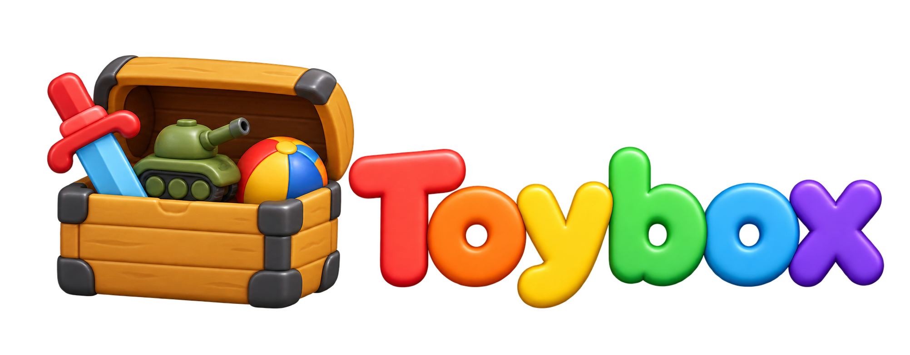

An experimental C++ game engine for **2D and 3D games**, developed through practical examples. Planned capabilities include 2D/3D physics integrations and multiple graphics APIs.

> **Status:** A native macOS OpenGL scaffold is implemented: window/context management, application lifecycle callbacks, shader programs with file loading, and RGBA8 textures with PNG/JPEG loading. The textured-quad example exercises these features. Camera, audio, physics, terrain destruction, and additional graphics backends remain planned.

Toybox began as Mini Artillery, a destructible-terrain experiment. The engine now lives separately from its examples in this repository; existing releases and milestone screenshots retain their original history. See the [changelog](CHANGELOG.md) and [RFC 0003](docs/rfcs/0003-toybox-engine-and-examples.md).

## Engine and examples

The static `toybox` library supplies reusable facilities. Examples depend on the engine and own their application behavior and runtime assets; the engine never depends on an example.

| Example | Status |
| --- | --- |
| [Textured Quad](examples/textured-quad/README.md) | Implemented: shader/image-file loading and quad rendering |
| [Mini Artillery](docs/examples/mini-artillery.md) | Planned: tanks and projectiles exercising destructible terrain |

Mini Artillery will own aiming, weapons, damage, turns, match rules, and game UI. Reusable terrain carving and collision rebuilding can belong to the engine. Other 2D/3D examples will be added as features need them; no gameplay is implemented yet.

## Technical approach

| Area | Choice and status |
| --- | --- |
| Language and build | C++17 and CMake; static engine library, separate example executables |
| Native development | macOS on Apple Silicon; Windows x64 and Linux x86_64 scaffolds remain unverified |
| Graphics | OpenGL 3.3 Core baseline, GLAD 2.0.8; SDL3 window/context integration |
| SDL | 3.4.18 official macOS universal dynamic framework |
| Rendering resources | ShaderProgram with source/file loading; Texture2D with in-memory RGBA8 upload and PNG/JPEG loading |
| Math and debug UI | GLM and Dear ImGui planned |
| Image loading | stb_image 2.28; PNG/JPEG decoding |
| Audio | SDL3 built-in audio planned; SDL3_mixer if richer playback is needed |
| 2D physics and terrain | Box2D 3.x and Clipper2 planned |
| 3D physics | Planned; library selection deferred |
| Additional graphics APIs | Planned; backend design deferred |
| Browser | Planned Emscripten/WebAssembly and WebGL 2 through its GLES3 interface; not configured |

OpenGL and the current 2D example are the starting point, not limits on Toybox's scope. Introduce new systems through concrete examples rather than building unused abstractions.

## Project structure

```text
toybox-engine/
├── CMakeLists.txt              # Shared project and local dependencies
├── CMakePresets.json
├── cmake/                      # SDK integration and example packaging
├── engine/
│   ├── CMakeLists.txt          # Static toybox library
│   └── src/
│       ├── app/                # Application lifecycle and frame coordination
│       ├── platform/           # Window and OpenGL context ownership
│       └── rendering/          # ShaderProgram and Texture2D
├── examples/
│   └── textured-quad/          # Example code, CMake target, and assets
├── external/                   # Pinned dependencies and license records
├── docs/                       # Structure, development, conventions, and RFCs
├── CHANGELOG.md
├── LICENSE
└── build/                      # Ignored generated outputs
```

Engine code uses namespace `toybox`; example code stays outside it. Headers live beside their `.cpp` files. Add camera, input, audio, terrain, physics, further examples, and tests when needed. The [structure guide](docs/project-structure.md) records ownership, callbacks, runtime assets, and platform SDK layout.

## Build and run

On an Apple Silicon Mac with Xcode or Command Line Tools and CMake 3.22 or newer:

```sh
cmake --preset native-debug
cmake --build --preset native-debug --parallel
./build/native/bin/toybox-textured-quad/toybox-textured-quad
```

The example opens a resizable window with a centered quad displaying a generated crate texture. Press Escape or close the window to exit. Its assets are resolved relative to the executable, independently of the working directory.

Each example's output directory contains its runtime assets and SDL framework. Keep them together when moving a build. CMake compiles the engine and GLAD from local source and copies the official SDL3 framework; it does not rebuild SDL3 or download dependencies. See [development instructions](docs/development.md) for engine-only builds, IDE setup, and remaining platform checks.

Third-party files remain pinned under `external/`, shared by the engine and examples. Preserve licenses and provenance; see the [dependency policy](external/README.md) and [RFC 0001](docs/rfcs/0001-local-dependencies.md).

## Documentation and license

Start with the [documentation index](docs/README.md). Follow the [coding conventions](docs/coding-conventions.md), and record significant decisions in [RFCs](docs/rfcs/README.md).

Project code is licensed under the [MIT License](LICENSE). Third-party libraries and assets retain their own licenses. Examples keep asset attribution with their assets; the [textured-quad record](examples/textured-quad/assets/LICENSES.md) covers its original shaders. Historical reference images are documented [separately](docs/assets/README.md).
