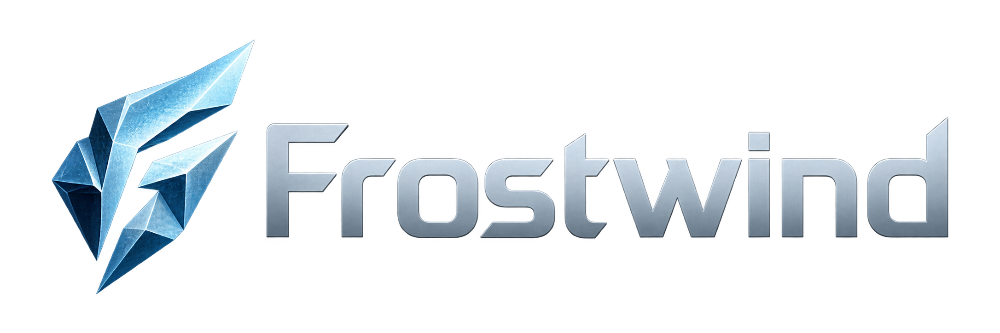

An experimental C++ game engine for **2D and 3D games**, developed through practical examples. Current rendering focuses on OpenGL; 2D/3D physics integrations are planned.

> **Status:** Native SDL3/OpenGL rendering, direct texture/shader/buffer/vertex-array owners, CPU image loading, elapsed-time updates, keyboard state, a perspective camera, and the Textured Quad/Textured Cube examples are implemented. Asteroids and Mini Artillery remain window scaffolds. Audio, physics, terrain destruction, 2D sprites/camera, and lighting are planned; other graphics APIs are deferred research.

Frostwind grew out of Mini Artillery, a destructible-terrain experiment, and was initially named Toybox. The engine now lives separately from its examples in this repository; existing releases and milestone screenshots retain their original history. See the [changelog](CHANGELOG.md) and [RFC 0003](docs/rfcs/0003-frostwind-engine-and-examples.md).

## Engine and examples

The static `frostwind` library supplies reusable facilities. Examples depend on the engine and own their application behavior and runtime assets; the engine never depends on an example.

Example directories use two-digit prefixes for a suggested learning order: Textured Quad, Textured Cube, Asteroids, then Mini Artillery. Each example builds independently; CMake targets and executable names omit the prefixes.

| Preview | Example | Status |
| :---: | --- | --- |
| [](docs/assets/milestones/m004-frostwind-textured-quad.png)<br>Screenshot | [Textured Quad](examples/01-textured-quad/README.md) | Implemented: shader/image-file loading and an indexed quad with four vertices and six indices |
| [](docs/assets/milestones/m005-frostwind-textured-cube-updated.png)<br>Screenshot | [Textured Cube](examples/02-textured-cube/README.md) | Implemented: rotating indexed cube, orbit camera, depth/culling, 4× MSAA, and a 120 FPS cap with VSync |
| [](examples/03-asteroids/docs/assets/asteroids-realistic-concept-v1.png)<br>Concept — planned | [Asteroids](examples/03-asteroids/README.md) | Runnable window scaffold; 2D camera/mouse aiming/sprites, lighting, and gameplay planned |
| [](examples/04-mini-artillery/docs/assets/mini-artillery-realistic-concept-v1.png)<br>Concept — planned | [Mini Artillery](examples/04-mini-artillery/README.md) | Runnable window scaffold; tanks, projectiles, and destructible terrain planned |

Asteroids and Mini Artillery each have a minimal executable that opens a plain OpenGL window, plus planning READMEs and concept/reference artwork. Their READMEs embed the preferred concepts and link older versions and provenance. Asteroids will own ship/arena rules, bullets, asteroid behavior, and scoring. Mini Artillery will own aiming, weapons, damage, turns, match rules, and game UI. Reusable terrain carving and collision rebuilding can belong to the engine. Other 2D/3D examples will be added as features need them; no gameplay is implemented yet.

## Technical approach

| Area | Choice and status |
| --- | --- |
| Language and build | C++17 and CMake; static engine library, separate example executables |
| Native development | macOS on Apple Silicon; Windows x64 and Linux x86_64 scaffolds remain unverified |
| Graphics | OpenGL 3.3 Core baseline, GLAD 2.0.8; SDL3 window/context integration |
| SDL | 3.4.18 official macOS universal dynamic framework |
| Rendering resources | Direct OpenGL Texture2D, ShaderProgram, VertexBuffer, IndexBuffer, and VertexArray owners; CPU Image loading; Renderer clears, depth/culling controls, and sequential/indexed triangle draws; Application viewport handling |
| Math and debug UI | GLM 1.0.3 integrated; Dear ImGui planned |
| Image loading | stb_image 2.28; PNG/JPEG decoding |
| Audio | SDL3 built-in audio planned; SDL3_mixer if richer playback is needed |
| 2D physics and terrain | Box2D 3.x and Clipper2 planned |
| 3D physics | Planned; library selection deferred |
| Rendering architecture | Window owns SDL/context/GLAD/presentation; resources perform their own OpenGL operations; examples use engine methods |
| Additional graphics APIs | Deferred research: [WebGPU](docs/rfcs/9998-webgpu-migration-research.md) and [multiple backends](docs/rfcs/9999-multi-backend-rendering-research.md); no backend compatibility requirement for current OpenGL development |
| Browser | Planned Emscripten/WebAssembly and WebGL 2 through its GLES3 interface; not configured |

OpenGL and the current 2D example are the starting point, not limits on Frostwind's scope. Introduce new systems through concrete examples rather than building unused abstractions.

The [engine roadmap](ROADMAP.md) records intended learning phases. Our [current focus](ROADMAP.md#current-focus---opengl-scenes) starts with [Textured Cube](examples/02-textured-cube/README.md) for matrices and camera experiments, then basic lighting before returning to Asteroids. Grass remains a later bounded experiment.

[RFC 0006](docs/rfcs/0006-opengl-focused-rendering.md) records the current direct OpenGL design. All four examples use engine operations; resources manage their GL objects without a device, pipeline, or backend hierarchy. The prior multi-backend experiment is preserved at commit `e9cf616` on `archive/multi-backend-experiment` and in deferred [RFC 9999](docs/rfcs/9999-multi-backend-rendering-research.md).

## Project structure

### Current layout

This tree shows the implemented repository, with the OpenGL-focused rendering owners.

```text
frostwind-engine/
├── CMakeLists.txt              # Shared project and local dependencies
├── CMakePresets.json
├── cmake/                      # SDK integration and example packaging
├── engine/
│   ├── CMakeLists.txt          # Static frostwind library
│   └── src/
│       ├── core/               # Primitive type aliases
│       ├── app/                # Application lifecycle and frame coordination
│       ├── camera/             # CPU-only perspective camera and orbit controller
│       ├── input/              # Keyboard state
│       ├── platform/           # SDL window, OpenGL context/loading/presentation
│       └── rendering/          # Rendering resources, clear/draw, CPU image loading
├── examples/
│   ├── 01-textured-quad/       # Implemented code, CMake target, and runtime assets
│   ├── 02-textured-cube/       # Rotating 3D cube, orbit camera, runtime assets
│   ├── 03-asteroids/           # Window scaffold, CMake target, and planning artwork
│   └── 04-mini-artillery/      # Window scaffold, CMake target, and planning artwork
├── external/                   # Pinned dependencies and license records
├── docs/                       # Structure, development, conventions, and RFCs
├── ROADMAP.md                  # Learning phases and future experiments
├── CHANGELOG.md
├── LICENSE
└── build/                      # Ignored generated outputs
```

Engine code uses namespace `frostwind`; example code stays outside it. Headers live beside their `.cpp` files. Add further input, camera, audio, terrain, and physics facilities as examples need them. Opt-in camera/input/update checks live under `tests/`. The [structure guide](docs/project-structure.md) records ownership, callbacks, runtime assets, and platform SDK layout.

### Rendering layout

[Window](engine/src/platform/Window.h) owns SDL video/window/context, GLAD initialization, VSync, and presentation. [Application](engine/src/app/Application.h) owns a persistent Renderer and coordinates callbacks, keyboard state, elapsed-time updates, viewport sizing, and software frame pacing.

```text
engine/src/
├── app/Application.h, .cpp
├── platform/Window.h, .cpp
├── camera/PerspectiveCamera.h, .cpp
├── camera/OrbitCameraController.h, .cpp
├── input/Keyboard.h, .cpp
└── rendering/
    ├── Texture2D.h, .cpp       # Direct RGBA8 upload, file loading, texture binding
    ├── ShaderProgram.h, .cpp   # Vertex/fragment linking, use, typed uniform setters
    ├── Renderer.h, .cpp        # Clear and draw submission
    ├── VertexBuffer.h, .cpp    # Immutable vertex bytes
    ├── VertexArray.h, .cpp     # Attribute layout and buffer associations
    ├── IndexBuffer.h, .cpp     # Immutable u32 indices and bounds metadata
    ├── Image.h, .cpp           # CPU PNG/JPEG loading
    ├── GraphicsChecks.h, .cpp  # Private context/error checks
    └── StbImage.cpp
```

Examples implement `initialize()` and `render(renderer, width, height)`, borrowing Application's persistent Renderer and owning resource members that are destroyed before the base Window/context. Shader programs are activated explicitly, uniforms use cached locations, and VertexArray configures the vertex layout and associates buffers once, while Renderer submits sequential or indexed triangle draws from it. Textured Quad reuses four vertices through six indices. Rendering failures throw diagnostic exceptions, caught and logged once by Application at SDL callback boundaries; examples call commands in sequence. Native calls stay inside engine implementations; GLAD remains private to the engine target.

The [structure guide](docs/project-structure.md) explains lifetime and packaging; the [rendering guide](docs/rendering-guide.md) demonstrates the actual example. There is no abstract backend/surface, device facade, pipeline description, or per-frame submission object.

The quad's flow is:

```text
initialize() → upload 4 vertices and 6 indices → configure VertexArray → load texture/program → cache uniforms
render()     → clear → activate program → update uniforms → bind texture → draw indexed triangles
```

VertexBuffer and IndexBuffer own data; VertexArray owns the layout, borrows the buffers, and stores vertex/index counts. Use `renderer.drawTriangles(vertexArray)` for the entire configured geometry: Renderer selects indexed drawing when an IndexBuffer is attached and sequential drawing otherwise. Follow the [indexed drawing usage](docs/rendering-guide.md#indexed-and-non-indexed-draws) and [working QuadDemo](examples/01-textured-quad/QuadDemo.cpp) for the exact calls.

## Build and run

On an Apple Silicon Mac with Xcode or Command Line Tools and CMake 3.22 or newer:

```sh
cmake --preset native-debug
cmake --build --preset native-debug --parallel
./build/native/bin/frostwind-textured-quad/frostwind-textured-quad
```

The preset builds all four examples. Textured Quad opens a resizable window with a centered quad displaying a generated crate texture. Its assets are resolved relative to the executable, independently of the working directory.

Run the cube or either window scaffold separately:

```sh
./build/native/bin/frostwind-textured-cube/frostwind-textured-cube
./build/native/bin/frostwind-asteroids/frostwind-asteroids
./build/native/bin/frostwind-mini-artillery/frostwind-mini-artillery
```

Textured Cube uses arrow keys to orbit, W/S to change camera distance, Space to pause rotation, and R to reset. It requests 4× MSAA and caps at 120 FPS with VSync; the other examples retain their 60 FPS defaults. Asteroids and Mini Artillery currently display plain backgrounds. Press Escape or close any example window to exit.

Each example's output directory contains its SDL framework and any runtime assets it uses. The two new scaffolds have no runtime assets; planning artwork is not packaged. Keep each output directory together when moving a build. CMake compiles the engine and GLAD from local source and copies the official SDL3 framework; it does not rebuild SDL3 or download dependencies. See [development instructions](docs/development.md) for individual targets, engine-only builds, IDE setup, and remaining platform checks.

Third-party files remain pinned under `external/`, shared by the engine and examples. Preserve licenses and provenance; see the [dependency policy](external/README.md) and [RFC 0001](docs/rfcs/0001-local-dependencies.md).

## Learning references

- [LearnOpenGL](https://learnopengl.com/) — step-by-step modern OpenGL tutorials covering shaders, transformations, cameras, lighting, model loading, and advanced rendering. Adapt examples to Frostwind's SDL lifecycle and engine interfaces; check version requirements for advanced and guest articles.
- [Rastertek: OpenGL 4.0 on Linux tutorials](https://www.rastertek.com/tutgl4linux.html) — rendering fundamentals, lighting, shadows, water, instancing, and other effects. Many techniques can be adapted to Frostwind's OpenGL 3.3 baseline; review shader versions and API requirements per tutorial. Hardware tessellation requires functionality beyond that baseline.

## Asset creation tools

Useful tools for preparing example artwork:

| Tool | Use |
| --- | --- |
| [Agent Sprite Forge](https://github.com/0x0funky/agent-sprite-forge) | AI-assisted generation and processing of 2D sprites, sprite sheets, transparent PNG frames, and animations |
| [NormalMap-Online](https://cpetry.github.io/NormalMap-Online/) | Browser-based normal-map generation from height maps, with adjustable settings and a live 3D preview |

These are optional asset-authoring tools. Record runtime asset sources, tools, modifications, and licenses in the owning example's `assets/LICENSES.md`. For normal maps, prefer authored height maps over color-image brightness, which also contains paint colors and baked lighting. Asteroids' normal-map lighting experiment remains planned; see the [prototype workflow in RFC 0005](docs/rfcs/0005-camera-keyboard-and-sprites.md#normal-mapped-sprite-lighting-prototype).

## Documentation and license

Start with the [rendering usage guide](docs/rendering-guide.md) for task-based examples and call-flow, lifetime, and program/geometry-sharing diagrams. The [documentation index](docs/README.md) links the other guides. Follow the [coding conventions](docs/coding-conventions.md), and record significant decisions in [RFCs](docs/rfcs/README.md).

Project code is licensed under the [MIT License](LICENSE). Third-party libraries and assets retain their own licenses. Examples keep asset attribution with their assets; the [textured-quad record](examples/01-textured-quad/assets/LICENSES.md) covers its original shaders. Each planned example records concept/reference provenance under its `docs/assets/`; [shared branding and historical milestone captures](docs/assets/README.md) stay in central documentation.
