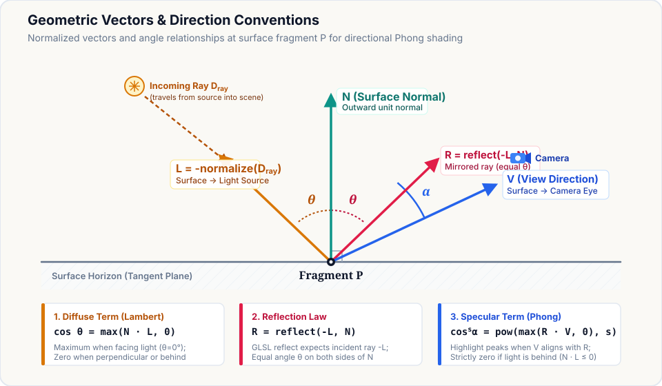
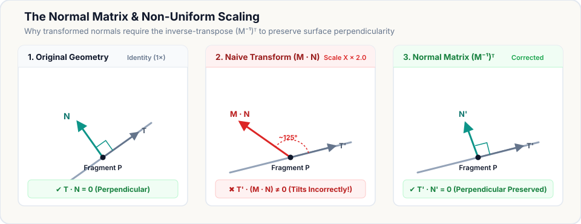

# Basic Lighting Theory: Phong Reflection Model

This document explains the conceptual and mathematical foundations of directional lighting and the classic Phong reflection model in Frostwind. It serves as an educational reference for surface illumination, vector mechanics, and coordinate transformations across the engine.

For the concrete OpenGL 3.3 Core implementation in Textured Cube, see [RFC 0008](../rfcs/0008-basic-lighting.md). For broader planned engine-level materials and mesh systems, see [RFC 0009](../rfcs/0009-materials-meshes-and-shader-composition.md).

---

## 1. Components of the Phong Reflection Model

The Phong reflection model is an empirical approximation of real-world illumination. It breaks fragment lighting into three additive terms: **ambient**, **diffuse**, and **specular**.


*Crate appearances are qualitative illustrations demonstrating individual terms; formulas indicate per-term evaluation in the shader. Illustration record: [basic-lighting-theory-prompt.md](../assets/lighting/basic-lighting-theory-prompt.md).*

### Ambient Term (Background Fill)
Real scenes receive scattered, multi-bounce light from ceilings, walls, and atmosphere. The ambient term provides a constant, direction-independent fill:
- Keeps back-facing or occluded surfaces subtly visible.
- Independent of light direction, surface orientation, and camera position.

$$\text{ambient} = \mathbf{C}_{\text{ambient}} \odot \mathbf{C}_{\text{albedo}}$$

where $\odot$ denotes component-wise (Hadamard) color multiplication.

### Diffuse Term (Lambertian Reflection)
Simulates light penetrating rough microscopic structures and scattering uniformly in all directions (Lambert's Cosine Law):
- Brightness depends solely on the angle $\theta$ between the outward surface normal $\mathbf{N}$ and the surface-to-light direction $\mathbf{L}$.
- When the surface directly faces the light ($\theta = 0^\circ, \mathbf{N} \cdot \mathbf{L} = 1$), diffuse reflection is maximized.
- When perpendicular ($\theta = 90^\circ$) or back-facing ($\theta > 90^\circ$), the diffuse contribution is zero:

$$\text{diffuse} = \max(\mathbf{N} \cdot \mathbf{L}, 0) \cdot \mathbf{C}_{\text{light}} \odot \mathbf{C}_{\text{albedo}}$$

### Specular Term (View-Dependent Highlight)
Simulates reflection off smooth, shiny micro-facets:
- Highlights become brightest when the viewing direction $\mathbf{V}$ aligns with the perfectly reflected light ray $\mathbf{R}$.
- As the camera orbits, the specular highlight shifts across the surface, even while the light and geometry remain completely stationary.
- The **shininess exponent** $s$ controls the tightness or sharpness of the highlight:
  - Small exponent ($s \approx 8$–$16$): Broad, dull sheen.
  - Large exponent ($s \ge 64$–$128$): Tight, focused, glossy pinpoint highlight.

$$\text{specular} = \max(\mathbf{R} \cdot \mathbf{V}, 0)^s \cdot \mathbf{C}_{\text{specular}} \odot \mathbf{C}_{\text{light}} \quad (\text{for } \mathbf{N} \cdot \mathbf{L} > 0)$$

### Combined Illumination
The final perceived color is the sum of all three components:

$$\mathbf{C}_{\text{lit}} = \text{ambient} + \text{diffuse} + \text{specular}$$

---

## 2. Geometric Vectors & Direction Conventions

All direction vectors used in dot products must be **unit length (normalized)**.

| Vector | Symbol | Description | Direction Convention |
| :--- | :---: | :--- | :--- |
| **Surface Normal** | $\mathbf{N}$ | Outward unit perpendicular to the surface at fragment $P$ | Points away from surface |
| **Light Vector** | $\mathbf{L}$ | Direction from fragment $P$ to the light source | Points toward light source |
| **View Vector** | $\mathbf{V}$ | Direction from fragment $P$ to the camera eye | Points toward camera |
| **Reflection Vector** | $\mathbf{R}$ | Perfect reflection of the incoming light ray across $\mathbf{N}$ | Points away from surface |



### Essential Vector Tripwires in GLSL

1. **Light Travel Direction vs. Surface-to-Light Vector:**
   - Directional light parameters typically define the travel direction of parallel rays from the source into the scene: $\mathbf{D}_{\text{ray}}$.
   - Shading equations require the vector pointing *from the surface toward the light source*:
     $$\mathbf{L} = -\text{normalize}(\mathbf{D}_{\text{ray}})$$

2. **GLSL `reflect()` Convention:**
   - The built-in GLSL function `reflect(I, N)` requires the incident ray $\mathbf{I}$ pointing **toward** the surface.
   - Because $\mathbf{L}$ points toward the light, the incident vector is $-\mathbf{L}$.
     ```glsl
     vec3 R = reflect(-L, N);
     ```
   - In terms of vector arithmetic:
     $$\mathbf{R} = \mathbf{I} - 2(\mathbf{N} \cdot \mathbf{I})\mathbf{N} = -\mathbf{L} + 2(\mathbf{N} \cdot \mathbf{L})\mathbf{N}$$

3. **Back-Face Specular Suppression:**
   - When a surface faces away from the light source ($\mathbf{N} \cdot \mathbf{L} \le 0$), its direct diffuse contribution is zero. This orientation test does not determine whether another object blocks the light.
   - However, if the camera happens to view the surface from behind the reflected ray, $\mathbf{R} \cdot \mathbf{V}$ can still be positive!
   - To avoid unnatural glowing highlights on unlit dark faces, specular must be conditionally gated:
     ```glsl
     if (diffuseFactor > 0.0) {
         // evaluate specular highlight
     }
     ```

4. **Camera-Fragment Singularity:**
   - If the camera position coincides with the fragment $P$, the view vector length is zero and normalization results in `NaN`.
   - Shaders should guard against zero distance before normalizing:
     ```glsl
     vec3 toCamera = uCameraPosition - vWorldPosition;
     float cameraDistanceSquared = dot(toCamera, toCamera);
     if (diffuseFactor > 0.0 && cameraDistanceSquared > 0.0) {
         vec3 viewDirection = toCamera * inversesqrt(cameraDistanceSquared);
         ...
     }
     ```

---

## 3. Surface Normals: Sharp vs. Smooth Geometry

A surface normal defines orientation in space. How normals are authored in vertex buffers dictates whether edges appear faceted or smoothly curved:

- **Sharp Edges (e.g. Cubes, Hard Meshes):**
  - Vertices along sharp edges cannot share normals.
  - A unit cube requires **24 separate vertices** (4 per face), where all 4 vertices on a given face share that face's perpendicular normal (e.g., $+Z = (0, 0, 1)$, $-X = (-1, 0, 0)$).
  - Averaging normals at corners would cause light to interpolate across faces, making the flat cube look improperly rounded or warped.
- **Smooth Surfaces (e.g. Spheres, Terrains):**
  - Adjacent triangles share vertices.
  - Normal vectors at shared vertices are averaged from surrounding faces, creating continuous gradients across triangle boundaries.

---

## 4. Coordinate Spaces & the Normal Matrix

Shading calculations can be performed in any space (such as World Space or View/Eye Space), provided **all participating vectors reside in the identical coordinate space**.

### The Problem of Non-Uniform Scale

When an object undergoes uniform scaling or pure rotation, transforming surface normals with the standard model matrix $\mathbf{M}$ preserves perpendicularity. However, under **non-uniform scale** (e.g. stretching $X$ by 2.0 while keeping $Y$ and $Z$ constant), surface tangents and normals scale differently. Multiplying the normal vector directly by $\mathbf{M}$ tilts it toward the stretched axis, destroying perpendicularity:



### Why the Inverse-Transpose Restores Perpendicularity

For any surface tangent vector $\mathbf{T}$ and surface normal $\mathbf{N}$, perpendicularity requires their dot product to be zero:
$$\mathbf{T} \cdot \mathbf{N} = \mathbf{T}^T \mathbf{N} = 0$$

Under an affine model transform $\mathbf{M}$, the surface tangent transforms directly as a vector connecting two surface points:
$$\mathbf{T}' = \mathbf{M} \mathbf{T}$$

We seek a transformation matrix $\mathbf{G}$ for the normal vector ($\mathbf{N}' = \mathbf{G} \mathbf{N}$) such that the transformed normal remains strictly perpendicular to the transformed tangent ($\mathbf{T}' \cdot \mathbf{N}' = 0$):
$$(\mathbf{T}')^T \mathbf{N}' = (\mathbf{M} \mathbf{T})^T (\mathbf{G} \mathbf{N}) = 0$$

Using the transpose product identity $(\mathbf{A}\mathbf{B})^T = \mathbf{B}^T \mathbf{A}^T$:
$$\mathbf{T}^T \mathbf{M}^T \mathbf{G} \mathbf{N} = 0$$

Because $\mathbf{T}^T \mathbf{N} = 0$ is already true for untransformed geometry, this condition is guaranteed for all surface tangents if:
$$\mathbf{M}^T \mathbf{G} = \mathbf{I} \implies \mathbf{G} = (\mathbf{M}^T)^{-1} = (\mathbf{M}^{-1})^T$$

Thus, the **Normal Matrix** must be the **inverse transpose** of the upper-left $3 \times 3$ model matrix:
$$\mathbf{M}_{\text{normal}} = (\mathbf{M}_{3\times 3}^{-1})^T$$

### Implementation in Shaders
In GLSL vertex shaders, this is evaluated per-vertex as:
```glsl
vWorldNormal = transpose(inverse(mat3(uModel))) * aNormal;
```
*Note: Because linear interpolation across rasterized polygon fragments alters vector length, transformed normals must always be re-normalized in the fragment shader:*
```glsl
vec3 normal = normalize(vWorldNormal);
```

---

## 5. Color Spaces and Numerical Limits

The classic Phong model uses basic RGB arithmetic. When applied directly to sRGB textures (like standard 8-bit PNGs) without gamma-correct linear conversion:
- The sum $\text{ambient} + \text{diffuse} + \text{specular}$ can easily exceed $1.0$ (255), clamping to pure white on highlights.
- Highlight falloffs may appear slightly harsher than in physically based rendering (PBR) pipelines.
- In Frostwind, this is accepted as a clear, bounded educational approximation before introducing HDR framebuffers or explicit sRGB workflows.

---

## 6. References & Further Reading

- Phong, Bui Tuong. *"Illumination for Computer Generated Pictures"*, Communications of the ACM, 1975.
- [Google Filament Materials Guide](https://google.github.io/filament/Materials.md.html) – overview of surface inputs, material models, and light formulations.
- [LearnOpenGL - Basic Lighting](https://learnopengl.com/Lighting/Basic-Lighting) – standard reference for Phong and Blinn-Phong implementations.
