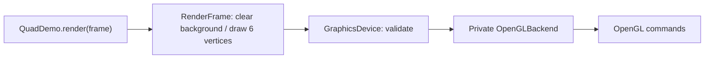
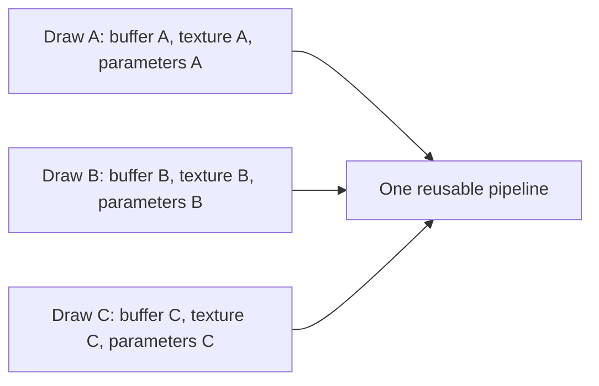
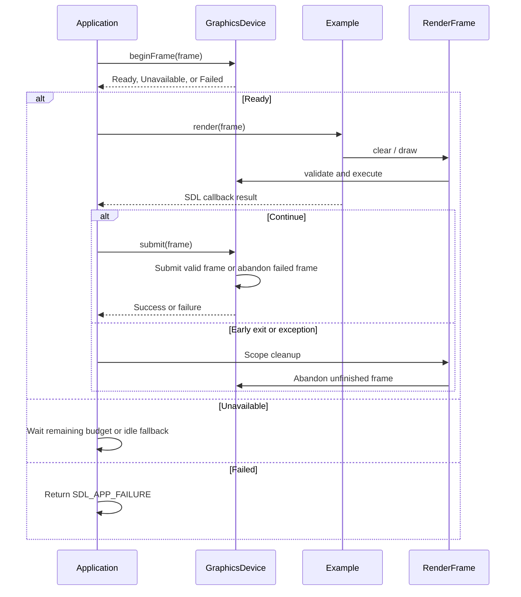
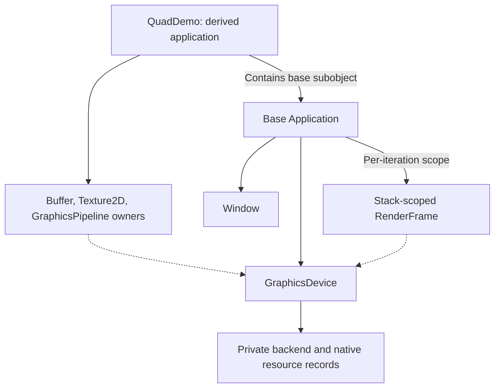

# Rendering guide

Use this guide to write an example with the current OpenGL-backed engine. Start by drawing a textured quad: create persistent resources once, then clear the background and draw its two triangles each frame. [Textured Quad](../examples/01-textured-quad/README.md) is the buildable reference.

For build/run commands, see [development](development.md#configure-build-and-run). For source organization and private integration, see [project structure](project-structure.md). For deferred multi-backend research and the pipeline comparison, see [RFC 9999](rfcs/9999-multi-backend-rendering-research.md); the [roadmap](../ROADMAP.md#current-focus---opengl-scenes) records the OpenGL-first learning plan.

## Render a textured quad

Solid arrows below mean calls. Only the private implementation issues native graphics commands.



An example derives from `frostwind::Application`. Its `initialize()` runs after the window and graphics device are ready. Its `render(RenderFrame&)` borrows an active frame with the current drawable size. Return `SDL_APP_CONTINUE` to submit/present, `SDL_APP_SUCCESS` to exit successfully, or `SDL_APP_FAILURE` to fail. The engine abandons unfinished frames on early returns or exceptions.

The working [Textured Quad example](../examples/01-textured-quad/README.md) follows this sequence. This is pseudocode; the linked source contains the full implementation.

```text
Startup:
    Application creates the window and graphics device
    QuadDemo resolves its asset directory and creates the quad resources

Each frame:
    Application acquires a frame and calls QuadDemo.render(frame)
    QuadDemo clears the background
    QuadDemo calculates scale from the drawable size
    QuadDemo requests a six-vertex draw through frame.draw(...)
    Application submits and presents if rendering succeeded
```

`frame.clear` fills the background; `frame.draw` produces the textured quad. The engine calls your `render(frame)` callback to decide which commands to issue.

Follow the source in this order:

1. [main.cpp](../examples/01-textured-quad/main.cpp): configuration, application factory, and SDL callback adapters.
2. [QuadDemo.h](../examples/01-textured-quad/QuadDemo.h): persistent resource owners.
3. [QuadDemo.cpp](../examples/01-textured-quad/QuadDemo.cpp): asset selection, resource creation, Escape handling, background clear, scaling, and the quad draw.

Build using the [development instructions](development.md#configure-build-and-run), then run:

```sh
./build/native/bin/frostwind-textured-quad/frostwind-textured-quad
```

Expect a centered, square crate image on a dark background. Resize to check its proportions; press Escape or close the window to quit.

## Know the example-facing types

| Type | What you use it for | Lifetime / initialization |
| --- | --- | --- |
| [Application](../engine/src/app/Application.h) | Startup, events, render callbacks, and protected `graphics()` access | Base owns the window and device; derived resource members are destroyed first |
| [GraphicsDevice](../engine/src/rendering/GraphicsDevice.h) | Creating device-backed resources and reading limits | Already initialized when the example's `initialize()` runs |
| [RenderFrame](../engine/src/rendering/RenderFrame.h) | Target dimensions, clear, and complete vertex draws | Borrow only for the current render callback; never store its reference |
| [Buffer](../engine/src/rendering/Buffer.h) | Immutable vertex bytes | Initialize through a device; caller bytes are copied/consumed before return |
| [Texture2D](../engine/src/rendering/Texture2D.h) | RGBA8 pixels or a PNG/JPEG texture file | Device-backed; nearest filtering, clamp-to-edge, no mipmaps |
| [Shader](../engine/src/rendering/Shader.h) | One vertex or fragment stage from source/file | Local initialization-stage owners can die after a pipeline retains their required resources |
| [GraphicsPipeline](../engine/src/rendering/GraphicsPipeline.h) | Shader combination, vertex layout, bindings, and drawing state | Create once for a compatible configuration; reuse across draws |
| [PipelineDescription](../engine/src/rendering/GraphicsTypes.h) | Describe that configuration before pipeline creation | Ordinary CPU data, copied during initialization; shaders are supplied separately |
| [Image](../engine/src/rendering/Image.h) | Inspect/decode PNG/JPEG pixels on the CPU | Works without a graphics context; supply a positive maximum dimension |

Device-backed resource owners are non-copyable and currently non-movable. Keep them as members of the example or its renderer. Constructors establish no GPU resources. Initialize them after graphics startup; successful initialization is one-time. Failed initialization cleans partial resources and permits a retry on that owner. A higher-level function that already initialized some members must account for those successful members before retrying the whole function.

## Create the quad's resources once

[QuadDemo.h](../examples/01-textured-quad/QuadDemo.h) owns a `Buffer`, `Texture2D`, and `GraphicsPipeline`. [QuadDemo::initialize](../examples/01-textured-quad/QuadDemo.cpp) resolves an executable-relative asset directory and initializes those resources through `graphics()`. The engine does not choose the example's assets.

The initialization flow is:

```text
Upload six position/UV vertices to a Buffer
Load the crate image into Texture2D
Compile the vertex and fragment Shader stages
Describe the vertex layout, parameter block, texture binding, and drawing state
Initialize GraphicsPipeline from the description and the two stages
```

The [implemented initialization](../examples/01-textured-quad/QuadDemo.cpp) uses attribute location 0 for position and 1 for UV. Stride/offsets must match both the vertex bytes and active shader inputs. Its pipeline declares the `QuadParameters` block with 16 bytes and the `uTexture` sampler. The default drawing state is an RGBA8 target, triangle list, opaque output, and depth/culling disabled.

Uploads consume/copy caller bytes before returning. The pipeline retains the shader resources it requires, so the example's local `Shader` owners can leave initialization scope. The persistent buffer, texture, and pipeline remain `QuadDemo` members.

## Supply changing values when drawing

A pipeline description fixes the layout and drawing state. Each draw supplies changing values, such as scale. Updating those values does not recreate the pipeline.

```text
Clear the background once
Calculate scale from frame.target()
Prepare the matching 16-byte scale parameter block
Draw the quad with the existing pipeline, buffer, and texture
```

The essential call from [QuadDemo::render](../examples/01-textured-quad/QuadDemo.cpp) is:

```cpp
frame.draw(pipeline_, vertices_, 6, 0,
    &texture_, &parameters, sizeof(parameters));
```

The draw arguments are **pipeline, vertex buffer, vertex count, first vertex, optional texture, optional parameter pointer, parameter byte count**. Here the request draws six vertices starting at zero. Counts must form complete triangles and fit the buffer. Supply a texture and parameters exactly when the pipeline declares them. An untextured triangle uses the same operation with three vertices and a compatible pipeline without those optional bindings.

Parameter bytes are consumed/copied by the draw before it returns. The stack structure can go out of scope afterward. Every draw supplies its complete bindings. Check the returned `bool`; a failed draw/clear also prevents later submission of that frame even if the callback ignores the failure.

The current [quad vertex shader](../examples/01-textured-quad/assets/shaders/quad.vert) declares a `std140` block named `QuadParameters` with a `vec4 scaleAndPadding`. Only its first two components are used. The example's CPU structure supplies two scale floats and two padding floats. The block name and total 16-byte size match the pipeline description. A `vec2` in a `std140` block could express the same scale with a 16-byte backing block, but changing the shader is a separate implementation edit. The [Khronos uniform-buffer specification](https://registry.khronos.org/OpenGL/extensions/ARB/ARB_uniform_buffer_object.txt) defines those packing rules.

The engine checks block name, size, and supported stage visibility. It does not infer or serialize C++ member offsets/matrix storage. Match CPU/shader layouts explicitly; matching total byte size alone is insufficient for more complex structures.

## Share a pipeline across draws

A pipeline belongs to a drawing configuration. Several objects can use the same one when their vertex layouts, shader combination, bindings, and state are compatible. Objects can retain geometry/texture references and changing values; a simple renderer chooses the pipeline and submits their draws.



Clear once at the beginning of this group, then call `frame.draw` for each object with the shared pipeline and its own data. The current `QuadDemo::render` includes its background clear; a multi-object example would place that clear before its draw loop. Keep initialization outside the per-frame draw path. A few named pipeline members and a draw loop are enough for the next example; shared caches/managers can follow demonstrated reuse needs.

Different pipelines may also reuse compatible shader stages. The current OpenGL implementation links one program per pipeline; reusing stage owners does not provide a linked-program cache. Pipelines can describe different layouts/state only as those features are implemented; the current enums intentionally expose the small supported set below.

## Understand the frame lifecycle



`Application` owns the stack-scoped frame and translates callback exceptions into SDL failure results. Minimized windows skip acquisition and use an idle wait. Zero-size/unavailable targets skip the example callback and receive pacing. A ready frame supplies the acquired drawable dimensions; use those for scale/aspect calculations.

The frame object borrows its device and allocates no GPU resources when constructed. Native resources persist in the device/backend. OpenGL executes drawing immediately, so abandonment skips presentation and resets ownership/bookkeeping; it cannot undo drawing already issued. After submission or abandonment, the frame cannot be reused. A failed/unavailable acquisition has not activated the object and can be retried by a lower-level caller. Normal examples leave acquisition to Application.

## Keep resource ownership explicit

Solid arrows in this diagram mean ownership. Dotted arrows mean borrowing; they do not prolong the device's lifetime.



Normal destruction is **derived example resources → base graphics device/context → base window**. Resource owners and frames must never outlive their creating device. Use direct resource members or scoped owners with that order. A pipeline retains the shader resources it needs, and an active frame retains native records referenced by its draws until completion. Releasing a public wrapper does not immediately invalidate recorded work, but it does not extend the device lifetime. Current resource owners expose no reset/move API; automatic cleanup occurs at scope destruction.

CPU `Image` data has no device dependency. `Image::load(path, maxDimension)` returns bottom-row-first, tightly packed RGBA8. The file-loading convenience on `Texture2D` composes that CPU step with device upload. Asset paths and licenses remain the example's responsibility.

## Current limits and next extensions

| Area | Implemented now | Add when a selected example needs it |
| --- | --- | --- |
| Shaders | GLSL source/files, `main`, vertex + fragment stages | Additional stages or shader tooling |
| Vertices | Immutable buffer, Float2 attributes, explicit stride/offsets | Float3/other formats, updates, instancing |
| Draws | Non-indexed triangle lists | Indexed draws and other primitives |
| Parameters | One optional vertex-only block at slot 0; size multiple of 16 within device limits | Stage visibility, additional bindings, shared camera/light data |
| Texture | One optional fragment texture at slot 0; RGBA8, nearest/clamp-to-edge | Multiple textures, sampling choices, other formats |
| Target/state | One RGBA8 window target, opaque state, depth/culling disabled | Depth targets, depth testing/culling, blending, offscreen rendering |
| Math/lighting | Parameter bytes can carry a matching matrix layout; no camera/math/lighting facility yet | Camera/transforms, normals, lighting shaders and required bindings |

The current OpenGL-first plan is a small 3D scene followed by a bounded grass experiment. A vertex matrix can use the existing parameter-byte mechanism, but a conventional 3D mesh also needs new vertex formats and depth support. Fragment-stage light parameters require extending the current binding contract; a pipeline currently rejects a block referenced by the fragment stage. Keep such additions separate from this guide's working quad path. See [the learning plan](../ROADMAP.md#current-focus---opengl-scenes).

## Troubleshooting

| Symptom / diagnostic | Check |
| --- | --- |
| Initialization fails | Return failure to Application and read the preceding SDL log; successful owners must not be initialized a second time |
| Missing shader/image | Example resolves the asset directory; build again to refresh packaged assets, and retain the full output directory |
| Vertex layout mismatch | Active shader locations/types, attribute offsets, stride, and actual vertex bytes must agree |
| Parameter block missing or wrong size | Check block name, declared byte size, CPU padding/offsets, and vertex-only visibility |
| Draw range/binding mismatch | Count/first vertex must fit the buffer; required texture and exact parameter byte count must be supplied |
| Wrong-device resource | Create all resources for a draw with the frame's owning device |
| Inactive/nested/completed frame | Use only the frame borrowed by the callback; let Application acquire and submit it |
| Earlier object disappears | Clear once before the group's draws; avoid clearing between objects |
| Texture appears inverted | Preserve the bottom-row-first pixel and bottom-left UV contract; avoid adding a second flip to decoded data |
| FPS stays capped | `ApplicationConfig::maxFps` and `graphics.vsync` are independent; see the frame-pacing notes in development |

## Follow the implementation when needed

Example-facing flow starts at [QuadDemo](../examples/01-textured-quad/QuadDemo.cpp). [Application.cpp](../engine/src/app/Application.cpp) coordinates callbacks/frame lifetime. [GraphicsDevice.cpp](../engine/src/rendering/GraphicsDevice.cpp) validates owners and dispatches operations. Private [GraphicsBackend](../engine/src/rendering/internal/GraphicsBackend.h), [OpenGLResources.cpp](../engine/src/rendering/backends/opengl/OpenGLResources.cpp), and [OpenGLCommands.cpp](../engine/src/rendering/backends/opengl/OpenGLCommands.cpp) implement the native boundary.

Examples should include the public rendering headers and keep native types/calls inside the engine. Private classes are implementation references for learning/debugging; they are not additional classes an example needs to instantiate.
