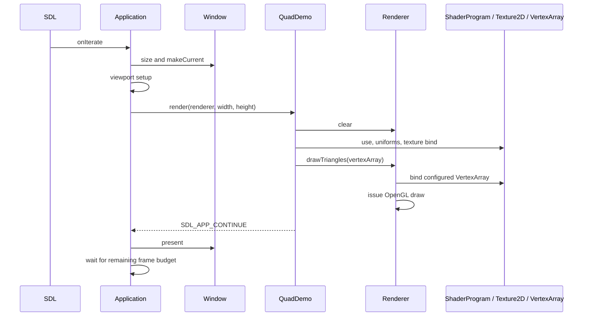
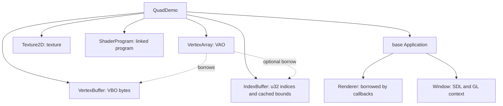

# Rendering guide

Frostwind is OpenGL-focused. Resources call OpenGL directly inside the engine, while examples select assets, shader parameters, and geometry through engine classes. Start with the buildable [Textured Quad example](../examples/01-textured-quad/README.md); this guide shows its flow rather than duplicating its complete source.

See [development](development.md#configure-build-and-run) for commands, [project structure](project-structure.md) for ownership, and [RFC 0006](rfcs/0006-opengl-focused-rendering.md) for the design decision. The [roadmap](../ROADMAP.md#current-focus---opengl-scenes) records the learning sequence.

## Follow the example

- [main.cpp](../examples/01-textured-quad/main.cpp) supplies the SDL adapters, factory, and configuration.
- [QuadDemo.h](../examples/01-textured-quad/QuadDemo.h) declares the persistent resource owners.
- [QuadDemo.cpp](../examples/01-textured-quad/QuadDemo.cpp) loads resources, caches uniforms, handles Escape, and draws.
- [quad.vert](../examples/01-textured-quad/assets/shaders/quad.vert) and [quad.frag](../examples/01-textured-quad/assets/shaders/quad.frag) declare vertex inputs, `uScale`, and `uTexture`.

```text
QuadDemo : Application
├── VertexBuffer
├── IndexBuffer
├── VertexArray → borrows both buffers
├── Texture2D
├── ShaderProgram
├── initialize() → create resources and cache uniform locations
├── handleEvent() → Escape handling
└── render(renderer, width, height) → clear, calculate scale, activate, bind, draw
```

`Application` owns one persistent Renderer, initializes Window before the example, passes Renderer by reference, and presents after a continuing render callback. Width and height are current drawable pixels. The example never polls a second event loop or calls a native swap operation.



Returning success or failure skips presentation. Rendering operations and resource initialization throw `std::runtime_error` with operation/file/compiler diagnostics. `Application::onInit`, `onEvent`, and `onIterate` catch exceptions, log once, and return `SDL_APP_FAILURE`; a failed frame skips presentation. The example can call operations in sequence without per-call checks or a local try/catch. Window retains checked boolean SDL results.

## Class reference

| Class or functions | When to use | Main operations |
| --- | --- | --- |
| [Application](../engine/src/app/Application.h) | Host an example with SDL callbacks | Override `initialize`, `handleEvent`, `render(renderer, width, height)` |
| [PerspectiveCamera](../engine/src/camera/PerspectiveCamera.h) | Calculate CPU-only 3D view/projection matrices | `setView`, `setPerspective`, `view`, `projection`, `viewProjection` |
| [OrbitCameraController](../engine/src/camera/OrbitCameraController.h) | Move a perspective camera around a target without device bindings | `reset(camera, config)`, `update(camera, input, deltaSeconds)` |
| [Keyboard](../engine/src/input/Keyboard.h) | Read state through Application's protected `keyboard()` accessor | `isDown`, `wasPressed`, `wasReleased` |
| [Window](../engine/src/platform/Window.h) | Own the SDL window and current GL context; normally Application handles it | `initialize`, `pixelSize`, `makeCurrent`, `present` |
| [ShaderProgram](../engine/src/rendering/ShaderProgram.h) | Link and activate vertex/fragment shaders and update uniforms | `initializeFromFiles`, `use`, `uniformLocation`, `setInt`, `setFloat`, `setVec2/3/4`, `setMat4` |
| [Texture2D](../engine/src/rendering/Texture2D.h) | Upload RGBA8 or load PNG/JPEG and select a texture unit | `initializeRGBA8`, `initializeFromFile`, `bind` |
| [VertexBuffer](../engine/src/rendering/VertexBuffer.h) | Upload immutable vertex bytes | `initialize`, `bind`, `byteCount` |
| [VertexArray](../engine/src/rendering/VertexArray.h) | Configure vertex layout and optional indices from initialized buffers | `initialize`, `bind`, `vertexCount`, `indexCount`, `indexBuffer` |
| [IndexBuffer](../engine/src/rendering/IndexBuffer.h) | Store immutable u32 indices and query their cached maximum | `initialize`, `bind`, `indexCount`, `maxIndex` |
| [Renderer](../engine/src/rendering/Renderer.h) | Borrow during the callback to clear, configure depth/culling, and submit draws | `clear`, `clearDepth`, `setDepthTest`, `setBackFaceCulling`, `drawTriangles` |
| [Image](../engine/src/rendering/Image.h) | Decode pixels independently of OpenGL | `load(path, maxDimension)`, `width`, `height`, `pixels` |

## Create resources once

For 3D usage, see [Textured Cube](../examples/02-textured-cube/README.md) and
[CubeDemo.cpp](../examples/02-textured-cube/CubeDemo.cpp). Its WindowConfig opts
into depth storage and 4× MSAA before window creation. The example sets depth
testing/back-face culling, clears color and depth each frame, uploads explicit
model/view/projection matrices through the existing `setMat4`, and draws the
indexed cube. Depth uses LESS/writes and back-face culling uses BACK/CCW;
state persists until changed. `clearDepth` disables scissor, enables depth
writes, and clears to 1. MSAA is configured and verified by Window. The cube initializes its texture
with `{TextureFilter::Trilinear, 16}`: generated mipmaps, linear magnification,
trilinear minification, and up to 16× anisotropy. Support/limits are checked and
the applied anisotropy is logged; unavailable anisotropy falls back to
trilinear filtering. Textured Quad retains nearest sampling. The cube uses a
120 FPS cap with VSync.

Animation and controls belong in `update(f32 deltaSeconds)` before rendering.
Application exposes accumulated keyboard state, consumes edge flags after the
update, and pauses updates/clears held keys on focus loss. First/resumed delta
is zero, and stalls clamp to 0.1 seconds. Update results/exceptions stop the
frame before rendering/presentation. Textured Quad keeps its default no-op
update and existing drawing behavior.

```text
initialize():
    resolve this example's asset paths
    vertices.initialize(vertex data, byte count)
    indices.initialize(index data, 6)  // 0, 1, 2, 2, 3, 0
    vertexArray.initialize(vertices, indices, layout)  // stride and float attributes
    texture.initializeFromFile(crate path)
    program.initializeFromFiles(vertex shader path, fragment shader path)
    cache uScale and uTexture locations; fail if required uniforms are missing
    program.use()
    program.setInt(texture location, 0)
```

Constructors do not create GL objects. `initialize()` runs after context creation and GLAD loading. Successful resource initialization is one-time; failure cleans partial objects and permits retry. File paths are supplied by the example, relative to the executable's copied `assets/`, rather than selected by the engine.

These resources remain members of QuadDemo and are reused each frame. See its [initialization code](../examples/01-textured-quad/QuadDemo.cpp) for the four position/UV records, attribute layout, and file paths.

## Draw each frame

```text
render(renderer, width, height):
    renderer.clear the color target
    calculate square scale from drawable pixels
    activate the shader program and set uScale
    bind the texture on unit 0
    renderer.drawTriangles(vertexArray)
    return continue if all operations succeeded
```

The actual draw portion uses these ordinary engine operations:

```cpp
renderer.clear({24.0f / 255.0f, 28.0f / 255.0f, 34.0f / 255.0f, 1.0f});
program_.use();
program_.setVec2(scaleLocation_, scaleX, scaleY);
texture_.bind(0);
renderer.drawTriangles(vertexArray_);
```

This is the same straight-line error-handling style used by the example: a failed call throws and prevents later calls. The application callback boundary handles the exception. `Renderer::clear(Color)` changes the target's pixels; `Renderer::drawTriangles` submits the indexed geometry. VertexBuffer owns bytes, IndexBuffer owns indices, and VertexArray owns layout/associations; Renderer submits draws. Program and texture bindings remain active until changed. There is no pipeline object or opaque parameter-byte block. The quad's two scale values map directly to GLSL `uniform vec2 uScale`.

## Indexed and non-indexed draws

The quad shares four vertex records between two triangles using six indices. The draw count describes index elements, independently of the number of stored vertices.

```text
3 ───── 2
│     ╱ │   Triangle 1: 0, 1, 2
│   ╱   │   Triangle 2: 2, 3, 0
│ ╱     │
0 ───── 1
```

| Operation | Size/count units | Meaning |
| --- | --- | --- |
| `VertexBuffer::initialize(data, byteCount)` | Bytes | Upload vertex records |
| `VertexArray::initialize(vertices, layout)` or `(vertices, indices, layout)` | Bytes for layout stride and attribute offsets | Configure buffer associations and derive vertex count |
| `IndexBuffer::initialize(data, indexCount)` | u32 index elements | Upload indices that refer to vertex records |
| `Renderer::drawTriangles(vertexArray)` | Uses the array's stored counts | Draw all indices if associated, otherwise all vertices |

Renderer chooses the path from the VertexArray's optional IndexBuffer. An indexed quad uses its stored index count of six, even though it has only four vertex records. Without indices, the same method draws the entire stored vertex count. There are no draw-count or offset arguments.

The selected count must be nonzero and divisible by three; this is engine policy for complete triangle lists. Renderer checks native count limits before conversion. For indexed geometry, it also checks that the cached maximum index is below vertex count.

IndexBuffer initialization consumes u32 elements, not bytes. It caches count and maximum index during upload, then keeps no CPU copy. VertexArray associates the buffers once, and Renderer binds the configured array for each draw; examples need no manual buffer binding. Additional index widths, subranges, base-vertex offsets, primitive restart, and instancing remain future work.

## VertexArray with or without indices

Create the buffers first, then configure a VertexArray. `VertexLayout` contains the byte stride and attributes; each attribute specifies a location, float component count, and byte offset. Vertex count belongs to the array because the same bytes can be interpreted using different layouts. It also stores the optional index count (zero when indices are omitted), so ordinary draws need only the array. The descriptor can be temporary; VertexArray consumes it during initialization.

```text
without indices:
    vertexArray.initialize(vertices, layout)
    renderer.drawTriangles(vertexArray)

with indices:
    vertexArray.initialize(vertices, indices, layout)
    renderer.drawTriangles(vertexArray)
```

Omitting indices is valid: Renderer uses sequential drawing automatically. Supplying an uninitialized vertex/index buffer fails during array initialization. Both configurations use `renderer.drawTriangles(vertexArray)`; the example does not select the native draw operation. A non-indexed quad needs six vertex records for the current triangle-list API; four shared vertices require the six indices used by this example.

## Use more than one shader program

Geometry does not own a shader. Two objects can share the same vertex buffer and use compatible programs:

```text
object A → program A.use() → A uniforms/textures → renderer.drawTriangles(shared vertexArray)
object B → program B.use() → B uniforms/textures → renderer.drawTriangles(shared vertexArray)
```

Cache uniform locations separately for each linked program, even when names match. Call that program's `use()` before its setters. `uniformLocation` treats the named uniform as required and throws if missing or optimized out; setters also reject negative locations. An integer location is local to its program and must not be reused with another program. The active-program guard does not prove that a supplied integer originated from that program.

Match vertex attribute locations/components to each shader's inputs. Match uniform setters to the declared GLSL types: integer for a sampler/unit, float/vec2/vec3/vec4 for those values, and `setMat4` for sixteen column-major floats. Matrix/light semantics belong to the scene/shader; no math library is required by these setters. The current engine does not automatically reflect and validate arbitrary vertex layouts or build materials.

## Error handling

Let rendering exceptions reach Application unless the example can recover from a specific failure. For example, an optional texture can be loaded in a local `try`/`catch (const std::runtime_error&)` and replaced with a fallback. Do not catch a required draw failure and return continue: earlier GL operations have already changed the target, and no rollback occurs. Standard allocation/filesystem exceptions also reach the callback boundary.

Failed initialization keeps an owner empty and retryable; previously initialized owners remain intact when repeated initialization is rejected. Texture uploads restore unpack state and bindings; vertex/index uploads preserve their buffer bindings and VAO state. VertexArray initialization restores the previous VAO/array-buffer binding even when a borrowed buffer fails to bind. Draw submission restores the previous VAO on success or exception and keeps the configured index association unchanged. Program activation, uniform writes, texture selection, and clears intentionally change active rendering state.

## Resource lifetime



Application supplies the same Renderer instance each callback; it needs no initialization, has no GPU resources, and does not retain geometry or frame references. Do not retain the borrowed callback reference. Declare buffers before their VertexArray member, so the array is destroyed first. The borrowed buffers must stay alive through array use/destruction. Derived members are destroyed before the base Renderer and Window. GPU destruction must happen with the creating context still current. Outside Application, declare Window before GPU owners and keep them in a scope that ends first. Resources use the application's single context without storing context pointers. Operations check OpenGL availability; destructors delete GPU objects directly and never throw, including during stack unwinding. Keep the context current until all GPU owners are destroyed. Using resources after context destruction is a lifetime error, not a supported recovery path.

CPU `Image` loading needs no context. GPU uploads and shader compilation require both the current context and loaded GLAD. All current operations run on SDL's callback thread.

## Limits and troubleshooting

| Symptom or requirement | Check |
| --- | --- |
| Resource initialization fails | Window/context and GLAD must be ready; inspect the logged GL/file/compiler diagnostic |
| Uniform update fails | Activate the correct program, use its cached location and matching setter, and check for an optimized-out declaration |
| Geometry is wrong or invisible | Verify float attribute location/component count, offsets/stride, shader inputs, triangle range, and active program |
| Texture is wrong | Match sampler integer to the bound texture unit; pixels use RGBA8 and a bottom-left UV origin |
| Quad stretches | Compute scale from current drawable pixels, not logical window size |
| Vertex draw fails | Count must be nonzero, divisible by three, and within initialized vertex storage |
| Indexed draw fails | Check that every index refers to an existing vertex and that the full index count forms complete triangles |
| Cleanup reports the wrong context | Destroy resources before Window and keep that context current |
| Aliased texture detail on angled faces | Use trilinear mipmaps and capability-checked anisotropy; MSAA addresses geometric edges |
| Need instancing or richer sampling | Add further operations for a concrete example |

PNG/JPEG decoding, RGBA8 textures with nearest or trilinear/mipmap sampling and optional anisotropy, float vertex attributes, u32 indexed and non-indexed triangle lists, perspective camera math, optional depth/MSAA, depth/culling controls, and vertex/fragment GLSL programs are implemented. Lighting systems, stencil operations, instanced geometry, other backends, and browser builds remain future work. Continue with Textured Cube in the roadmap; preserve Textured Quad and both scaffolds as the engine grows.
