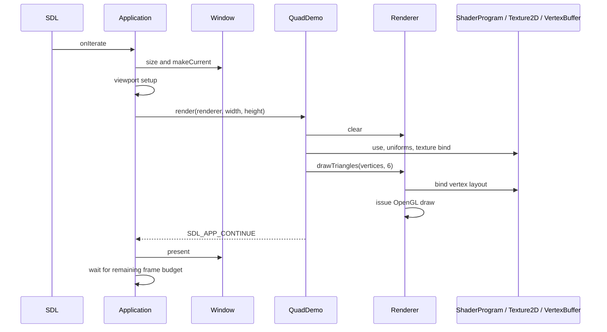
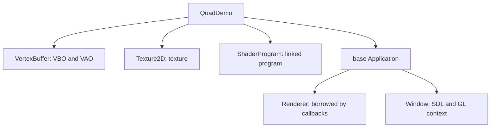

# Rendering guide

Frostwind is OpenGL-focused. Resources call OpenGL directly inside the engine, while examples select assets, shader parameters, and geometry through engine classes. Start with the buildable [Textured Quad example](../examples/01-textured-quad/README.md); this guide shows its flow rather than duplicating its complete source.

See [development](development.md#configure-build-and-run) for commands, [project structure](project-structure.md) for ownership, and [RFC 0006](rfcs/0006-opengl-focused-rendering.md) for the design decision. The [roadmap](../ROADMAP.md#current-focus---opengl-scenes) records the learning sequence.

## Follow the example

- [main.cpp](../examples/01-textured-quad/main.cpp) supplies the SDL adapters, factory, and configuration.
- [QuadDemo.h](../examples/01-textured-quad/QuadDemo.h) declares the persistent resource owners.
- [QuadDemo.cpp](../examples/01-textured-quad/QuadDemo.cpp) loads resources, caches uniforms, handles Escape, and draws.
- [quad.vert](../examples/01-textured-quad/assets/shaders/quad.vert) and [quad.frag](../examples/01-textured-quad/assets/shaders/quad.frag) declare vertex inputs, `uScale`, and `uTexture`.

```text
QuadDemo : Application
├── VertexBuffer
├── Texture2D
├── ShaderProgram
├── initialize() → create resources and cache uniform locations
├── handleEvent() → Escape handling
└── render(renderer, width, height) → clear, calculate scale, activate, bind, draw
```

`Application` owns one persistent Renderer, initializes Window before the example, passes Renderer by reference, and presents after a continuing render callback. Width and height are current drawable pixels. The example never polls a second event loop or calls a native swap operation.



Returning success or failure skips presentation. Exceptions are caught at SDL callback boundaries. Check each rendering operation; ignored failures are not automatically latched by a frame object.

## Class reference

| Class or functions | When to use | Main operations |
| --- | --- | --- |
| [Application](../engine/src/app/Application.h) | Host an example with SDL callbacks | Override `initialize`, `handleEvent`, `render(renderer, width, height)` |
| [Window](../engine/src/platform/Window.h) | Own the SDL window and current GL context; normally Application handles it | `initialize`, `pixelSize`, `makeCurrent`, `present` |
| [ShaderProgram](../engine/src/rendering/ShaderProgram.h) | Link and activate vertex/fragment shaders and update uniforms | `initializeFromFiles`, `use`, `uniformLocation`, `setInt`, `setFloat`, `setVec2/3/4`, `setMat4` |
| [Texture2D](../engine/src/rendering/Texture2D.h) | Upload RGBA8 or load PNG/JPEG and select a texture unit | `initializeRGBA8`, `initializeFromFile`, `bind` |
| [VertexBuffer](../engine/src/rendering/VertexBuffer.h) | Upload vertex storage/layout; select it when needed | `initialize`, `bind`, `vertexCount` |
| [Renderer](../engine/src/rendering/Renderer.h) | Borrow during the callback to clear and submit draws | `clear`, `drawTriangles` |
| [Image](../engine/src/rendering/Image.h) | Decode pixels independently of OpenGL | `load(path, maxDimension)`, `width`, `height`, `pixels` |

## Create resources once

```text
initialize():
    resolve this example's asset paths
    vertices.initialize(vertex bytes, stride, float attribute layout)
    texture.initializeFromFile(crate path)
    program.initializeFromFiles(vertex shader path, fragment shader path)
    cache uScale and uTexture locations; fail if required uniforms are missing
    program.use()
    program.setInt(texture location, 0)
```

Constructors do not create GL objects. `initialize()` runs after context creation and GLAD loading. Successful resource initialization is one-time; failure cleans partial objects and permits retry. File paths are supplied by the example, relative to the executable's copied `assets/`, rather than selected by the engine.

## Draw each frame

```text
render(renderer, width, height):
    renderer.clear the color target
    calculate square scale from drawable pixels
    activate the shader program and set uScale
    bind the texture on unit 0
    renderer.drawTriangles(vertices, 6)
    return continue if all operations succeeded
```

The actual draw portion uses these ordinary engine operations:

```cpp
program_.use();
program_.setVec2(scaleLocation_, scaleX, scaleY);
texture_.bind(0);
renderer.drawTriangles(vertices_, 6);
```

This short excerpt omits failure handling; the linked example checks every result. `Renderer::clear(Color)` changes the target's pixels; `Renderer::drawTriangles` submits geometry. VertexBuffer owns storage/layout and never draws itself. Program and texture bindings remain active until changed. There is no pipeline object or opaque parameter-byte block. The quad's two scale values map directly to GLSL `uniform vec2 uScale`.

## Use more than one shader program

Geometry does not own a shader. Two objects can share the same vertex buffer and use compatible programs:

```text
object A → program A.use() → A uniforms/textures → renderer.drawTriangles(shared vertices, count)
object B → program B.use() → B uniforms/textures → renderer.drawTriangles(shared vertices, count)
```

Cache uniform locations separately for each linked program, even when names match. Call that program's `use()` before its setters. Missing or optimized-out uniforms return -1; setters reject -1. An integer location is local to its program and must not be reused with another program. The active-program guard does not prove that a supplied integer originated from that program.

Match vertex attribute locations/components to each shader's inputs. Match uniform setters to the declared GLSL types: integer for a sampler/unit, float/vec2/vec3/vec4 for those values, and `setMat4` for sixteen column-major floats. Matrix/light semantics belong to the scene/shader; no math library is required by these setters. The current engine does not automatically reflect and validate arbitrary vertex layouts or build materials.

## Resource lifetime



Application supplies the same Renderer instance each callback; it needs no initialization, has no GPU resources, and does not retain geometry or frame references. Do not retain the borrowed callback reference. Derived members are destroyed before the base Renderer and Window. GPU destruction must happen with the creating context still current. Outside Application, declare Window before GPU owners and keep them in a scope that ends first. Each resource checks its recorded context; it does not switch contexts or keep Window alive. Cross-context operations fail. Using resources after context destruction is a lifetime error, not a supported recovery path.

CPU `Image` loading needs no context. GPU uploads and shader compilation require both the current context and loaded GLAD. All current operations run on SDL's callback thread.

## Limits and troubleshooting

| Symptom or requirement | Check |
| --- | --- |
| Resource initialization fails | Window/context and GLAD must be ready; inspect the logged GL/file/compiler diagnostic |
| Uniform update fails | Activate the correct program, use its cached location and matching setter, and check for an optimized-out declaration |
| Geometry is wrong or invisible | Verify float attribute location/component count, offsets/stride, shader inputs, triangle range, and active program |
| Texture is wrong | Match sampler integer to the bound texture unit; pixels use RGBA8 and a bottom-left UV origin |
| Quad stretches | Compute scale from current drawable pixels, not logical window size |
| Vertex draw fails | Count must be nonzero, divisible by three, and within initialized vertex storage |
| Cleanup reports the wrong context | Destroy resources before Window and keep that context current |
| Need depth, indices, instancing, or other sampling | These are not implemented yet; add them for a concrete example |

PNG/JPEG decoding, nearest/clamp-to-edge RGBA8 textures, float vertex attributes, triangle lists, and vertex/fragment GLSL programs are implemented. Camera, lighting systems, depth/stencil storage, indexed/instanced geometry, other backends, and browser builds remain future work. Continue with the small 3D scene in the roadmap; preserve Textured Quad and both scaffolds as the engine grows.
