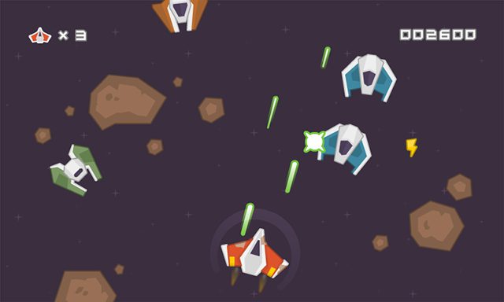

# RFC 0005: 2D camera, keyboard/mouse input, and sprites for Asteroids

- **Status:** Draft
- **Created:** 2026-10-14
- **Supersedes:** None
- **Superseded by:** None

## Problem

The textured-quad example renders directly in clip space using a viewport-dependent scale. It has no world-space camera, reusable sprite drawing, held-key state, or elapsed-time update callback. Escape handling demonstrates individual keyboard events, but smooth movement needs input state and frame timing.

The next implementation should make heading-relative ship movement, automatic camera following, and sprite transforms visible in a new Asteroids example alongside Textured Quad while preserving the engine/example boundary established by [RFC 0003](0003-frostwind-engine-and-examples.md). The FPS limiter in [RFC 0004](0004-frame-pacing.md) controls callback throughput; it does not provide movement timing.

## Goals and scope

- Add a GLM-backed orthographic `Camera2D` with world position and drawable viewport sizing. Asteroids follows the ship automatically at fixed rotation 0 and zoom 1; camera manipulation and its interactive validation belong in a separate example.
- Keep floating-point world coordinates and use pixel units: one world unit maps to one drawable pixel at zoom 1 with zero camera rotation.
- Track keyboard held/pressed/released state through SDL’s existing event callbacks and retain mouse position for world-space ship aiming.
- Supply elapsed seconds to example updates so camera and sprite movement are independent of the configured FPS cap.
- Add a reusable immediate sprite renderer using existing shader and texture resources.
- Add an example-owned scrolling starfield with subtle parallax to make camera movement and depth readable.
- After the baseline renderer works, prototype normal-mapped lighting on one ship and one asteroid to evaluate the preferred detailed art direction before producing a complete asset set.
- Add a separate Asteroids example to demonstrate mouse heading, heading-relative keyboard movement, automatic camera following, resizing, and overlapping sprites. This sprint uses an Asteroids-themed scene to validate engine behavior. A fully functional game is not a required outcome. Retain Textured Quad as the minimal shader/texture example.

This sprint does not implement thrust/inertia simulation, asteroid motion or splitting, bullets, collisions, screen wrapping, scoring, lives, restart rules, physics integration, fixed-step simulation, terrain, sprite animation, atlases, batching, an entity/component system, input rebinding, text input, mouse buttons/wheel/capture, a 3D camera, or another graphics backend. Browser integration remains pending. Fixed world-height camera sizing can follow when an example needs it.

## Proposed design

The [Asteroids README](../../examples/asteroids/README.md) is the example’s concept/status entry point; its planning artwork and provenance live under `examples/asteroids/docs/assets/`, separate from future runtime assets.

### Ownership and dependencies

| Location | Proposed responsibility |
| --- | --- |
| `engine/src/camera/Camera2D.h`, `.cpp` | Camera properties and matrix calculations, independent of SDL and OpenGL |
| `engine/src/input/Keyboard.h`, `.cpp` | Keyboard state and SDL keyboard/focus event interpretation |
| `engine/src/input/Mouse.h`, `.cpp` | Minimal cursor position/validity state from SDL mouse/window events |
| `engine/src/app/Application.h`, `.cpp` | Input coordination, monotonic update timing, and existing frame pacing |
| `engine/src/rendering/SpriteRenderer.h`, `.cpp` | Shared quad geometry, shader ownership, transforms, and sprite draws |
| `engine/src/rendering/ShaderProgram.h`, `.cpp` | Matrix and color uniform setters needed by sprites |
| `examples/asteroids/` | Camera instance, controls, ship/asteroid placement, texture ownership, shader assets, and scene clear; future Asteroids gameplay |
| `external/glm/`, `cmake/GLM.cmake` | Pinned local GLM headers and a shared interface target |

The Asteroids directory currently contains its planning README and documentation artwork only. Code, runtime assets, and CMake target paths above remain proposed; create them as implementation needs them. Engine types use namespace `frostwind` and primitive aliases where appropriate. Use GLM vectors/matrices directly rather than wrapping them in another math library.

Import an exact GLM release/commit with its license and `README.integration.md`, following [RFC 0001](0001-local-dependencies.md) and the [local dependency policy](../../external/README.md). Select and record the exact revision during implementation before importing files. Use a local CMake interface target, exposed transitively because camera/rendering headers use GLM types. Do not download dependencies during configuration. Keep GLM compile definitions consistent across the engine and consumers; avoid aligned or experimental types without a concrete need.

### Camera coordinates and projection

The camera has a floating-point world-space center (`glm::vec2`) and positive drawable width/height (`int`). In Asteroids, camera rotation is fixed at 0 and zoom at 1. World axes are +X right and +Y up; sprite heading is measured counterclockwise in radians from +Y. The camera follows the ship center immediately, without smoothing, so ship movement scrolls the world and background. No manual camera controls are exposed.

For drawable size `W × H`, orthographic bounds relative to the camera center are:

```text
left   = -W / 2     right = W / 2
bottom = -H / 2     top   = H / 2
```

Use GLM's orthographic projection with an explicit right-handed, OpenGL negative-one-to-one depth convention and near/far bounds `-1` and `1`. Sprites initially lie at world Z = 0.

```text
view       = translate(-camera.x, -camera.y, 0)
projection = ortho(left, right, bottom, top, -1, 1)
clip       = projection * view * model * localVertex
```

Expose position access, viewport sizing, and view/projection/view-projection matrix access. Matrix calculations require no graphics context. Reject non-finite positions and invalid viewport sizes without replacing valid state; return a failure result for invalid setters. Reject inputs that produce non-finite projection bounds or matrices. Camera rotation/zoom extensions and interactive pan/rotate/zoom coverage are deferred to a separate example; they are not acceptance requirements for Asteroids.

At an 800 × 600 drawable viewport, the camera covers 800 × 600 world units. A 64 × 64 sprite covers 64 × 64 drawable pixels. As the camera follows a ship moving right, stationary world objects move left on screen. Resizing reveals more or less world instead of scaling existing sprites to fit; use explicit sprite world sizes rather than Textured Quad’s viewport-relative sizing.

Use `Window::pixelSize` for both `glViewport` and camera sizing. Retina drawable pixels differ from logical window coordinates; this mode is deliberately measured in drawable pixels. Mouse-to-world aiming must use explicit coordinate conversions. Fractional positions remain valid for smooth motion. Pixel units do not imply pixel snapping: crisp pixel art additionally needs suitable texture filtering and aligned edges. Automatic snapping is deferred.

### Keyboard events and state

`Application` owns one `Keyboard` state for its window and exposes read-only access to derived examples. Update this state in `onEvent` before delegating to the example's `handleEvent`. Preserve the existing raw SDL event callback and engine quit/close handling; do not add another event pump or poll loop.

Provide `isDown`, `wasPressed`, and `wasReleased` queries indexed by `SDL_Scancode`. Physical scancodes define movement controls independently of keyboard layout. SDL types stay at this input boundary; no full engine key-enum mapping is needed yet.

- A transition from up to down sets held and pressed state. Repeated key-down events do not create another press or affect movement speed.
- A transition from down to up clears held state and sets released state.
- A down/up pair between updates preserves both edge flags even though the final held state is up.
- Clear edge flags after the update that consumes them, while retaining held state.
- On window focus loss or minimization, release held keys so missing key-up events cannot leave movement stuck. Ignore keyboard presses while inactive until focus is regained. Regaining focus starts from cleared state.
- Ignore unknown/out-of-range scancodes safely. State represents the application's combined keyboard input; per-device tracking is deferred.

Movement is derived from held state once per update. Example-specific bindings, movement speeds and automatic camera-follow behavior stay in the example. One-shot commands use press edges rather than OS key repeat. Text entry remains a separate future input concern.


### Mouse position and ship aiming

Track the absolute cursor position in logical window coordinates through SDL’s callback flow, with a validity flag for the active window. `Application` exposes read-only cursor state and current logical/drawable dimensions to the derived example before update. `Window` remains responsible for querying those dimensions without exposing its native handles. Refresh the camera viewport before computing the aim target, including the first frame and after resize.

The mouse sets the ship’s logical +Y heading. WASD translates relative to that heading: W forward, S backward, A strafe left, D strafe right. The camera follows automatically at fixed rotation and zoom. Escape quits; these are the only example controls. Mouse-button input, shooting, wheel zoom, pointer lock, and an input action system are outside this scope.

For logical window size `Lw × Lh`, drawable size `W × H`, and logical cursor `(mx, my)` with top-left origin:

```text
px = mx * W / Lw                 py = my * H / Lh
ndc = (2 * px / W - 1, 1 - 2 * py / H)
world = inverse(projection * view) * (ndc.x, ndc.y, 0, 1)
target = world.xy / world.w
heading = atan2(target.y - ship.y, target.x - ship.x) - pi / 2
```

This formula assumes the full-window viewport and symmetric Z bounds specified by this RFC. It explicitly accounts for high-DPI scaling and the window/world Y-axis difference. Convert dimensions to floating-point before division. At the start of each update, refresh the viewport and center the camera on the current ship position, then compute mouse heading. Apply keyboard movement using this heading, and recenter the camera on the new ship position before rendering. Recompute aiming each active update even without a new mouse event so automatic following and resize do not leave a stale target. Keep any texture-specific visual orientation offset separate from the logical heading.

Retain the previous heading for a cursor coincident with the ship (within a small world-space epsilon), invalid/non-finite input, invalid sizes, or an unavailable cursor. Invalidate on focus loss, minimize, or pointer leave; reacquire the current position through platform input handling on enter/focus return before resuming aiming. Do not snap to a default heading or use a stale position. Initial state is invalid until a current cursor position is known.

Mouse state/conversion facilities are reusable engine concerns; the choice to point a ship at that world position is example behavior. Keep coordinate conversion independent of an OpenGL context and test it numerically. No extra SDL polling loop is introduced.

### Frame timing and callback order

Add an optional protected `update(f32 deltaSeconds)` callback returning `SDL_AppResult`, with a default result of `SDL_APP_CONTINUE`. Keep `render(width, height)` for rendering and propagate update success/failure before attempting a draw. Handle update exceptions at the existing callback exception boundary.

Measure delta from successive active frame starts using the monotonic nanosecond clock and `u64`. This includes prior rendering, swap waits, software pacing, and SDL event processing; do not use only the time spent rendering. The first active update receives zero. Clamp update delta to 0.1 seconds after a stall to avoid a large ship/camera jump; this deliberately discards excess movement time and is not a physics policy.

An active callback follows this order:

1. Query drawable size and establish the frame's start timestamp.
2. Calculate update delta and make keyboard state, valid cursor state, and current logical/drawable dimensions available.
3. Invoke the example update; consume keyboard edge flags.
4. Invoke rendering with the current drawable dimensions. The example reuses the camera viewport/matrices already refreshed for update and mouse aiming.
5. Present and apply the remaining frame budget from RFC 0004.

Preserve pacing measurement across the complete callback, including drawable queries and updates. When minimized or zero-sized, skip update/render/presentation, retain the idle wait, discard pending key edges, and invalidate the update timestamp. The first frame after restoring receives zero delta. Focus loss also resets the update timestamp and pauses example movement until focus returns; visible unfocused windows may continue rendering. Pacing and movement delta serve separate purposes and must not share a single elapsed-time calculation.

### Sprite rendering

Introduce `SpriteRenderer` as an OpenGL resource owner with empty construction, explicit fallible initialization, private handles, disabled copying, and cleanup while the context remains current. Reuse one shared centered unit quad, with local bounds `[-0.5, 0.5]`, and bottom-left UV origin. The example passes explicit shader paths to initialization, preserving engine independence from example assets.

A draw call borrows a `Texture2D` and receives camera matrices plus sprite position, positive size in world units, Z rotation in radians, and RGBA tint (white by default). Keep the initial sprite description as a small value struct rather than a scene object or resource manager. Textures outlive the draw calls that borrow them. Draw the full texture; subregions and UV flipping can be introduced with an atlas example later.

Build the model matrix as `translate(position) * rotateZ(rotation) * scale(size)`. Add the required `ShaderProgram::setMat4` and color setter, retain cached uniform locations, and upload GLM matrices without transposing them. The vertex shader uses `projection * view * model`; the fragment shader multiplies the sampled RGBA texture by tint. Validate finite transforms and positive dimensions before drawing; invalid sprite values skip the draw with a diagnostic.

Use straight-alpha source-over blending with separate color/alpha factors so transparent RGBA textures compose correctly. Disable depth testing and face culling for this initial 2D pass. Sprites draw in submission order, with later sprites appearing over earlier ones. The renderer establishes and documents the GL state/bindings needed for its pass; it is not a general state-preserving wrapper. No batching or sorting is required.

The new example owns viewport setup, background clearing, textures, and camera state. Add a derived `AsteroidsDemo` that calls `SpriteRenderer` in `examples/asteroids/`. Give it a separate `frostwind-asteroids` executable using the existing example packaging helper. Its shader and texture assets live in its own `assets/` directory with an `assets/LICENSES.md` record. Derived GPU members continue to be destroyed before the base window/context. Keep `QuadDemo`, `QuadRenderer`, the crate texture, and their existing executable as the minimal shader/texture example; shared application API changes must retain its behavior.

### Example controls and visible behavior

The first Asteroids scene renders a movable directional ship and several stationary asteroid sprites at distinct world positions, including an overlapping tinted instance, so panning, zoom, rotation, and draw order can be inspected. These asteroids are visual landmarks in this sprint. Keep texture dimensions and world dimensions explicit, and demonstrate native-size rendering at zoom 1.

### Original sprite plan and retained pack reference

For the initial unlit foundation, use a small selection of standalone transparent PNGs from [Kenney’s Space Shooter Remastered](https://kenney.nl/assets/space-shooter-remastered), whose upstream page lists a CC0 license. These pack assets provide a baseline while the separate normal-map prototype evaluates custom detailed sprites. The directional ship and rock silhouettes provide useful subjects for transform and alpha validation without introducing animation or an atlas loader.

The owner supplied the following pack example as the visual reference on 2026-10-14:



*Third-party pack example supplied by the owner, associated with Kenney’s Space Shooter artwork. This is a design reference, not a screenshot of Frostwind or an implemented Asteroids example. Attribution is recorded in the [Asteroids image inventory](../../examples/asteroids/docs/assets/README.md).*

The original unlit art plan remains below as a baseline reference. The preferred visual exploration is now the detailed normal-mapped approach in the next section. The baseline uses the pack’s top-down, flat geometric style: angular light ship hulls with colored panels and dark cockpits, faceted brown rocks, and a muted plum space background. Source the individual sprites from the pack rather than extracting them from this reference image. The intended first scene is:

- **Ship:** use an orange-accented, light gray/white craft like the foreground player ship in the supplied reference, with a dark cockpit, clear nose, and visible rear engines. Its logical forward direction is +Y at zero rotation; aim for roughly 48–64 world units across. Blue/teal variants like the reference’s other ships can serve as later secondary objects. Choose exact supplied PNGs after inspecting the pack; filenames and dimensions are not yet selected.
- **Asteroids:** two or three irregular brown rock variants with darker outlines and broad lighter facets, matching the supplied reference. Draw instances at small, medium, and large world sizes and different rotations; keep at least one instance at its source-pixel size for scale validation. Avoid a uniform circular silhouette that hides rotation.
- **Background:** retain the muted dark plum clear color as the original baseline/reference. The updated scene adds sparse scrolling star layers with subtle parallax as specified below. Particle effects and animated engine flames remain deferred.
- **Composition:** a centered ship, rocks distributed beyond the initial viewport to expose panning, and a deliberate overlap to inspect tint, transparency, and submission order. The reference’s bullets, impact flashes, shield ring, pickup, lives display, and score illustrate later gameplay direction; they are outside this sprint.

Asset preparation during implementation:

1. Retrieve the upstream archive, inspect the individual PNGs and included license, and select one ship plus two or three rocks. Record the source URL, archive identity/checksum, pack version if supplied, and original filenames.
2. Import only the selected textures and license under `examples/asteroids/assets/`. Record exact original-to-local filename mapping and all modifications in `assets/LICENSES.md`, keeping third-party licensing separate from the project code license.
3. Preserve the supplied RGBA artwork, dimensions, and transparent padding initially. Choose the sprite's world size explicitly from its texture dimensions/aspect ratio. If the supplied ship faces a different axis, apply a documented example-owned visual rotation offset so its logical forward direction remains +Y; do not change the engine's UV convention.
4. Reuse the existing bottom-left decoding convention and nearest texture sampling. Validate ship orientation, transparent edges, tint, and native-size rendering in the new example. Do not add sprite sheets, generate mipmaps, or import unused pack files.

The supplied archive shortlist and source dimensions are recorded below; final imports and gameplay sizes remain to be chosen. Future custom artwork can replace these textures through the same asset interface without changing camera or renderer behavior.


### Supplied archive inspection (2026-10-14)

The owner supplied `kenney_space-shooter-remastered.zip`. Its SHA-256 is `0edbe0ab5cda6c44901d8c42f150268fdfa0c8d48492098669f37e9c296929b5`. Inspection found 314 files, including 301 PNGs (individual sprites, backgrounds, a sheet, and previews), vector artwork, fonts, sounds, and `license.txt`. The included license identifies Kenney Vleugels and CC0. The archive's `sample.png` matches the preserved owner reference pixel-for-pixel, although the PNG file bytes differ.

Candidate baseline sprites inspected from this archive:

| Original archive path | Dimensions | Role |
| --- | --- | --- |
| `PNG/playerShip1_orange.png` | 99 × 75 | Recommended initial ship; compact white center hull and orange side wings |
| `PNG/playerShip2_orange.png` | 112 × 75 | Alternate broad swept-wing ship |
| `PNG/playerShip3_orange.png` | 98 × 75 | Alternate triangular ship |
| `PNG/Meteors/meteorBrown_big1.png` | 101 × 84 | Large asteroid variant |
| `PNG/Meteors/meteorBrown_big2.png` | 120 × 98 | Large irregular asteroid variant |
| `PNG/Meteors/meteorBrown_med1.png` | 43 × 43 | Smaller asteroid |

The recommended ship and listed asteroids are RGBA PNGs with transparent pixels. Ship designs face upward in image space, consistent with logical +Y after the engine's existing image decoding/UV convention. Use original texture dimensions for the native-size validation; the earlier 48–64-unit ship target is an optional gameplay scale rather than a source-file dimension.

Only inspection copies were extracted under ignored `build/space-shooter-inspection/`; runtime assets have not been imported. Preserve the bundled license and original-to-local filename mapping when importing the final subset. No normal maps, height maps, or 3D models are supplied in this archive. The vector sheet may provide source shapes for authoring, but does not encode surface geometry; matching normal textures still require the separate prototype workflow.

### Game concept and preserved art iterations

The scene takes its visual/gameplay inspiration from a top-down Asteroids-style space arena: an orange-accented player spacecraft navigates a field of rocky asteroids, with thrust, turning, weapons, waves, and scoring as optional later experiments rather than required features. Keep positions, collision rules, and camera projection in 2D; a detailed shaded appearance does not require runtime 3D models. Blue/teal secondary ships, shields, pickups, and HUD elements in these concepts are possible later additions, not committed gameplay requirements for this sprint.

Retain all three visual references, without overwriting the original pack scene:

| Reference | Role |
| --- | --- |
| Original Kenney pack scene above | Composition, ship colors, object readability, and original unlit asset baseline |
| Realistic concept v1 below | Preferred material/detail target: metal panels, dark cockpit glass, rocky craters, and restrained emissive accents |
| Softer concept v2 below | Preserved comparison: softer baked shading was explored but did not meet the owner’s visual preference |


*Generated concept v1, 2026-10-14: detailed ships and rocky asteroids based on the owner-supplied pack scene. Retained as a material and composition reference. This image is not a Frostwind screenshot or a set of usable runtime sprites.*


*Generated concept v2, 2026-10-14: softer overhead lighting and simplified shading. Preserved as an explored alternative; it is not the selected final art style or a rendered normal-map test.*

The current direction is to retain v1’s richer surfaces while making lighting controllable at runtime. Neither generated scene contains a usable aligned normal-map set. [Individual transparent ship and meteor prototypes](../../examples/asteroids/docs/assets/asteroids-sprites/README.md) were subsequently generated and preserved with their prompts; they retain baked shading and do not supply matching normals. Do not extract already lit sprites from these scene images and treat them as lighting-neutral base color.

### Detailed sprite art style

Use the [generated player ship](../../examples/asteroids/docs/assets/asteroids-sprites/player-ship-v1.png) and [generated meteor](../../examples/asteroids/docs/assets/asteroids-sprites/meteor-v1.png) as the latest individual art references. Preserve these prototypes and the older pack/scene versions unchanged; new asset revisions get separate filenames.

The target is detailed, semi-realistic science fiction rendered as 2D sprites, with a strict overhead orthographic view. Ship design uses an off-white central fuselage, burnt-orange wings, a dark blue-charcoal cockpit, shallow beveled panels, restrained wear, and readable engine housings. Rocks use asymmetrical chipped silhouettes, warm gray-brown stone, broad surface plates, fissures, and craters. Keep strong large shapes readable at gameplay size rather than relying on fine surface noise. Blue/teal accents may distinguish later secondary ships.

Retain the realistic concept’s material richness. The softer painted concept is a comparison reference, not the target. Achieve controllable shading with matching base color and normals instead of painting a fixed cinematic light into every sprite. Start with ambient and diffuse lighting; reflective cockpit/metal highlights need a later validated specular response, not bright patches baked into base color. Transparent sprite silhouettes, a sparse dark space backdrop, and restrained emissive accents should keep gameplay readable.

### Scrolling background and parallax

Add a lightweight background pass owned by `AsteroidsDemo`, drawn before ships and rocks. Start with a seamless sparse star texture over the plum-charcoal clear color; optionally add a second sparse layer to strengthen depth. Stars remain unlit and do not use normal maps. Bright nebulae, dense debris, motion blur, and particles are outside this experiment.

Tie scrolling to camera/world movement rather than advancing a fixed number of pixels per rendered frame. For camera center `C`, render a distant layer with an effective center `f * C`, where a small factor such as `f = 0.15` makes it shift by `-0.15 * deltaC` while foreground world objects shift by `-deltaC` at fixed camera rotation and zoom. A second layer may use `f = 0.3`. Keep stars stable when the camera is stationary. The camera follows ship translation automatically, so travel scrolls the scene without a player camera control. Keep any extra ambient drift out of the initial implementation; motion derives from world travel.

Use the fixed camera scale and apply the layer center once, without translating it twice. Keep foreground asteroids at their actual world positions; parallax belongs only to decorative distant layers and must not change collisions or arena wrapping. Explain that these factors are artistic depth cues in an orthographic 2D scene rather than perspective geometry.

Tile enough background quads to cover the viewport during ship following, and derive stable tile positions/indices from the effective layer center. Use matching opposite texture edges and positive modulo/floor handling for negative positions so crossing a tile boundary does not pop, jump, or expose a seam. World/UV offsets must wrap without changing the visible pattern. The current texture wrapper uses clamp-to-edge: prefer repeated quads for this small example instead of silently changing global texture sampling. Any later repeat-sampler API needs its own explicit contract. Recompute coverage on viewport resize and update tile positions as the ship/camera moves. Fixed zoom keeps coverage bounded for a given viewport.

Use validation fixtures or configuration to compare parallax and plain backgrounds; do not expose a toggle binding. Check scroll direction and speed at 30/60/120 FPS, stationary-ship stability, negative camera coordinates, repeated tile crossings, wide/tall/Retina viewports, and complete coverage without distracting stars. This remains a small example-specific layer implementation, not a general parallax engine system.

### Normal-mapped sprite lighting prototype

After the camera/input/unlit sprite foundation works, build a small experiment with one ship, one asteroid, and controlled light directions supplied by validation fixtures or configuration. Do not add player-facing light controls. Judge actual rotation and relighting before deciding on production assets or extending the general renderer. Keep an unlit fallback and an unlit/lit comparison in the example.

Each test sprite uses matching standalone textures with identical dimensions, padding, UVs, and orientation:

- **Base color plus alpha:** paint, metal/rock color, and silhouette with minimal baked directional light or specular reflections. Existing alpha blending still defines the silhouette.
- **Tangent-space normal map:** bevels, hull panels, craters, and surface slopes. Decode RGB from `[0, 1]` to `[-1, 1]`, then normalize. A flat normal points along +Z toward the viewer; +X follows U right, +Y follows V up. Declare the green-channel convention explicitly and validate it with a known sloped surface.
- **Optional emission mask:** cockpit/engine lights independent of diffuse illumination; animated flames remain separate later work. Roughness/specular maps can follow if the diffuse prototype establishes a useful result.

Start with ambient plus one directional diffuse light, using a normalized world-space direction toward the light and `max(dot(normal, lightDirection), 0)`. Sweep the direction in a focused validation fixture; point lights, shadow casting, and a full PBR material system are deferred. Uniform-scale test sprites are sufficient initially. Rotate local normals into world space with the sprite’s Z rotation, including any visual orientation offset. Ship rotation and camera translation must not rotate the world light. Declare the matrix policy before supporting nonuniform scaling or mirrored UVs.

Normal data must be sampled as linear values, not sRGB color. Perform illumination in linear color space with an explicit base-color decode/output encode policy. The current `Texture2D` only supports RGBA8 uploads; choose and document shader conversion or explicit texture/framebuffer format support during implementation, avoiding duplicate gamma conversions. Start without mipmaps and check filtering of color and normal textures together; use a known flat normal for sprites without a normal map. Keep existing bottom-left image decoding consistent for both textures; do not guess channel inversion based on how a normal PNG looks.

The engine owns the reusable shader/material behavior introduced by the prototype. The example owns its assets, configured light settings, and scene. Do not add a backend hierarchy, deferred renderer, or generic lighting manager for this experiment. The basic unlit `SpriteRenderer` contract remains available; settle the smallest optional normal-texture/light interface after the experiment.

The preferred asset workflow uses one common source per sprite:

1. Use the generated ship and meteor as design references to model simple hull panels/bevels or rock shapes/craters offline.
2. Project/bake their visible surface detail onto a flat sprite plane from a fixed overhead orthographic view. Normals must be expressed in the sprite plane’s tangent basis, not left in the source mesh’s unrelated UV tangent bases.
3. Export aligned lighting-neutral base color, tangent-space normals, and silhouette alpha with identical framing, dimensions, padding, and UVs. Keep direct/indirect light and specular reflections out of base color. Record bake settings and channel conventions.
4. Check texture alignment and known surface directions, then inspect stationary sprites under an adjustable light and rotating sprites under a fixed world light. Recheck at intended gameplay size.

An authored height map converted to normals is an alternative for simpler hull panels or rock relief. Height values represent physical surface height; do not use color-image brightness as geometry, since paint, cockpit reflections, and shadows do not uniquely determine height. Independently AI-generated normals are exploratory estimates and require the same validation; they are not a substitute for a matched source bake.

Offline 3D asset authoring does not introduce runtime 3D gameplay. The current generated sprites retain baked highlights and shadows; they are visual prototypes, not finished relightable base-color maps. Strongly shaded pack/concept artwork may serve as reference or unlit fallback, but is unsuitable as-is for clean relighting. Record tools, source files, licenses, bake settings, and modifications for custom assets.


#### NormalMap-Online as an offline prototype tool

[NormalMap-Online](https://cpetry.github.io/NormalMap-Online/) is a candidate height-to-normal generator for the authored-height-map route. Its documentation describes height-map input, strength, blur/sharpen and channel/height inversion controls, a live preview, and normal-map download. Processing runs in the browser. This is an offline asset-preparation option, not a dependency to vendor into Frostwind or invoke at build/runtime.

For a quick comparison, importing a generated color texture directly can yield an approximate bump map, but the tool cannot infer reliable geometry from paint color, reflections, and baked shadows. Label such output as an approximation. Prefer preparing a matching grayscale height map with explicit raised hull panels/bevels or rock relief/craters, then use the tool to derive normals. Preserve original dimensions, silhouette mask, padding, and orientation; avoid deriving a false raised edge from transparent/background pixels.

Record the input file/checksum, tool/source revision if available, output dimensions, strength, smoothing/filter settings, and every inversion setting with the generated asset. Validate the green-channel convention and fixed-light sprite rotation in the engine, rather than accepting the browser’s model preview as proof. Inspect gameplay-size output for false paint-shaped bumps, excessive noisy detail, and double lighting. No maps have been generated with this tool or validated yet. The common-source model bake remains the preferred reliable option if an authored-height approximation does not meet the material target.

Normal maps alter surface lighting, not geometry, silhouette, parallax, self-occlusion, or cast shadows. Validate the perceived quality with rotating sprites under a fixed light, then moving the light over a stationary sprite. This experiment must demonstrate that detailed surfaces remain readable at gameplay size without contradictory baked highlights.

| Controls | Example action |
| --- | --- |
| Mouse position | Set ship heading by aiming its +Y nose at the world-space cursor target |
| WASD | W forward, S backward, A strafe left, D strafe right, relative to that heading |
| Escape | Quit |

For a heading `theta` measured counterclockwise from +Y, derive ship-relative movement as:

```text
forward = (-sin(theta), cos(theta))
right = (cos(theta), sin(theta))
move = (W_down - S_down) * forward + (D_down - A_down) * right
```

Opposite inputs cancel. Normalize a nonzero combined vector and multiply by movement speed and delta seconds, so diagonal input is no faster than single-axis input. Resolve mouse heading before movement in each update. Keyboard input does not add a turn angle and mouse input does not move the ship. Retain heading when cursor input is unavailable, allowing movement along the last valid orientation. No thrust acceleration or inertia is required for this direct-translation foundation.

Document only these bindings in the example README. Manual camera pan/rotation/zoom, reset, background toggles, and interactive light adjustment belong outside Asteroids; camera manipulation can be covered in a separate example. Keep any diagnostic comparisons in validation fixtures or configuration.

### Optional follow-up experiments

The example’s purpose and technical success criteria are recorded in the [Asteroids README](../../examples/asteroids/README.md#purpose-and-scope). A complete playable game is not required. After the foundation is validated, optional experiments may extend the same example when they answer another concrete engine question:

1. Introduce fixed-step simulation scheduling as needed, thrust acceleration and inertia, and an example-owned arena with screen wrapping. Define arena bounds independently of camera zoom and viewport size.
2. Add moving asteroids, bullets, and simple circle-based collision checks, followed by asteroid splitting. Keep geometry/simulation independent of the graphics context. A physics library is not required for the initial collision rules.
3. Add score, lives, waves, restart behavior, and optional visual/audio feedback as separate work.

The engine supplies reusable timing, input, camera, texture, and sprite facilities. Ship controls, arena/wrapping rules, asteroid sizes and splitting, bullets, collision responses, scoring, and match state belong in `examples/asteroids/`. Asteroids uses automatic following; a separate example can explore alternate camera behavior and manual manipulation. This draft specifies only the foundation sprint, not the follow-up gameplay contracts.

## Alternatives

- Continue using clip-space scaling in the demo: leaves camera and sprite placement coupled to viewport math.
- Use integer world coordinates: simplifies some pixel-art placement but prevents smooth subpixel movement and is unnecessary for pixel-unit projection.
- Default to fixed visible world height: useful for some games, but does not meet the selected one-unit-per-drawable-pixel behavior. Add it when needed.
- Move the camera directly in each key-down event: depends on key repeat frequency and cannot provide consistent held movement.
- Use SDL's keyboard snapshot alone: held state is convenient, but accumulated press/release edges and synthetic event validation still need explicit policy.
- Add a general renderer, scene graph, or action-mapping system: exceeds the current example's needs.

## Risks and limitations

Introducing public GLM types adds a transitive dependency and requires consistent compile configuration. Camera and sprite changes can expose multiplication-order, handedness, angle-unit, UV-orientation, blending, and high-DPI mistakes. Raw physical controls may differ from printed key labels on other keyboard layouts. Variable delta with a stall clamp is appropriate for this direct-movement example, but must not become an implicit physics timestep. The existing low-FPS pacing wait still limits event responsiveness. OpenGL success does not establish another platform or browser support.

## Validation

No implementation checks have run for this draft. During implementation:

- Build native engine targets, both example executables, and an engine-only configuration from local dependencies. Check GLM provenance/license and transitive includes; configuration must require no dependency downloads.
- Test camera math without a graphics context: viewport corners, centered origin, translation sign, automatic-follow positions, aspect ratio, resize, and rejection of invalid values. At 800 × 600 and zoom 1, a centered 64 × 64 sprite should map to the expected 64-pixel extent.
- Feed keyboard events for down/held/repeat/up, multiple keys, down/up between updates, unknown scancodes, focus loss/regain, and minimization. Verify transitions last one update and movement never sticks after inactivity.
- Test cursor-to-world conversion at viewport center/corners and with unequal logical/drawable dimensions, automatic camera following, resize, and a stationary cursor while the ship moves. Verify mouse heading with ship-relative forward/backward/left/right motion, +Y heading, a coincident target, invalid input, pointer leave/reentry, focus loss/restore, and first-frame sizing.
- Use controlled timestamps to verify first-frame/restore delta, prior swap/pacing time, stall clamping, update results/exceptions, and skipping inactive movement. With synthetic one-second schedules at 30, 60, and 120 updates/sec, verify equal travel at each rate and normalized diagonal speed within floating-point tolerance. Check W/S/A/D at headings 0, 90, 180, and 270 degrees, opposing keys, and changing heading while movement is held.
- Validate sprite matrix upload, texture orientation, tint, submission order, and straight-alpha composition using small known textures and focused GPU readback. Check startup failure/retry, initialization exceptions, partial teardown, and resource destruction while the context is current.
- Test background/parallax motion at several FPS caps, stable stars with a stationary camera, negative positions, tile boundary crossings, and full viewport coverage through automatic following and resize.
- For the lighting prototype, test a flat normal and known tilted normals, sprite rotation under a fixed world light, camera translation, fixture-controlled light direction, texture/alpha alignment, and the color-space policy. Compare lit/unlit output on the ship and asteroid at gameplay size. Record visual findings rather than claiming the generated concepts validate normal mapping.
- Launch both examples from outside the repository to validate their separate packaged assets and retain Textured Quad’s existing behavior. Manually inspect mouse heading, heading-relative WASD movement, automatic following, wide/tall resize, Retina sizing, focus switching, minimize/restore, and Escape/close exit at several FPS caps.

Temporary validation output belongs under ignored `build/`. Meaningful camera/input tests may be added to the repository with explicit CMake integration; there is no established automated suite to assume. Record executed checks and remaining manual checks in development documentation. Screenshots remain owner-supplied; do not capture automatically. Record pending captures in the changelog without declaring a release or numbered milestone.

## Implementation plan

1. Select/import pinned GLM headers, license, and provenance; add the local interface target.
2. Implement `Camera2D` and context-free projection/view tests.
3. Add `Keyboard` and minimal mouse-position state, current window/drawable dimensions, cursor unprojection, and application event integration including inactive-window handling.
4. Add elapsed-time updates while preserving callback results, exception boundaries, and frame pacing.
5. Add matrix/color uniforms and `SpriteRenderer`; add the separate Asteroids target with world-space sprite drawing.
6. Inspect/import the selected Kenney ship and asteroid PNGs with their license/provenance, add the mouse/WASD/Escape control scheme, automatic camera following, and sprite instances, and add the example-owned scrolling/parallax starfield. Update implemented architecture, example READMEs, asset records, and changelog.
7. Execute native/math/input/rendering/lifecycle checks for the foundation.
8. Create matching base-color/normal test assets for one ship and one asteroid, implement the scoped light experiment, and compare live rotation/relighting with the retained concepts.
9. Record actual results, remaining manual checks, and pending owner captures. Choose the production art/material approach from prototype findings before expanding asset work.

## Open questions

- Which common-source asset workflow (orthographic model bake or authored height maps) yields the best normal-map prototype? Final production assets and the optional lit-sprite interface depend on the result.
- Does the diffuse prototype meet the desired material look, or is a small specular/roughness extension justified afterward?
- Which of the inspected ship/asteroid candidates should become the final imported baseline subset? Source paths/dimensions are recorded above; confirm gameplay sizes and any visual orientation offset during integration.
- Which exact GLM release/commit should be pinned? Resolve and record compatibility before import.
- Final public method signatures may be adjusted during implementation while preserving the coordinate, ownership, input, and timing contracts above.

## Decision

Prepared as a draft for the upcoming implementation following the owner’s request, then updated to establish a separate Asteroids example and its sprite plan. The current sprint covers the game’s camera/input/rendering foundation, an example-owned scrolling/parallax background, and a scoped normal-map lighting experiment; further gameplay is optional and a fully functional game is not an expected deliverable. The original pack image and both generated art iterations are retained as references. Camera, keyboard state, update timing, GLM integration, and sprite rendering described here are proposals, not implemented capabilities.

## References

- [GLM manual](https://github.com/g-truc/glm/blob/master/manual.md): upstream matrix, transform, and uniform-upload guidance; verify against the selected pinned revision during implementation.
- [SDL3 keyboard events](https://wiki.libsdl.org/SDL3/SDL_KeyboardEvent): scancode, keycode, and repeat fields; the packaged SDL 3.4.18 headers are authoritative for this repository.
- [SDL3 event types](https://wiki.libsdl.org/SDL3/SDL_EventType): keyboard and window focus events used by the proposed input policy.
- [Unity’s sprite secondary-texture guidance](https://docs.unity.com/en-us/engine/6000.5/manual/unity2d/2d-urp/2d-index/secondary-textures): an existing example of normal maps used with 2D sprite lighting; this RFC does not adopt Unity’s rendering architecture.

- [Blender render baking](https://docs.blender.org/manual/en/4.4/render/cycles/baking.html): upstream color/normal baking guidance for the proposed offline common-source asset workflow.

- [NormalMap-Online](https://cpetry.github.io/NormalMap-Online/) and its [source repository](https://github.com/cpetry/NormalMap-Online): candidate offline height-to-normal tool; prototype output still requires engine-side validation.
