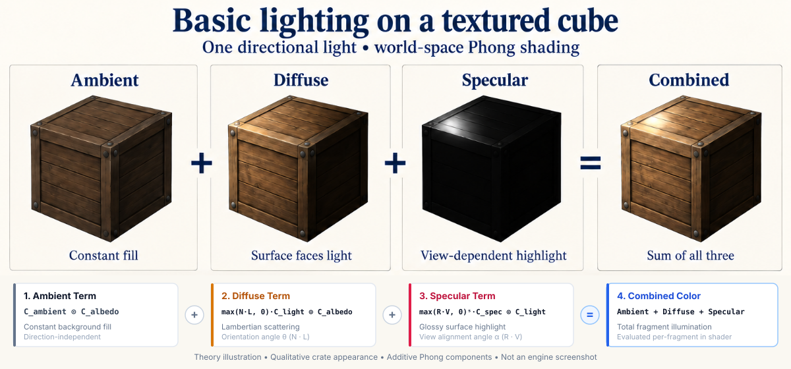

# RFC 0008: Basic lighting theory in Textured Cube

- **Status:** Implemented
- **Created:** 2026-10-21
- **Supersedes:** None
- **Superseded by:** None

## Problem

Textured Cube currently samples a texture without accounting for surface
orientation or camera position. The next step is to learn and demonstrate basic
lighting on this existing scene. Building material, mesh, model, shader-module,
and binding systems at the same time would obscure that learning objective.

This RFC explains lighting theory and proposes applying it directly in the
example. It preserves the engine/example boundary in
[RFC 0003](0003-frostwind-engine-and-examples.md), the direct OpenGL owners in
[RFC 0006](0006-opengl-focused-rendering.md), and the cube/camera foundation in
[RFC 0007](0007-textured-cube-and-perspective-camera.md).

## Goals and scope

- Demonstrate one directional light with ambient, Lambert diffuse, and per-fragment
  Phong specular terms on the existing textured cube.
- Explain face normals, world-space transforms, light direction, camera-dependent
  highlights, specular color, and shininess separately from implementation details.
- Keep light/surface values, uniform locations, face geometry, and shaders in
  `examples/02-textured-cube/`. Upload values directly through ShaderProgram.
- Preserve existing controls, texture sampling, depth/culling, MSAA, pacing,
  lifecycle, asset packaging, and other examples.

Keep C++17, pinned GLM, OpenGL 3.3 Core, and GLSL 330. No new dependencies,
engine classes, renderer APIs, uniform helpers, shader include resolver, built-in
shader library, or engine directory restructuring are part of this work.
Normal maps/tangents, point/spot lights, shadows, PBR, HDR, debug UI, and Asteroids
sprite lighting remain later increments. Broader engine architecture belongs in
[RFC 0009](0009-materials-meshes-and-shader-composition.md).

## Lighting theory

This section explains the lighting model and its inputs. The following
[implementation proposal](#implementation-proposal) defines how Frostwind exposes
those concepts directly in the existing cube example and its shaders.

### Lighting components and illustration



*Generated crate illustrations combined with precise SVG vector diagrams,
not a screenshot of implemented lighting. Crate appearances are qualitative
illustrations, not numerical outputs of the equations
below. The incoming ray and reflected vector are symmetric about `N`, each
at 45 degrees to it. [Illustration record](../assets/lighting/basic-lighting-theory-prompt.md).*

- **Ambient:** constant fill keeps the texture visible without using surface or
  viewing direction. It approximates background illumination.
- **Diffuse:** the angle between the surface normal `N` and surface-to-light
  vector `L` controls brightness. Facing the light gives the largest dot product;
  a perpendicular or back-facing surface receives no diffuse contribution.
- **Specular:** a highlight becomes strongest when surface-to-camera vector `V`
  aligns with reflected light vector `R`. The shininess exponent narrows it.
- **Combined:** add the three contributions. With cube and light stationary,
  orbiting the camera changes specular while ambient and diffuse remain fixed.

The bottom diagrams are two-dimensional slices through a surface point `P`.
All direction vectors used in dot products are normalized. Incoming light rays
point toward the surface, while `L` points toward the source; `N` points outward,
`R` points along the reflected ray, and `V` points toward the camera.

### Directional light and Phong equations

A directional light models parallel rays with one travel direction and no
distance attenuation. If `lightDirection` points from the source toward the
scene, the surface-to-light vector is `L = -normalize(lightDirection)`.
Use the same coordinate space for light direction, surface normal, surface
position, and camera position. A world-space light stays fixed while an object
rotates or the camera orbits.

For normalized surface normal `N`, surface-to-light direction `L`, and
surface-to-camera direction `V`, calculate:

```text
albedo   = surface color at the fragment
ambient  = ambientColor * albedo
diffuse  = max(dot(N, L), 0) * lightColor * albedo
R        = reflect(-L, N)
specular = specularColor * pow(max(dot(R, V), 0), shininess)
           * lightColor                         // only when dot(N, L) > 0
color    = ambient + diffuse + specular
```

Use zero specular when the light is behind the surface. The view direction is
undefined if the camera and surface point coincide, so this case needs handling.
Specular color controls highlight tint and strength independently of base color;
a gray specular color produces a white-light highlight scaled equally in RGB.
Phong here names the reflection-vector specular term, not Blinn-Phong's
half-vector variant. Ambient is an artistic approximation, not indirect light.

### Surface normals and coordinate spaces

A surface normal describes which way a surface faces. For a sharp-edged cube,
each face has its own outward normal; averaging normals at corners would make
it appear rounded. The lighting equations need normalized normals after
interpolation.

With column vectors, object-space position and normal become world-space values
as follows. Here `model`, `view`, and `projection` are mathematical transforms,
not prescribed shader uniform names:

```text
worldPosition = model * vec4(objectPosition, 1)
normalMatrix  = transpose(inverse(mat3(model)))
worldNormal   = normalMatrix * objectNormal
clipPosition  = projection * view * worldPosition
```

The inverse transpose preserves perpendicularity to transformed surface tangents
under nonuniform scale. The linear part of the model transform must be invertible;
a zero scale makes this transformation undefined. Normalize the resulting normal
before using it in lighting calculations.

Phong depends on the final surface normal, regardless of how it was produced.
Vertex normals provide it initially. A normal map can later supply a more detailed
normal, transformed from tangent space into the lighting space, without changing
the Phong reflection equations. Normal mapping and the choice of shading model
are separate concerns.

## Implementation proposal

### Example ownership and affected files

| Existing file | Proposed change |
| --- | --- |
| `examples/02-textured-cube/CubeDemo.cpp` | Add face normals; choose light and surface values; cache/upload uniforms directly |
| `examples/02-textured-cube/CubeDemo.h` | Store additional cached uniform locations and any example settings needed across callbacks |
| `examples/02-textured-cube/assets/shaders/cube.vert` | Produce world-space position, transformed normal, and existing UV |
| `examples/02-textured-cube/assets/shaders/cube.frag` | Sample the crate and calculate ambient, diffuse, and specular lighting |
| Cube README, rendering/development documentation, changelog | Describe actual behavior and validation when implementation is authorized and complete |

Existing VertexBuffer, IndexBuffer, VertexArray, Texture2D, ShaderProgram, and
Renderer are sufficient. No Material, PhongMaterial, Mesh, Model, PhongShader,
DirectionalLight class, or binding adapter is introduced. Use ordinary
example-local values and the existing matrix/vector/float uniform setters.
GLAD/native graphics calls stay in engine implementations as before.

### Geometry and vertex stage

Retain the 24-vertex/36-index cube. Add a three-component outward unit normal to
each vertex. All four vertices on each face share its axis normal; face-specific
vertices preserve sharp edges and existing UV orientation. Keep position at
attribute location 0, UV at 1, and add normal at 2 using VertexLayout.

Keep model/view/projection as the existing mat4 uniforms. The vertex stage
computes world-space values using these formulas:

```glsl
vec4 worldPosition = uModel * vec4(aPosition, 1.0);
vWorldPosition = worldPosition.xyz;
vWorldNormal = transpose(inverse(mat3(uModel))) * aNormal;
vUv = aUv;
gl_Position = uProjection * uView * worldPosition;
```

This deliberately calculates the inverse transpose in the vertex shader for
this small demonstration. It avoids adding a mat3 engine setter or a transform
helper solely for this increment. A later engine design may calculate/upload
normal matrices per object. Keep the model finite, affine, and invertible;
zero scale is unsupported. Negative scales and their culling policy remain
outside the example. Renormalize the interpolated normal in the fragment stage.

### Direct uniform contract

Cache all required locations after linking using ShaderProgram::uniformLocation.
Activate the program before writing its locations. The example supplies:

| Uniform | Type and meaning |
| --- | --- |
| `uModel`, `uView`, `uProjection` | Existing mat4 transforms |
| `uTexture` | Existing crate sampler on unit 0 |
| `uCameraPosition` | vec3, world-space camera position |
| `uLightDirection` | vec3, finite nonzero world-space ray travel direction |
| `uLightColor` | vec3, finite nonnegative RGB color/intensity |
| `uAmbientColor` | vec3, finite nonnegative scene fill |
| `uSpecularColor` | vec3, finite nonnegative highlight tint/strength |
| `uShininess` | float, finite positive Phong exponent |

The implemented scene uses ray direction (0.4, -0.1, -0.6), light RGB 0.8,
ambient RGB 0.192, specular RGB 0.8, and shininess 16. The shallow light angle
and broader highlight are chosen to expose the specular term from the initial
camera view. These fixed values and
the sampler are uploaded once during initialize; only matrices and camera
position need per-frame updates. All locations are cached after linking.

Light direction stays fixed in world space while the cube rotates. Normalize
its negative in the fragment shader to obtain L. Read camera position from the
existing PerspectiveCamera getter each rendered frame so orbit movement changes
the specular term correctly. Surface and light settings are example-local
constants or simple members, not engine material/light types.

The fragment shader evaluates the [theory equations](#directional-light-and-phong-equations)
with sampled crate RGB as albedo, normalized interpolated normal N, and
surface-to-camera direction V. Suppress specular when the light is behind the
surface; use zero specular if the camera coincides with the fragment rather
than normalize a zero view vector. Keep sampled alpha and opaque rendering.

### Frame flow and learning sequence

```text
initialize → upload position/UV/normal vertices and existing indices
           → configure VertexArray → load example texture/shader files
           → cache required uniforms and set sampler unit
update     → existing camera controls, pause/reset, cube rotation
render     → clear color/depth → activate program
           → upload transforms, camera position, light/surface values
           → bind crate texture → drawTriangles(vertexArray)
```

First implement ambient + diffuse to inspect surface orientation, then add
specular with the same program and draw call. Shader-local functions may make
the equations readable, but no cross-file include or source-preprocessing system
is required. The final example demonstrates all three terms. Existing resource
members and teardown ordering stay intact: VertexArray before borrowed buffers
are destroyed, and all example GPU resources before the base Window/context.

## Alternatives

- **Engine lighting/material overhaul now:** establishes reusable architecture
  but expands this step beyond demonstrating the equations. Defer it to the next
  architecture RFC after the small example is working.
- **Separate lighting example:** duplicates cube/camera/asset setup. Extend the
  existing cube for this bounded learning step.
- **CPU normal matrix plus mat3 setter:** reasonable later, but requires an engine
  API change that this cube does not need. Use the GLSL inverse transpose here.
- **Transform normals with mat3(model) alone:** works for rotation/uniform scale
  but fails under nonuniform scale; use the general inverse-transpose rule.

## Risks and limitations

Mixed coordinate spaces, inverted light direction, incorrect normals, or stale
camera uniforms can produce plausible but incorrect shading. Keep world-space
conventions explicit and inspect a paused cube while orbiting.

The current RGBA8 crate/output path has no explicit sRGB workflow. This increment
retains that path as a documented lighting approximation; it is not a physically
correct linear-light/color pipeline. Bright sums can clamp. Do not add isolated
gamma powers, HDR, or texture-format changes as part of this work.

No shadows, indirect illumination, normal mapping, or richer material behavior
are implied. Native macOS checks establish no Windows/Linux/browser support.

## Validation

For this documentation revision, verify links, section anchors, formatting,
and that scope consistently describes example-only implementation. The following
acceptance checks guided implementation; executed results and remaining manual
checks are recorded in [development](../development.md#cube-lighting-validation-2026-10-22):

1. Build the native examples and engine-only configuration. Verify other examples
   and existing engine public APIs are unchanged by the implementation.
2. Verify face normals and existing winding/UVs. A face toward the light receives
   diffuse light; a face away receives ambient only. Reverse the direction and
   check the relationship reverses. Specular stays zero on an unlit face.
3. Rotate the cube under a fixed light. Pause and orbit: ambient/diffuse remain
   fixed on each face while the specular highlight moves. Check camera distance,
   pause/reset, resize, and existing depth/culling/sampling behavior.
4. Temporarily use rotation and nonuniform positive scale to check normal
   transformation, then restore the intended scene transform.
5. Exercise asset loading from another working directory, required-uniform or
   shader-load failures, and automatic cleanup before context destruction.
   Use controlled inputs/readback tolerances where appropriate; report actual
   executed results and remaining manual checks.

Keep generated validation outputs under ignored `build/`. Screenshots remain
owner-supplied; do not capture them automatically.

## Implementation plan

1. Review the RFC scope and obtain the owner's implementation mark (received
   on 2026-10-22).
2. Once authorized, add cube face normals and world-space vertex outputs using
   the existing layout and resource owners.
3. Implement ambient + diffuse in the example fragment shader and upload values
   directly from CubeDemo through existing ShaderProgram setters.
4. Add Phong specular, camera position, and example-local response settings.
   Preserve existing controls and rendering defaults.
5. Run relevant checks and update implementation documentation/changelog with
   actual results. Mark Implemented only after the agreed scope is complete.

## Deferred engine architecture

[Draft RFC 0009](0009-materials-meshes-and-shader-composition.md) records the
proposed Material, geometry/Mesh, Model/ModelInstance, shader composition,
ownership rules, project structure, and reference documents. That work is
separate from this lighting demonstration and is not a prerequisite for it.
RFC 0009 remains a draft awaiting separate implementation authorization.

## Open questions

Further visual tuning remains manual follow-up. The owner supplied a
[lit capture](../assets/milestones/textured-cube-lighting-2026-10-22.png) on
2026-10-22. Broader engine architecture and normal mapping remain separate work.

## References

- [Filament](https://google.github.io/filament/) and its
  [Materials Guide](https://google.github.io/filament/Materials.md.html): broader
  material/lighting architecture research for the deferred engine RFC.
- [RFC 0003](0003-frostwind-engine-and-examples.md),
  [RFC 0006](0006-opengl-focused-rendering.md), and
  [RFC 0007](0007-textured-cube-and-perspective-camera.md): implemented ownership,
  rendering operations, cube, and camera contracts preserved by this proposal.

## Decision

Accepted and implemented on 2026-10-22 following the owner's implementation mark.
Textured Cube now owns face normals, world-space shader calculations, and direct
lighting/camera uniform uploads. Existing engine APIs, example controls, sampling,
depth/culling, and MSAA remain in use. RFC 0009 is still a separate draft.

Native example builds, engine-only/context-free checks, actual CubeDemo callback
checks, and numerical shader readback passed. See the
[validation record](../development.md#cube-lighting-validation-2026-10-22) for
executed checks and remaining manual/platform limitations. No screenshots were
captured; existing unlit milestone images/captions remain historical.
