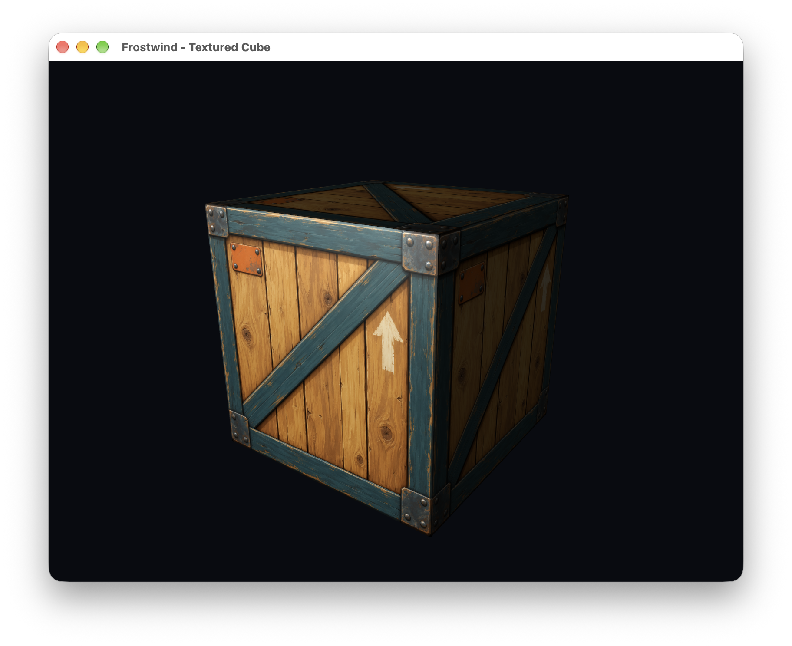
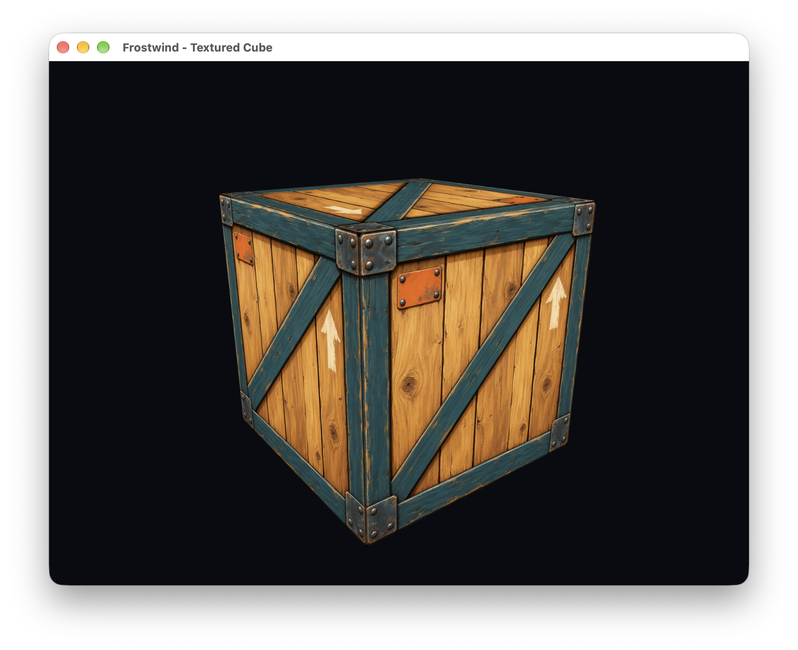

# Textured Cube

The second Frostwind example explores 3D transforms and a perspective camera.
It renders a rotating, textured unit cube with depth testing and back-face
culling through the existing OpenGL resource owners. It uses trilinear
texture filtering with mipmaps and requests 16× anisotropy, 4× MSAA, and
a 120 FPS cap with VSync for the development display.

**Status:** implemented native example with one world-space directional light,
ambient fill, Lambert diffuse shading, and Phong specular highlights. Light and
surface settings and uniform uploads belong to this example; engine APIs are
unchanged. Normal maps, shadows, skyboxes, model loading, and mouse look remain
future experiments. See [RFC 0008](../../docs/rfcs/0008-basic-lighting.md) for theory
and implementation, [RFC 0007](../../docs/rfcs/0007-textured-cube-and-perspective-camera.md)
for the foundation, and [lighting validation](../../docs/development.md#cube-lighting-validation-2026-10-22)
for executed checks and remaining manual verification.

[Draft RFC 0009](../../docs/rfcs/0009-materials-meshes-and-shader-composition.md)
records broader engine architecture separately; it remains unimplemented.



*Textured Cube with ambient, diffuse, and Phong specular lighting on macOS Apple
M1 Pro, captured manually by the owner on 2026-10-22 at 21:15:03. The PNG is
preserved unchanged; see [capture provenance](../../docs/assets/README.md#milestone-captures).
Shadows and normal maps remain unimplemented.*

<details>
<summary>Earlier unlit capture from 2026-10-20</summary>



*Running on macOS Apple M1 Pro, captured manually by the owner on 2026-10-20.
The original PNG is preserved with its [capture provenance](../../docs/assets/README.md#milestone-captures).
The scene uses unlit texture color; lighting and shadows remain planned.*

</details>

## Build and controls

From the repository root on the development Mac:

```sh
cmake --preset native-debug
cmake --build --preset native-debug --target frostwind-textured-cube --parallel
./build/native/bin/frostwind-textured-cube/frostwind-textured-cube
```

| Control | Action |
| --- | --- |
| Left / Right arrows | Orbit around the cube horizontally |
| Up / Down arrows | Raise / lower the orbit viewpoint |
| W / S | Move the camera closer / farther |
| Space | Pause / resume cube rotation |
| R | Reset camera and rotation; resume animation |
| Escape / window close | Quit |

Orbit pitch and distance are bounded so the camera cannot cross its up-vector
singularity or enter the cube. Controls use held scancodes; Space and R use
press edges and ignore key repeat. Focus loss pauses updates and clears held
keys. The first update after returning has zero elapsed time.

## Matrices and coordinates

World space is right-handed, with +Y up. The cube is centered at the origin,
with corners at ±0.5. Camera view space looks down -Z. The perspective camera
uses a 50-degree vertical field of view, aspect ratio from drawable pixels,
near plane 0.1, and far plane 100. Resizing changes the aspect ratio without
stretching the cube; high-DPI scaling uses the actual drawable dimensions.

```text
local vertex → model → world → view → camera → projection → clip
clip = projection * view * model * localPosition
model = translation * rotation * scale
```

Matrices use column vectors, radians, column-major storage, and OpenGL NDC
depth [-1, 1]. The rightmost model operation acts first. `CubeDemo::render`
keeps translation, Y-axis rotation, and scale explicit for experimentation;
translation and scale start at identity. Rotation advances by elapsed seconds,
independently of the FPS cap, with a 0.1-second stall clamp. This is animation
timing, not a fixed physics timestep.

The cube has 24 position/UV/normal vertices and 36 indices. Each face has separate UVs,
bottom-left texture origin, and outward counterclockwise winding. The example
requests a 24-bit depth attachment plus 4× multisampling and clears depth each
frame to 1 using the LESS comparison. Back faces are culled. MSAA smooths
geometric edges; trilinear filtering and generated mipmaps reduce texture
aliasing. The cube requests 16× anisotropy to retain detail on angled faces.
Anisotropy is clamped to the supported maximum, or falls back to trilinear
without anisotropy when unavailable; the applied value is logged at startup.
The requested MSAA sample count must be supported and is also logged.
A 120 FPS cap is a ceiling; actual throughput depends on rendering, display mode,
VSync, and OS scheduling. These operations remain in engine
implementations; the example includes no GLAD or native OpenGL calls.

## Basic lighting

Each face has a separate outward unit normal, keeping the cube edges sharp.
The vertex shader computes world position and the inverse-transpose normal
transform; the fragment shader normalizes the interpolated normal. This handles
rotation and nonuniform positive scale without a new engine matrix setter.

CubeDemo uploads the fixed scene values once after linking:

| Uniform | Value | Meaning |
| --- | --- | --- |
| `uLightDirection` | (0.4, -0.1, -0.6) | World-space ray travel direction; shader normalizes its negative |
| `uLightColor` | (0.8, 0.8, 0.8) | Directional color/intensity |
| `uAmbientColor` | (0.192, 0.192, 0.192) | Constant texture-colored fill |
| `uSpecularColor` | (0.8, 0.8, 0.8) | Highlight tint/strength |
| `uShininess` | 16 | Phong exponent |

Every frame uploads model/view/projection and the camera's world position.
Diffuse brightness follows the angle toward the light. Specular uses the reflected
light direction and camera direction, and is suppressed on unlit faces and when
the camera coincides with the fragment. Alpha stays sampled from the crate.
The shallow light angle and broader exponent make the highlight visible from
the initial camera view. A larger shininess exponent narrows the highlight;
specular color controls its strength. Pause rotation and orbit to see it move
while diffuse shading remains
fixed on the stationary faces. Edit the values in CubeDemo::initialize to explore
each term; no additional controls or lighting UI were added.

This is a learning approximation on the existing RGBA8/output path, with no
explicit sRGB/linear-light workflow, shadows, indirect light, or normal maps.
The theory figure in RFC 0008 is conceptual, not a rendering reference image.

## Ownership and extension points

The engine owns `PerspectiveCamera` pose/projection matrices, a reusable
`OrbitCameraController`, keyboard state, elapsed-time callback coordination,
and direct rendering operations. The example owns cube geometry, key bindings,
initial camera setup/limits, animation, shader paths, and its runtime assets. GPU owners are
destroyed before Application's Window/context; VertexArray dies before the
buffers it borrows.

The camera is CPU-only. GLM 1.0.3 is pinned locally under `external/glm/` and
exposed transitively by the engine. Uniforms reuse `ShaderProgram::setMat4`, `setVec3`, and `setFloat`;
there is no new mesh, scene, material, or graphics-backend hierarchy.

The controller accepts signed horizontal, vertical, and distance axes in
[-1, 1] plus elapsed seconds; it has no SDL or OpenGL dependency. It owns orbit
state, wraps yaw, clamps pitch/distance, and updates the camera's view while
leaving projection alone. `CubeDemo::update` maps keys and delegates movement:

```cpp
cameraController_.update(camera_, {horizontal, vertical, travel}, deltaSeconds);
```

Reset supplies the example's initial yaw/pitch/distance and limits, applying the
view immediately. PerspectiveCamera exposes its position, target, and normalized
up vector. A future FPS controller can drive the same camera through composition;
FPS movement and mouse look are not implemented yet. Cube rotation remains a
separate model transform.

Further increments can add mouse look, more objects, normal mapping, and
separate skybox/shadow experiments. The current example stays
small enough to inspect the model/view/projection relationship directly.

Assets are resolved beside the executable. Keep its `assets/` and SDL framework
with it when moving a build; force a target rebuild after shader/texture-only
edits. See [asset provenance](assets/LICENSES.md).
