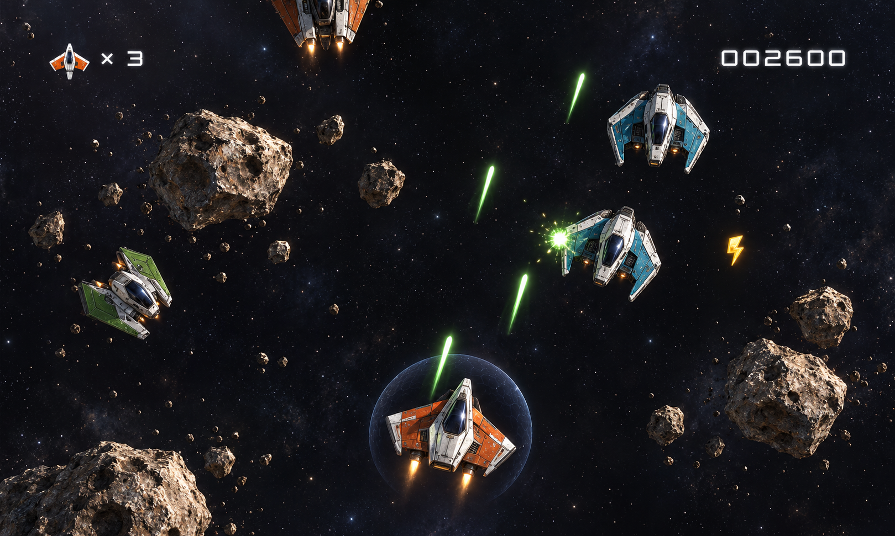
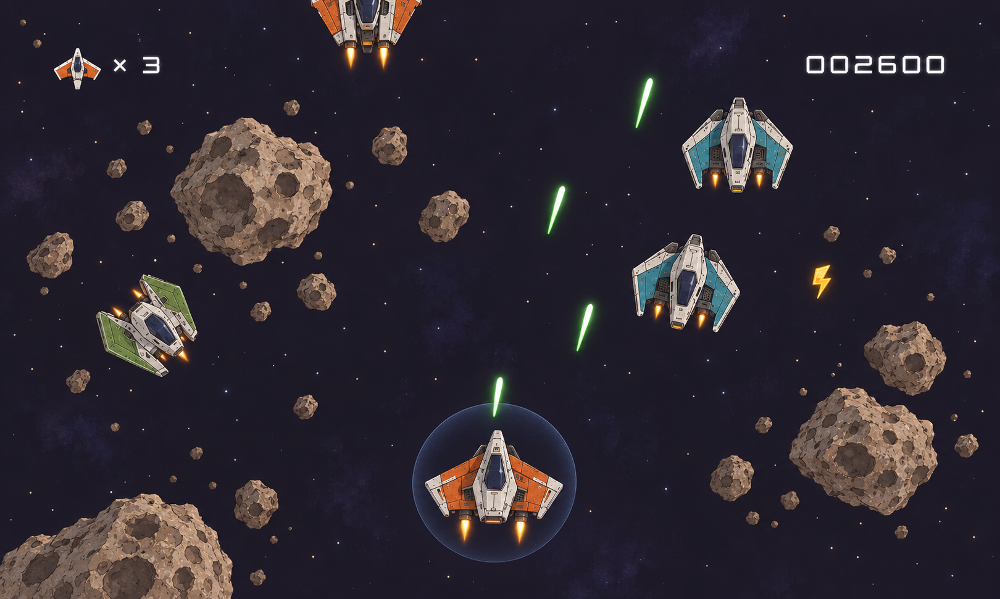
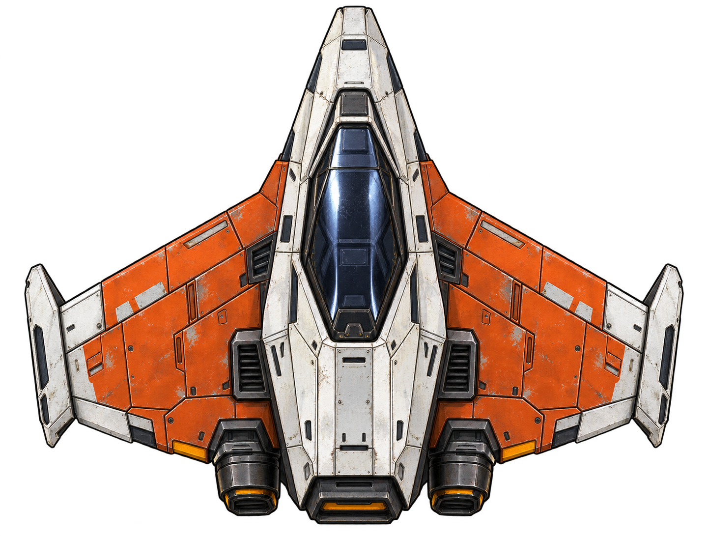
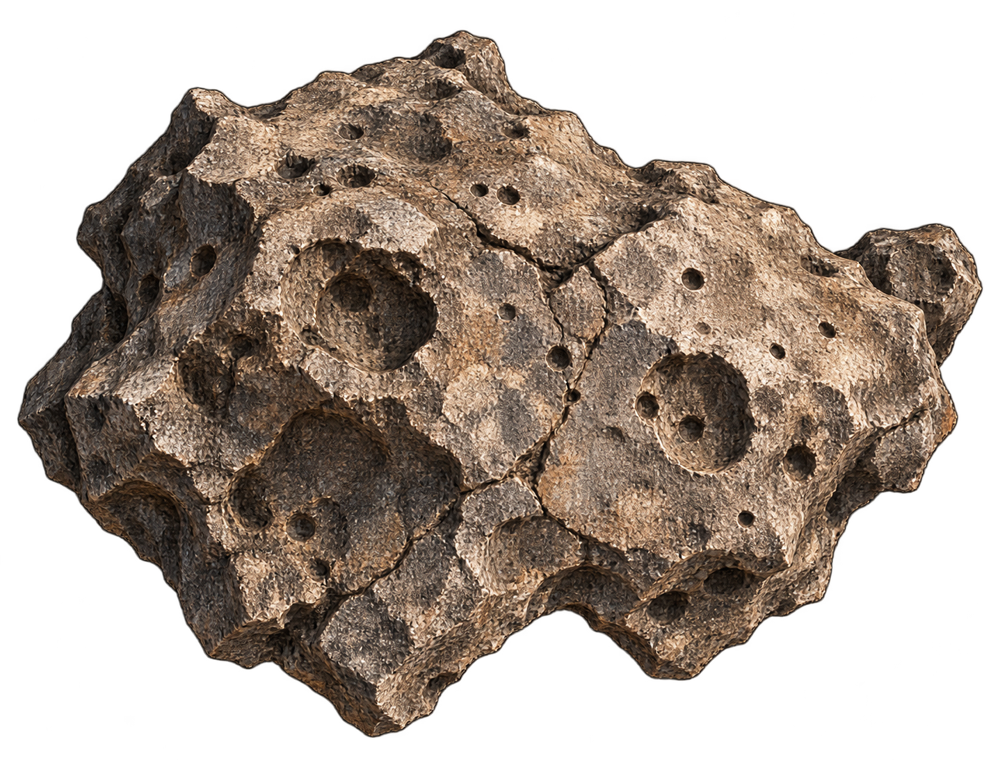

# Asteroids example

A planned Asteroids-themed 2D technical example for Frostwind. A spacecraft and asteroid scene provides a practical setting for developing and validating reusable engine features.

**Status:** runnable window scaffold with a separate `frostwind-asteroids` CMake target. It opens a plain dark-blue OpenGL window; camera, ship movement, sprites, lighting, gameplay, and imported runtime assets remain planned. [Textured Quad](../01-textured-quad/README.md) remains the working texture-rendering demo.

**Priority:** scene and game development are deferred while engine features are developed and validated through smaller technical examples. Revisit this example once its 2D camera/input, sprite rendering, and intended lighting foundations are demonstrated. The scope below preserves the proposed direction; it is not the next implementation task. See the [current roadmap](../../ROADMAP.md#current-focus---opengl-scenes).

## Concept progression and art lineage

Tracing the visual evolution from initial third-party reference to the selected 2D normal-mapped art direction:

| 1. Pack reference (Origin) | 2. Realistic concept (Selected target) | 3. Softer alternative (Explored) |
| :---: | :---: | :---: |
|  |  |  |
| [Kenney Space Shooter](https://kenney.nl/assets/space-shooter-remastered) (CC0): starting point for composition, colors, and readable silhouettes. | **Selected direction:** weathered metal, dark glass, and rocky asteroids designed for dynamic normal-map lighting. | Explored diffuse overhead light and simplified shading; preserved for comparison. |

### Sprite prototypes

| Player ship prototype | Meteor prototype |
| :---: | :---: |
|  |  |
| Transparent color prototype; baked shading to be replaced by matching base-color and normal maps. | Chipped rock plates and craters; candidate for height-map and bake experiments. |

*Generated prototypes (2026-10-14). See [sprite prompts and provenance](docs/assets/asteroids-sprites/README.md) and [full reference attribution](docs/assets/README.md).*

## Technical purpose and scope

This example exists to validate concrete engine systems rather than deliver a complete game loop:
- **World coordinates & camera following:** An orthographic `Camera2D` following the ship at fixed rotation 0 and zoom 1, mapping 1 world unit to 1 drawable pixel on standard and Retina viewports.
- **Input & mouse aiming:** SDL keyboard state tracking and cursor unprojection to orient the ship (+Y) toward the cursor in world space.
- **Frame timing:** Monotonic elapsed-time updates producing consistent motion across 30, 60, and 120 FPS caps.
- **Sprite rendering:** Reusable immediate `SpriteRenderer` with shared quad geometry, straight-alpha blending, and scoped GPU ownership.
- **Parallax background:** An example-owned tiled starfield that scrolls convincingly with camera motion.
- **Lighting prototype:** A focused normal-mapped lighting comparison (1 ship, 1 asteroid) evaluating dynamic relighting against baked shading.

Gameplay features like bullets, collision responses, asteroid splitting, waves, scoring, and audio are non-goals for this initial phase. See [RFC 0005](../../docs/rfcs/0005-camera-keyboard-and-sprites.md) for the detailed design, math formulas, and technical verification matrix.

## Engine and game responsibilities

- **Engine owns:** Reusable `Camera2D`, `Keyboard`, `Mouse`, monotonic timing, `SpriteRenderer`, and shader/material lighting behavior.
- **Example owns:** Ship controls/heading, camera follow logic, starfield parallax pass, scene layout, and assets.

Runtime geometry and simulation remain independent of a graphics context. The variable-delta update is designed for smooth rendering and camera motion, not as a fixed physics timestep.

## Proposed controls

Mouse aiming and WASD movement remain planned. Escape and window-close exit work in the current scaffold.

| Controls | Action |
| --- | --- |
| Mouse position | Set ship heading by aiming its nose (+Y) toward the cursor |
| WASD | W forward, S backward, A strafe left, D strafe right (relative to heading) |
| Escape | Quit |

Movement uses direct translation scaled by delta seconds (no inertia simulation). The camera follows the ship automatically. Light inspection and diagnostic comparisons use test fixtures or configuration rather than runtime hotkeys.

## Build and assets

On the development Apple Silicon Mac, from the repository root:

```sh
cmake --preset native-debug
cmake --build --preset native-debug --target frostwind-asteroids --parallel
./build/native/bin/frostwind-asteroids/frostwind-asteroids
```

The scaffold opens a resizable 960 × 540 window titled **Frostwind - Asteroids**, with a 60 FPS cap and VSync requested. Press Escape or close the window to quit. See [development instructions](../../docs/development.md) for building all examples and remaining platform checks.

`docs/assets/` holds planning artwork only and is not packaged with an executable. Future runtime textures and shaders belong in this example’s `assets/`, with their sources/licenses in `assets/LICENSES.md` when imported.
