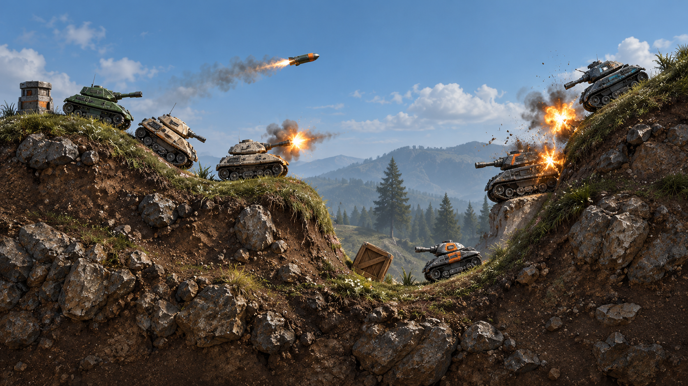
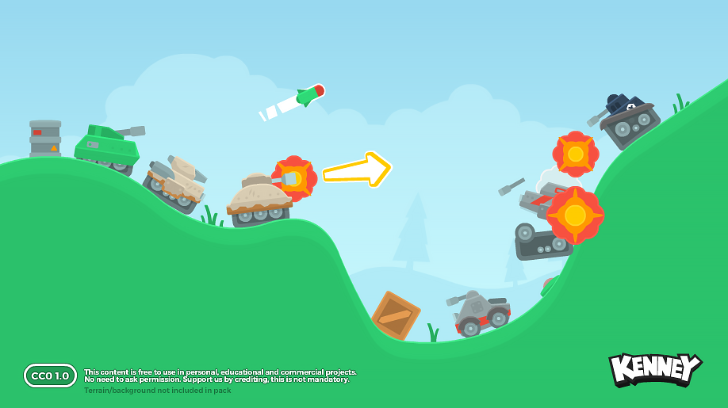
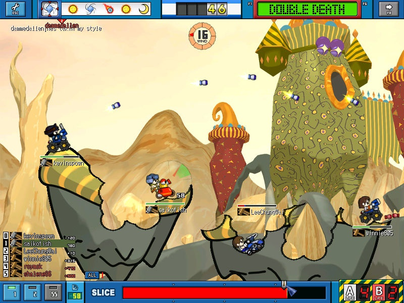

# Mini Artillery example

Mini Artillery is a Frostwind example inspired by Gunbound and Pocket Tanks. It will exercise 2D destructible terrain, projectile impacts, and bodies settling on modified ground. **Status:** runnable window scaffold with a separate `frostwind-mini-artillery` CMake target. It opens a plain dark-green OpenGL window; terrain, tanks, gameplay, and imported runtime assets remain planned. The earlier Mini Artillery window/checkerboard scaffold is now the [textured-quad example](../01-textured-quad/README.md).

## Concept art



*Generated visual concept, 2026-10-14. This is a proposed side-view art direction, not a Frostwind screenshot or implemented terrain/gameplay.*

Match the [Asteroids material direction](../02-asteroids/README.md) with detailed weathered metal, readable vehicle silhouettes, restrained identification colors, and convincing rocky surfaces. Tanks use green/tan/charcoal hulls with orange or teal accents. The terrain is a grassy rim over a soil-and-rock cutaway, with distant hills and trees on separate background layers for future parallax.

Prepare separate chassis and turret sprites for slope alignment and independent aiming. Matching color/normal textures may provide runtime lighting after the Asteroids prototype validates that workflow; individual sprites, terrain materials, and normal maps have not been created for this example. The concept image is not a source of finished collision geometry or relightable terrain.

## Planned game and terrain work

Begin with a textured hill and circular explosion cuts, keeping the visible surface and collision boundary consistent. Chunk terrain so an impact updates only affected geometry/collision. Soil and rock materials are clipped to the remaining solid regions; crater edges need fresh exposed-material treatment and lighting rather than a normal map baked solely for the original hill. Distant scenery remains separate from destructible foreground terrain.

Later work adds tanks resting/falling on terrain, aiming and projectiles, damage, turn and wind rules, score/match UI, and effects. Geometry carving, rendering updates, and physics integration need their own implementation decisions and validation; the illustrated terrain is a visual target, not an implemented destruction system.

## Engine and game responsibilities

The example will own tanks, aiming, weapons, damage, turns, wind rules, match state, UI, and game-specific assets. The engine can supply terrain geometry, GPU masks, chunk ownership, carving, and physics integration. For an explosion, the example selects impact position, radius, and damage rules; the engine applies carving and rebuilds affected collision chunks.

Terrain experiments will coordinate visible masks and collision geometry, using explicit render-pixel/physics/integer-coordinate conversions. Physics will use fixed timesteps. Multiplayer and hosting are optional later experiments, requiring explicit authority, event ordering, and state recovery; deterministic behavior must not be assumed.

## Earlier visual references



*Kenney Tanks asset-pack mockup used as a reference, not a Frostwind or Mini Artillery screenshot.*

The intended tank art uses separate chassis and turret sprites, with chassis following terrain slopes and independent turret aiming.



*Gunbound reference for turn-based aiming, wind, and destructible terrain.*


*Pocket Tanks reference for craters and shot controls.*


Original baseline sprite candidate: [Kenney Tanks](https://kenney.nl/assets/tanks), released under CC0. See [reference attribution](docs/assets/README.md); third-party game images are not covered by the project's MIT license.


## Related work and build status

- [RFC 0003](../../docs/rfcs/0003-frostwind-engine-and-examples.md) establishes engine/example ownership.
- [RFC 0005](../../docs/rfcs/0005-camera-keyboard-and-sprites.md) proposes reusable camera/input/sprite foundations through Asteroids; it does not implement artillery gameplay or terrain destruction.
- [Concept generation prompt](docs/assets/mini-artillery-concept-prompts.md) records the supplied composition and shared art style.
- [Development instructions](../../docs/development.md) cover all example targets and remaining platform checks.

On the development Apple Silicon Mac, from the repository root:

```sh
cmake --preset native-debug
cmake --build --preset native-debug --target frostwind-mini-artillery --parallel
./build/native/bin/frostwind-mini-artillery/frostwind-mini-artillery
```

The scaffold opens a resizable 960 × 540 window titled **Frostwind - Mini Artillery**, with a 60 FPS cap and VSync requested. Press Escape or close the window to quit. Gameplay controls remain undefined.

`docs/assets/` contains planning images and provenance only. Future runtime textures, shaders, and their `assets/LICENSES.md` belong in this example’s separate `assets/` directory when imported. Preserve third-party reference licensing independently of project code licensing.
